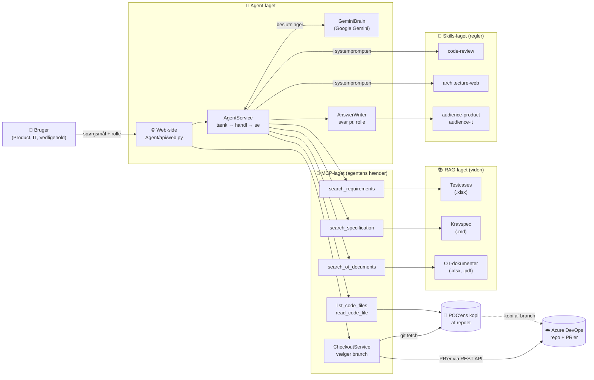
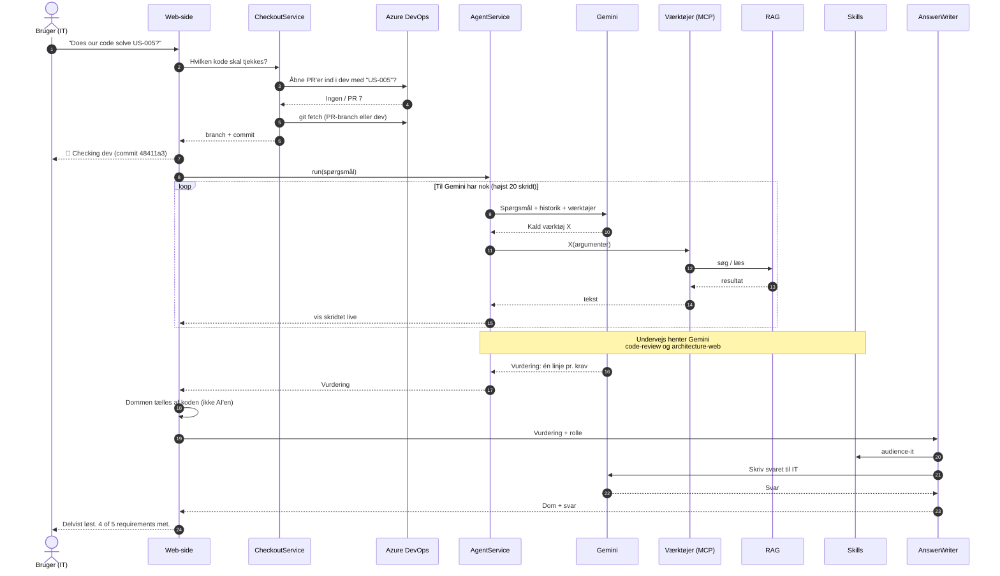
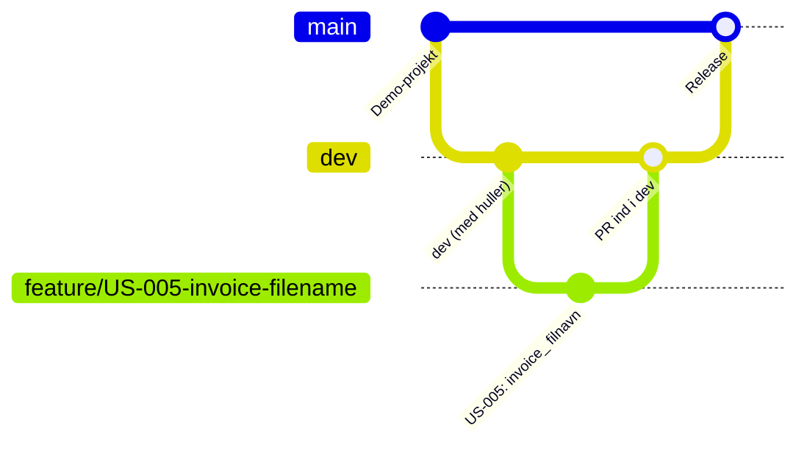
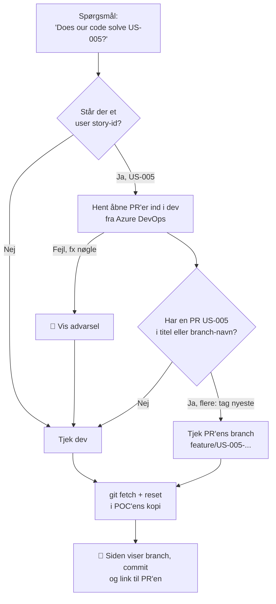
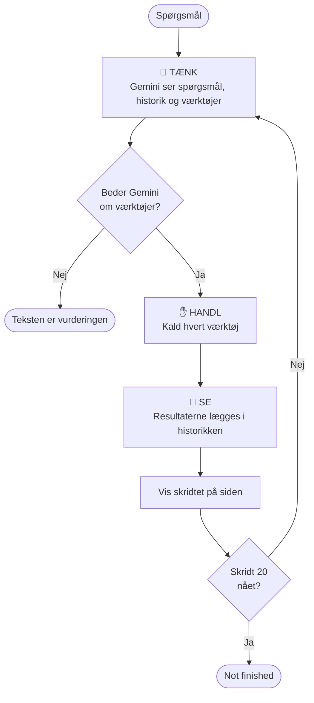
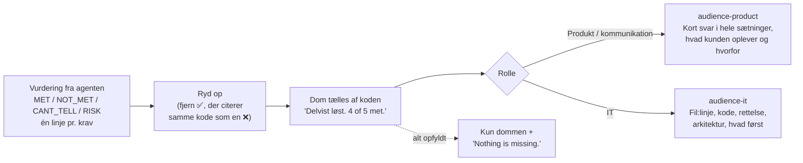
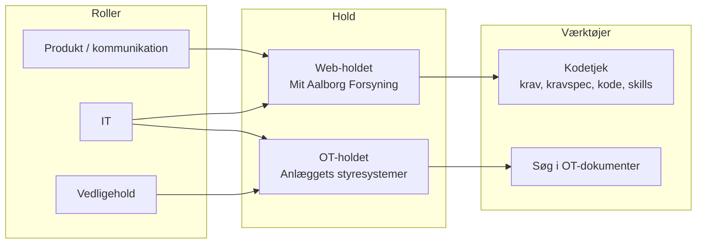
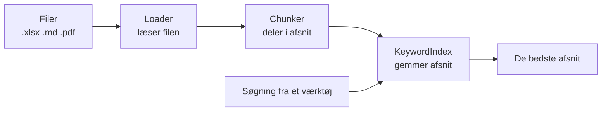
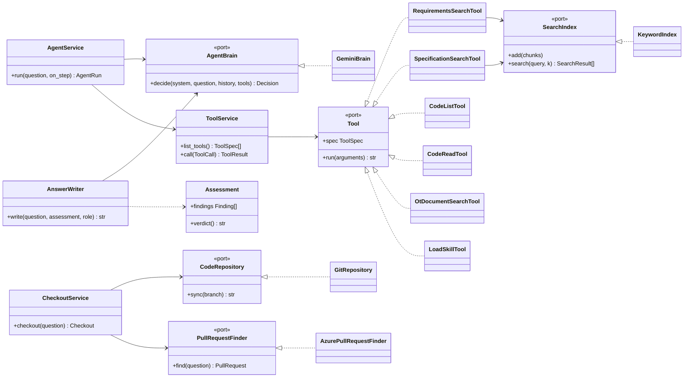
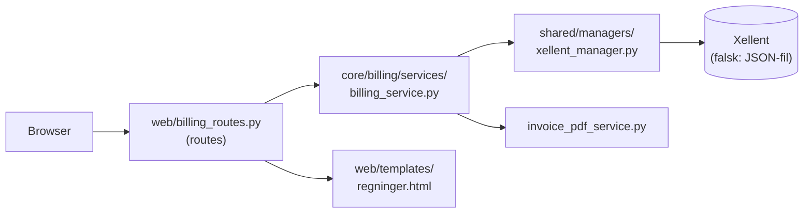

# AI Platform POC – demo

En AI-agent, der svarer på **"Løser vores kode opgaven?"**. Den slår user storyen, testcasene og forretningens krav op, læser udviklerens kode direkte fra Azure DevOps (den rigtige branch eller PR) og giver en dom: **Solved**, **Delvist løst** eller **Ikke løst**, med præcis hvad der mangler.

Svaret skrives til den, der spørger: en fra produkt/kommunikation får almindeligt sprog, IT får fil og linje. Vedligehold kan i samme løsning søge i OT-holdets dokumenter.

---

## 1. Overblik

Løsningen består af fire lag. Hvert lag har én opgave og kender kun de andre gennem små, faste grænseflader (porte):

| Lag | Rolle | Billede |
|---|---|---|
| **Agent** | Beslutter, hvad der skal gøres, og hvornår der er nok til et svar | Hjernen |
| **MCP** | Værktøjer, agenten kan kalde: søge, liste og læse kode, vælge branch | Hænderne |
| **RAG** | Indlæser og søger i dokumenter: testcases, kravspec, OT-dokumenter | Hukommelsen |
| **Skills** | Faste regler for, hvordan der vurderes og svares | Arbejdsinstrukserne |

---

## 2. Et kodetjek fra start til slut

Spørgsmål: *"Does our code solve US-005 Download faktura?"* som **IT**.

**Det, publikum ser på siden:** hvert skridt kommer live ("🔎 Slår testcases op", "📄 Læser BillingService.cs") i en boks, der foldes sammen, når svaret kommer som en chatboble med dommen som et farvet mærke og to foldede bokse (*Kilder* og *Vurdering pr. krav*).

---

## 3. Hvilken kode bliver tjekket? (branch-valg)

IT's regel for git: **feature-branch → PR ind i `dev` → `dev` ind i `main`**.

Før hvert kodetjek vælger POC'en branch. Det er koden, der vælger, ikke AI'en, så samme spørgsmål altid giver samme branch:

| Situation | Hvad siden skriver |
|---|---|
| Åben PR for US-005 | 🔀 Checking pull request 7 "US-005: ..." (feature/US-005-... → dev), commit abc1234 |
| Ingen PR | 🔀 No open pull request matches the question, so checking dev (commit 48411a3) |
| Azure svarer ikke | 🔴 Could not look for pull requests, so dev is used: ... |

Kun ét kodetjek kører ad gangen, fordi der kun er én kopi af repoet. Ellers kunne to spørgsmål skifte branch for hinanden.

---

## 4. Agentens løkke

Gemini beslutter selv, hvad den slår op, og i hvilken rækkefølge. Den kan kun bruge de værktøjer, rollen har fået. Den kan kun læse koden, aldrig ændre den.

---

## 5. Fra vurdering til svar

Agenten skriver ikke et svar, men en **vurdering**: én linje pr. krav. Dommen tælles af koden, og svaret skrives bagefter til rollen.

**Hvorfor sådan?**
- **Samme vurdering til alle.** Agenten får ikke rollen at vide, så en produktperson og en udvikler får den samme dom. Kun formuleringen er forskellig.
- **Tallet passer altid.** "4 of 5" regnes af koden ud fra linjerne, ikke af AI'en.
- **Samme kode giver samme svar.** Vurderingen gemmes. Spørger man igen om uændret kode (eller skifter rolle), genbruges den (♻️). Ændres en fil, eller tjekkes en anden branch, laves et nyt tjek.

Statusser i vurderingen:

| Status | Betyder | Tæller i dommen |
|---|---|---|
| ✅ MET | Koden gør det, kravet siger | Opfyldt |
| ❌ NOT_MET | Koden gør det anderledes eller slet ikke | Ikke opfyldt |
| ❓ CANT_TELL | Kan ikke ses i koden (fx hastighed) | Ikke opfyldt |
| ⚠️ RISK | Koden afviger fra holdets måde at kode på | Tæller ikke, vises som risiko |

---

## 6. Roller og hold

Rollen i dropdownen bestemmer, hvilke værktøjer agenten får. AI'en vælger det ikke selv.

| Rolle | Ser | Får |
|---|---|---|
| Produkt / kommunikation | Web | Kodetjek, kort svar i almindeligt sprog |
| IT | Web og OT | Kodetjek med fil:linje, og opslag i OT's dokumenter. Agenten afgør ud fra spørgsmålet, hvilken slags det er |
| Vedligehold | OT | Kun søgning i OT's dokumenter (signalliste og PDF'er), svar direkte |

---

## 7. Komponenter

### Agent-laget (`Agent/`)

| Komponent | Fil | Hvad den gør |
|---|---|---|
| Web-side | `api/web.py` | Siden i browseren. Modtager spørgsmål og rolle, vælger branch, viser hvert skridt live, *Kilder*- og *Vurdering pr. krav*-boksene og svaret. Gemmer vurderinger, så samme kode får samme svar. |
| Samling | `api/build.py` | Bygger én agent pr. rolle med præcis de værktøjer, rollens hold giver. Det eneste sted, der kender alle lag. |
| AgentService | `application/agent_service.py` | Løkken: tænk, handl, se. Stopper ved et svar eller efter 20 skridt. |
| AnswerWriter | `application/answer_writer.py` | Læser vurderingen, rydder op i modstridende linjer og skriver svaret til rollen med rollens skill. Får ingen værktøjer, så den kan ikke ændre vurderingen. |
| GeminiBrain | `infrastructure/brains/gemini_brain.py` | Den eneste fil, der kender Google Gemini. Et skift til en anden model er en ny fil her. |
| Modeller | `domain/models.py` | Decision, Step, Finding, Assessment. Dommen (Løst/Delvist/Ikke løst) regnes ud her. |

### MCP-laget (`MCP/`) – agentens værktøjer

| Værktøj / komponent | Hvad den gør |
|---|---|
| `search_requirements` | Søger i user stories, acceptkriterier og testcases (xlsx). |
| `search_specification` | Søger i kravspec. Et US-id giver præcis de krav, der dækker det, eller "ikke dokumenteret", så AI'en ikke finder på krav. |
| `list_code_files` | Lister filerne i repoet (via git, så .gitignore respekteres). |
| `read_code_file` | Læser én fil med linjenumre, så svaret kan pege på fil:linje. Afviser alt uden for repoet. |
| `search_ot_documents` | Søger i OT-holdets signalliste og PDF'er. Kan søge ordret ("BERAN backup"). |
| `CheckoutService` | Vælger branch pr. spørgsmål: en åben PR med user story-id'et, ellers `dev`. |
| `AzurePullRequestFinder` | Henter åbne PR'er ind i `dev` fra Azure DevOps' REST API. |
| `GitRepository` | POC'ens egen kopi af Azure-repoet. Kloner ved start, henter branchen før hvert tjek. Nøglen gemmes ingen steder. |

### RAG-laget (`RAG/`) – viden

| Komponent | Hvad den gør |
|---|---|
| `XlsxLoader` | Læser testcases: hver user story og hver testcase bliver ét afsnit. |
| `MarkdownLoader` | Læser kravspec: hvert krav (KRAV-REG-xx) bliver ét afsnit. |
| `XlsxTableLoader`, `PdfLoader` | Læser OT's signalliste (én række = ét afsnit) og PDF'er (én side = ét afsnit). |
| `ParagraphChunker` | Deler dokumenter op ved tomme linjer. |
| `KeywordIndex` | Simpel søgning: et afsnit får ét point pr. ord, det deler med søgningen. Kan senere skiftes til søgning på betydning (embeddings) uden at ændre resten. |

Hver kilde har sit eget indeks, så fx de 20.000 signaler ikke skubber kravene ud af resultaterne.

### Skills-laget (`Skills/`) – arbejdsinstrukser

| Skill | Hvad den siger |
|---|---|
| `code-review` | Hvordan koden vurderes: slå krav op, læs koden, én linje pr. krav med status, aldrig gætte. |
| `architecture-web` | Hvordan web-holdet koder: routes → services → managers, interfaces, dependency injection, kvalitet. Fast og uafhængig af projektet. |
| `audience-product` | Svar til produkt/kommunikation: kort svar i hele sætninger som en kollega: svaret først, så hvad kunden oplever og hvorfor, og om testen kan gennemføres. |
| `audience-it` | Svar til IT: fil:linje, koden, rettelsen, arkitektur og hvad der skal rettes først. |

En skill er en mappe med en `SKILL.md`. `code-review` og holdets `architecture-<hold>` skal bruges i hvert kodetjek, så koden sætter dem ind i systemprompten. Skills, agenten selv kan vælge, vises kun med navn og beskrivelse og hentes med `load_skill`, når der er brug for dem. Et nyt hold (fx FDAP) får sin egen `architecture-fdap` uden at ændre kode.

---

## 8. Opbygning: porte og adaptere (UML)

Hvert lag taler med omverdenen gennem porte (interfaces). Det gør det muligt at skifte Gemini, Azure DevOps eller søgningen ud uden at røre resten.

---

## 9. Demo-projektet (det, der bliver tjekket)

*Mit Aalborg Forsyning – Regninger* i Python/Flask, i Azure-repoet. Det er bygget, som web-holdet koder, med vilje lagt huller ind.

---

## 10. Demo-manuskript

**Før demoen**
- [ ] `git pull` på POC'en, og `AZURE_DEVOPS_PAT` og `GEMINI_API_KEY` står i `local_secrets.py`
- [ ] `dev` findes i Azure-repoet (med hullerne)
- [ ] Valgfrit: feature-branch `feature/US-005-invoice-filename` med en åben PR ind i `dev`, titel med "US-005"
- [ ] Start: `python -m Agent.api.web` og åbn http://localhost:8000
- [ ] Kør hvert spørgsmål én gang før demoen, så svarene er gemt (♻️) og kommer med det samme

**Forløb**

| # | Rolle | Spørgsmål | Forventet | Pointe |
|---|---|---|---|---|
| 1 | Produkt / kommunikation | Does our code solve US-006 Skift kontrakt/adresse? | ✅ Løst | Et grønt svar i almindeligt sprog |
| 2 | Produkt / kommunikation | Does our code solve US-005 Download faktura? | Delvist løst, filnavn mangler | Finder en konkret fejl |
| 3 | IT | *samme spørgsmål* | Samme dom, nu med `web/billing_routes.py:35` og rettelse | Samme vurdering, skrevet til en udvikler (♻️ genbruges) |
| 4 | IT | Does our code solve US-004 Vis betalingsstatus? | Delvist løst, "Forfalden" mangler | Fanger et krav, der kun står i kravspec og testcase |
| 5 | IT | Does our code solve US-003 Regninger er ikke længere tilgængelige? | Ikke løst | Rød dom |
| 6 | IT | Does our code solve US-007 Sikker og robust oplevelse? | Solved, med arkitektur-risici | Tjekker også *hvordan* koden er bygget |
| 7 | IT | Does our code solve US-005 Download faktura? *(efter PR'en er lavet)* | 🔀 Checking pull request ..., Solved | Ser udviklerens arbejde, før det er merget |
| 8 | Vedligehold | fx "Hvad er kølevandspumpe 2?" | Svar fra signalliste/PDF med kilde | Samme platform, anden afdeling |

**Undervejs, vis:**
- De live skridt: agenten slår op og læser selv.
- *Kilder*-boksen: præcis hvilke dokumenter, branch, commit og filer svaret bygger på.
- *Assessment*-boksen: én linje pr. krav, så dommen kan efterprøves.

---

## 11. Begrænsninger (det er en POC)

- **Gemini free tier** (`gemini-3.5-flash-lite`): hurtig og gratis, men kan tage fejl. Derfor regnes dommen af koden, og modstridende linjer ryddes op. Google kan bruge det, der sendes på free tier.
- **Nøgleordssøgning**: finder ord, ikke betydning. Spørg med id og titel.
- **PR-match på id**: en PR findes kun, hvis US-id'et står i titlen eller branch-navnet.
- **Ét kodetjek ad gangen**, fordi der er én kopi af repoet.
- **Vurderinger gemmes kun i hukommelsen** og forsvinder ved genstart.
- **Testcases og kravspec er eksempler** skrevet til demo-projektet.

**Mulige næste skridt:** søgning på betydning (embeddings), Word-filer i OT-søgningen, og en arkitektur-skill pr. hold (fx FDAP).
