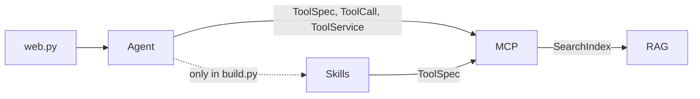

# AI Platform POC

A developer asks: *"Does our code solve this user story?"* An AI agent looks up the user story, its acceptance criteria and the business requirements, reads the developer's code, and assesses each requirement with a `file:line` reference. The answer is then written for whoever asks: a product person or IT.

The code has four layers, each with its own README: [Agent](Agent/README.md), [MCP](MCP/README.md), [RAG](RAG/README.md) and [Skills](Skills/README.md).

## Run the demo

Python 3.10+. Run everything from the `AIPlatform/` folder.

```bash
pip install -r requirements.txt
```

1. The code to check comes from the Azure DevOps repo in `CODE_REPO` in `settings.py`. The page clones it into `repos/code` when it starts. Before every code check it picks the branch and fetches the latest, so a developer can push and ask straight away: if an open pull request into `dev` has the question's user story id (e.g. US-005) in its title or branch name, its branch is checked, otherwise `dev`. The first step on the page says which branch and pull request it checks. You need git installed. Set `CODE_REPO = ""` to read a folder on your computer instead (`CODE_FOLDER`).
2. Put a Gemini key from Google AI Studio and an Azure DevOps Personal Access Token with read access to Code in `local_secrets.py` (ignored by git):
   ```python
   GEMINI_API_KEY = "your-key"
   AZURE_DEVOPS_PAT = "your-token"
   ```
3. Start the page:
   ```bash
   python -m Agent.api.web
   ```
4. Open http://localhost:8000 and ask a question.

## Questions to ask

The code is the demo project *Mit Aalborg Forsyning – Regninger* (Python, Flask) in the Azure DevOps repo. It has deliberate gaps, so not every answer is green.

- Does our code solve US-005 Download faktura?
- Does our code solve US-004 Vis betalingsstatus?
- Does our code solve US-003 Regninger er ikke længere tilgængelige?
- Does our code solve US-001 Vis regningsoversigt?

The page shows each step live, then a folded *Sources* box with the test documents, requirement files and code folder (and its git repo) the agent actually used, then a folded *Assessment* box with every requirement's status, then the answer. The agent assesses the code once per question, the same whoever asks: one line per requirement (met, not met, can't tell) plus risks. The verdict (**Solved**, **Partly solved** or **Not solved**, "X of Y requirements met") is counted from that list by the code, not written by the AI. A dropdown above the question says who is asking, and the answer is written from the assessment for that role; switching role on the same question reuses the assessment. *Product / communication* gets at most 8 lines of plain English: how many requirements are met, only what is missing, and at most two risks from how the code is built (`architecture-web`). *IT* gets a technical answer with file:line, what can't be told from the code, architecture deviations and what to fix first.

The test cases (`RAG/data/Mit Aalborg Forsyning_Regninger_Testcases.xlsx`) and the business requirements spec (`RAG/data/kravspec/Kravspec_Regninger.md`) are examples written for the demo project.

### OT's documents (Vedligehold and IT)

Choose *Vedligehold* or *IT* in the dropdown to ask about the documents the OT team makes, such as the plant's signal list. Put the xlsx and PDF files in `RAG/data/ot/` first; they are kept out of git because they describe a real plant.

- Which signal is Kedel Fyr Nødud in 800xA?
- What is the range of MKF20AP001A?
- Which signals are there for kølevandspumpe 2?
- Which document says "BERAN backup"? (quoted words are matched word for word, and the answer names the file and page)

Which teams a role sees is set in `ROLE_TEAMS` in `settings.py`, and the code gives each role an agent with only those teams' tools; the AI doesn't choose. *Product / communication* sees web (code check), *Vedligehold* sees OT (only `search_ot_documents`, no code), and *IT* sees both, because IT covers both teams. IT's agent decides from the question whether it is a code check or an OT lookup. An OT lookup answers straight away with the signal, its old and new name, description, unit and range, and the *Sources* box lists the sheets it used. There is no assessment and nothing is saved, because there is no code to judge.

## The flow

Each step is marked in the code with a comment like `# 13: TÆNK`. Search for `# 13:` to jump to it.

**When the server starts (once)**

| # | Step | Where | Why |
|---|---|---|---|
| 1 | START | `Agent/api/web.py` · `main()` | The Agent layer owns the entry point, because the agent is what the user talks to. |
| 2 | Build the agents | `Agent/api/build.py` · `build_agents()` | The Agent layer is the only place that knows all the other layers, so it wires them together: one agent per role, with the tools for the teams in `ROLE_TEAMS`. The tools are built once and shared. `main()` also calls `build_writer()`, which builds the `AnswerWriter` used in step 20b. |
| 3 | Skills | `Skills/api/build.py` · `build_service()` | Skills holds the answer format as plain text, so the review rules can change without touching code. |
| 4 | Tools | `MCP/api/build.py` · `build_service()` | MCP is the list of things the agent can do. Gemini only sees tool names and descriptions, never the code behind them. |
| 5 | Load the requirements | `RAG/application/ingest_service.py` · `run()` | RAG owns the requirements. It loads them once at start, so each question only searches. |
| 6 | Read the xlsx files | `RAG/infrastructure/loaders/xlsx_loader.py` · `load()` | RAG reads the raw files. Only this adapter knows about Excel, so another source would only replace this file. |
| 6b | Read the business requirements (kravspec) | `RAG/infrastructure/loaders/markdown_loader.py` · `load()` | Steps 5–8 run a second time for `RAG/data/kravspec/*.md`, into their own index, so a requirement isn't crowded out by test cases. |
| 7 | Split into user stories and test cases | `RAG/infrastructure/chunking/text_chunker.py` · `split()` | RAG splits the text so a search returns one user story, not a whole workbook. |
| 8 | Store in the search index | `RAG/infrastructure/index/keyword_index.py` · `add()` | RAG keeps the index. The rest of the code only knows the `SearchIndex` port, so keyword search could become vector search. |
| 9 | Assemble tools, system prompt and Gemini | `Agent/api/build.py` · `build_agent()` inside `build_agents()` | For a role that sees web, the Agent layer joins the MCP code-check tools, the skill tool and the brain; the system prompt names the team (`TEAM`) and lists the skills, except the `audience-` skills: the role must not affect the assessment. For a role that sees OT, it adds `search_ot_documents` and `OT_PROMPT`. A role that sees both gets both, and is told to decide from the question which one it is. |
| 10 | Wait for a question | `Agent/api/web.py` · `main()` | The Agent layer serves the page, so the agent is built once and reused for every question. Before that, `build_checkout_service()` in `MCP/api/build.py` clones `CODE_REPO` into `CODE_FOLDER` (or fetches the latest), because the code tools read a folder. |

**For each question**

| # | Step | Where | Why |
|---|---|---|---|
| 11 | Question arrives | `Agent/api/web.py` · `do_GET()` | The question and the role from the dropdown go to the Agent layer, because only the agent decides what to do. For a code check, `CheckoutService.checkout()` in `MCP/application/checkout_service.py` first picks the branch (an open pull request into `dev` whose title or branch has the question's user story id, otherwise `dev`) and fetches it, so a push is checked straight away. One code check runs at a time, because there is one copy of the repo. If the same question was checked before and `fingerprint()` shows that the code files read and the requirement files are unchanged, the saved assessment is reused and steps 12–19 are skipped. |
| 12 | Agent loop starts | `Agent/application/agent_service.py` · `run()` | The Agent layer runs the loop. It knows the steps (think, act, observe) but not which model or tools. The agent is not told the role, so the assessment is the same whoever asks. |
| 13 | Gemini thinks | `Agent/infrastructure/brains/gemini_brain.py` · `decide()` | The Agent layer's brain adapter talks to Gemini. Only this file knows the Gemini SDK. |
| 14 | Done? If yes, go to 19 | `agent_service.py` | The Agent layer checks for an answer, since Gemini signals "done" by asking for no tools. |
| 15 | Call the tools Gemini asked for | `agent_service.py` | The Agent layer hands the calls to MCP. It never runs a tool itself. |
| 16 | Tool runs | `MCP/application/tool_service.py` · `call()` | MCP finds the tool by name and catches errors, so a failing tool can't crash the agent. |
| 16a | `load_skill`: answer format | `Skills/api/skill_tool.py` | Skills gives Gemini the answer format only when it needs it, which keeps the system prompt short. |
| 16b | `search_requirements`: keyword search | `MCP/infrastructure/tools/requirements_search_tool.py` | MCP wraps the RAG search as a tool. The agent doesn't know RAG exists; it just calls a tool. |
| 16c | `list_code_files`: files in `CODE_FOLDER` | `MCP/infrastructure/tools/code_list_tool.py` | MCP gives read access to the code, limited to `CODE_FOLDER`. |
| 16d | `read_code_file`: one file with line numbers | `MCP/infrastructure/tools/code_read_tool.py` | MCP returns line numbers so the answer can point to `file:line`. It refuses paths outside `CODE_FOLDER`. |
| 16e | `search_specification`: business requirements | `MCP/infrastructure/tools/specification_search_tool.py` | The test cases say what the test team checks; the kravspec says what the business ordered. Searching for a US id returns exactly the requirements that cover it, or says none are documented, so the agent can't invent one. |
| 16f | `search_ot_documents`: the OT team's documents (roles that see OT) | `MCP/infrastructure/tools/ot_document_search_tool.py` | Only roles whose `ROLE_TEAMS` include OT (IT and Vedligehold) get this tool (`build_ot_service()`), so Product / communication never sees OT's documents and Vedligehold never sees code. Each row of a sheet is one result. |
| 17 | Results go into the history | `agent_service.py` | The Agent layer keeps the history, so Gemini sees everything it has learned on the next step. |
| 18 | Step shown on the page, back to 13 | `web.py` · `render_step()` | The Agent layer's page shows each step live, so the user sees what the agent is doing. |
| 19 | Assessment ready | `agent_service.py` | The Agent layer returns Gemini's assessment text together with all the steps it took. Back in `web.py`, `parse_assessment()` (`answer_writer.py`) reads one line per requirement, and `Assessment.verdict` counts the verdict from it. If the agent didn't finish or wrote no assessment lines, the page shows what it wrote under *Not finished*. |
| 20b | Answer written for the role | `Agent/application/answer_writer.py` · `write()` | Gemini gets only the assessment and the `audience-<role>` skill, no tools, so it can rewrite but not re-judge. The assessment is kept per question, so both roles get the same verdict. |
| 20 | OUTPUT: answer shown on the page | `web.py` · `render_sources()`, `render_assessment()`, `render_markdown()` | The Agent layer's page shows the *Sources* and *Assessment* boxes and turns the answer into HTML for the user. |

Gemini decides which tools to call and in which order. The code only runs the loop.

## Classes

```mermaid
classDiagram
direction LR

namespace Agent {
  class AgentService {
    +brain: AgentBrain
    +tools: ToolService
    +system: str
    +max_steps: int
    +run(question, on_step) AgentRun
  }
  class AgentBrain {
    <<Protocol>>
    +decide(system, question, history, tools) Decision
  }
  class GeminiBrain {
    +client: genai.Client
    +model: str
    +thinking: str
    +decide(system, question, history, tools) Decision
    -_to_contents(question, history)
  }
  class Decision {
    +text: str
    +actions: list~Action~
    +is_final() bool
  }
  class Action {
    +id: str
    +tool: str
    +arguments: dict
  }
  class Observation {
    +action_id: str
    +content: str
    +is_error: bool
  }
  class Step {
    +action: Action
    +observation: Observation
  }
  class AgentRun {
    +answer: str
    +steps: list~Step~
    +finished: bool
  }
  class AnswerWriter {
    +brain: AgentBrain
    +instructions_for: Callable
    +write(question, assessment, role) str
  }
  class Finding {
    +status: str
    +ids: str
    +requirement: str
    +code: str
    +where: str
    +fix: str
  }
  class Assessment {
    +findings: list~Finding~
    +no_spec: bool
    +count(status) int
    +verdict() str
  }
}

namespace MCP {
  class ToolService {
    +tools: dict
    +list_tools() list~ToolSpec~
    +call(call: ToolCall) ToolResult
  }
  class Tool {
    <<Protocol>>
    +spec: ToolSpec
    +run(arguments) str
  }
  class ToolSpec {
    +name: str
    +description: str
    +input_schema: dict
  }
  class ToolCall {
    +name: str
    +arguments: dict
  }
  class ToolResult {
    +name: str
    +content: str
    +is_error: bool
  }
  class RequirementsSearchTool {
    +index: SearchIndex
    +k: int
    +run(arguments) str
  }
  class SpecificationSearchTool {
    +index: SearchIndex
    +k: int
    +run(arguments) str
  }
  class CodeListTool {
    +folder: Path
    +run(arguments) str
  }
  class CodeReadTool {
    +folder: Path
    +run(arguments) str
  }
}

namespace RAG {
  class IngestService {
    +loader: DocumentLoader
    +chunker: Chunker
    +index: SearchIndex
    +run() int
  }
  class DocumentLoader {
    <<Protocol>>
    +load() list~Document~
  }
  class Chunker {
    <<Protocol>>
    +split(document) list~Chunk~
  }
  class SearchIndex {
    <<Protocol>>
    +add(chunks)
    +search(query, k) list~SearchResult~
  }
  class XlsxLoader {
    +folder: Path
    +load() list~Document~
  }
  class MarkdownLoader {
    +folder: Path
    +load() list~Document~
  }
  class ParagraphChunker {
    +split(document) list~Chunk~
  }
  class KeywordIndex {
    +add(chunks)
    +search(query, k) list~SearchResult~
  }
  class Document {
    +source: str
    +text: str
  }
  class Chunk {
    +source: str
    +text: str
    +position: int
  }
  class SearchResult {
    +chunk: Chunk
    +score: float
  }
}

namespace Skills {
  class SkillService {
    +repository: SkillRepository
    +list_skills() list~SkillSummary~
    +catalog(hide) str
    +load(name) Skill
  }
  class SkillRepository {
    <<Protocol>>
    +list() list~SkillSummary~
    +get(name) Skill
  }
  class FileSkillRepository {
    +folder: Path
    +list() list~SkillSummary~
    +get(name) Skill
  }
  class LoadSkillTool {
    +service: SkillService
    +spec: ToolSpec
    +run(arguments) str
  }
  class SkillSummary {
    +name: str
    +description: str
  }
  class Skill {
    +name: str
    +description: str
    +instructions: str
  }
}

AgentService --> AgentBrain : brain
AgentService --> ToolService : tools
GeminiBrain ..|> AgentBrain
AgentService ..> AgentRun : returns
Decision *-- Action
Step *-- Action
Step *-- Observation
AgentRun *-- Step
AnswerWriter --> AgentBrain : brain
AnswerWriter ..> Assessment : reads
Assessment *-- Finding

ToolService o-- Tool : tools
Tool --> ToolSpec : spec
ToolService ..> ToolCall
ToolService ..> ToolResult
RequirementsSearchTool ..|> Tool
SpecificationSearchTool ..|> Tool
CodeListTool ..|> Tool
CodeReadTool ..|> Tool
LoadSkillTool ..|> Tool

RequirementsSearchTool --> SearchIndex : index
SpecificationSearchTool --> SearchIndex : index
IngestService --> DocumentLoader
IngestService --> Chunker
IngestService --> SearchIndex
XlsxLoader ..|> DocumentLoader
MarkdownLoader ..|> DocumentLoader
ParagraphChunker ..|> Chunker
KeywordIndex ..|> SearchIndex
SearchResult *-- Chunk

LoadSkillTool --> SkillService : service
SkillService --> SkillRepository
FileSkillRepository ..|> SkillRepository
SkillService ..> Skill
SkillService ..> SkillSummary
```

Each layer has the same shape: **domain** (data and ports), **application** (one service) and **infrastructure** (adapters that do the real work). Ports are marked `<<Protocol>>`. The adapters don't inherit from them; they just have the same methods (dotted arrow). Services only know the ports, never the adapters.



`LoadSkillTool` lives in Skills but behaves like an MCP tool, so the agent sees it next to the other five. `History` is not a class but a list of `Decision`s and lists of `Observation`s. `AnswerWriter` uses the same `AgentBrain` port as the agent, but with no tools, and gets the `audience-<role>` instructions through a function that `build_writer()` passes in, so it never imports the Skills layer.

## Dependencies

An arrow means "imports". Only three dependencies cross layers: Agent uses MCP's types, MCP uses RAG's `SearchIndex` port, and Skills uses MCP's `ToolSpec`. RAG depends on no other layer.



File by file. Only the three `api/build.py` files and `web.py` (for the folder paths in the *Sources* box) read `settings.py`; everything else gets its values passed in. `Agent/api/build.py` is the one place where all four layers meet.

```mermaid
flowchart TD
  web["Agent/api/web.py"]
  settings[["settings.py"]]

  subgraph AGENT["Agent"]
    abuild["api/build.py"]
    asvc["application/agent_service.py"]
    awriter["application/answer_writer.py"]
    agem["infrastructure/brains/gemini_brain.py"]
    aports["domain/ports.py"]
    amodels["domain/models.py"]
  end

  subgraph MCPL["MCP"]
    mbuild["api/build.py"]
    msvc["application/tool_service.py"]
    msearch["infrastructure/tools/requirements_search_tool.py"]
    mspec["infrastructure/tools/specification_search_tool.py"]
    mlist["infrastructure/tools/code_list_tool.py"]
    mread["infrastructure/tools/code_read_tool.py"]
    mports["domain/ports.py"]
    mmodels["domain/models.py"]
  end

  subgraph RAGL["RAG"]
    ringest["application/ingest_service.py"]
    rxlsx["infrastructure/loaders/xlsx_loader.py"]
    rmd["infrastructure/loaders/markdown_loader.py"]
    rchunk["infrastructure/chunking/text_chunker.py"]
    rindex["infrastructure/index/keyword_index.py"]
    rports["domain/ports.py"]
    rmodels["domain/models.py"]
  end

  subgraph SKL["Skills"]
    sbuild["api/build.py"]
    stool["api/skill_tool.py"]
    ssvc["application/skill_service.py"]
    srepo["infrastructure/file_skill_repository.py"]
    sports["domain/ports.py"]
    smodels["domain/models.py"]
  end

  web --> abuild
  web --> awriter
  web --> amodels
  web --> settings

  abuild --> settings
  abuild --> asvc
  abuild --> awriter
  abuild --> agem
  abuild --> mbuild
  abuild --> msvc
  abuild --> sbuild
  abuild --> stool

  asvc --> amodels
  asvc --> aports
  asvc --> msvc
  asvc --> mmodels
  awriter --> amodels
  awriter --> aports
  agem --> amodels
  agem --> mmodels
  aports --> amodels
  aports --> mmodels

  mbuild --> settings
  mbuild --> msvc
  mbuild --> msearch
  mbuild --> mspec
  mbuild --> mlist
  mbuild --> mread
  mbuild --> ringest
  mbuild --> rxlsx
  mbuild --> rmd
  mbuild --> rchunk
  mbuild --> rindex
  msvc --> mmodels
  msvc --> mports
  mports --> mmodels
  msearch --> mmodels
  msearch --> rports
  mspec --> mmodels
  mspec --> rports
  mlist --> mmodels
  mread --> mmodels

  ringest --> rports
  rports --> rmodels
  rxlsx --> rmodels
  rmd --> rmodels
  rchunk --> rmodels
  rindex --> rmodels

  sbuild --> settings
  sbuild --> ssvc
  sbuild --> srepo
  stool --> mmodels
  stool --> ssvc
  ssvc --> smodels
  ssvc --> sports
  sports --> smodels
  srepo --> smodels
```



## Configuration

Everything is in `settings.py`:

| Setting | What it does |
|---|---|
| `GEMINI_MODEL`, `GEMINI_THINKING` | Which Gemini model thinks, and how much it thinks per step. |
| `GEMINI_API_KEY` | Read from `local_secrets.py`, or from the `GEMINI_API_KEY` environment variable if that file doesn't exist. |
| `DATA_FOLDER`, `SPEC_FOLDER` | The xlsx test cases and the kravspec `.md` files that RAG loads. |
| `OT_FOLDER` | The OT team's xlsx and PDF documents. Each sheet is read as a table, one result per row, and each PDF page is one result. The files are kept out of git. |
| `SEARCH_K`, `OT_SEARCH_K` | How many results a search returns. |
| `CODE_REPO`, `CODE_BRANCH` | The git repo with the code to check, and the branch to check when no open pull request into it matches the question (`dev`, following IT's feature branch → `dev` → `main` rule). It is cloned at start and fetched again before every code check. Empty `CODE_REPO` reads `CODE_FOLDER` as it is. |
| `AZURE_DEVOPS_PAT` | The token git and the pull request search use to read `CODE_REPO`. Read from `local_secrets.py`, or from the `AZURE_DEVOPS_PAT` environment variable. It is sent as a header to git and never stored in the clone. |
| `CODE_FOLDER` | Where the code tools read the code: the clone of `CODE_REPO` (`repos/code`, ignored by git), or your own folder. The code tools can't see outside it. |
| `SKILLS_FOLDER` | The skill folders. |
| `TEAMS` | IT's teams and what each one does: web builds Mit Aalborg Forsyning, OT runs the plant's control systems and makes their documents. The agents get the description. |
| `TEAM` | The team whose code is checked, and so which `architecture-<team>` skill it is checked against. |
| `DOCUMENT_TEAM` | The team whose documents `search_ot_documents` searches (`ot`). |
| `ROLES`, `DEFAULT_ROLE` | The roles in the dropdown. A role that sees web needs an `audience-<key>` skill. |
| `ROLE_TEAMS` | Which teams each role sees, and so which tools its agent gets: Product / communication web, IT web and OT, Vedligehold OT. |
| `MAX_STEPS`, `SYSTEM_PROMPT`, `OT_PROMPT` | The step limit, the instruction for code checks and the instruction for OT lookups. |

How the code is reviewed is in `Skills/data/skills/code-review/SKILL.md`, and the answer formats are in `audience-product/SKILL.md` and `audience-it/SKILL.md`.

## Limitations

- **Keyword search.** It only matches whole words, and the requirements are in Danish, so the agent searches with ids and Danish words.
- **Every file name on every step.** `list_code_files` returns all files, which is slow on a large solution.
- **Free Gemini tier.** It is slow, and Google may use what is sent, including the code being checked.
- **Saved assessments live in memory.** Restarting the server forgets them, so the next question is checked from scratch. A new file the agent didn't read last time doesn't change the fingerprint.
