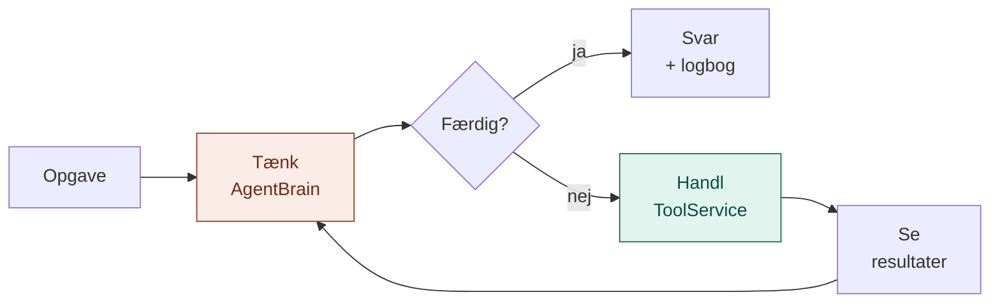
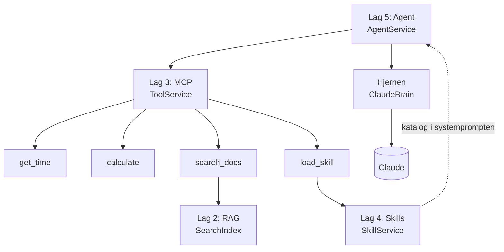

# Agent: Hjerne + hænder (lag 5)

En agent er **en LLM i en løkke**. Den tænker over opgaven, beslutter at gøre noget, ser resultatet og tænker igen, indtil opgaven er løst.

Det er det sidste lag, og det binder alle de andre sammen. Agenten bygger ikke selv noget nyt: den bruger hjernen, biblioteket, værktøjerne og skillene fra lag 1 til 4.

## Hvorfor laget findes

| Lag 1 til 4 alene | Med en agent |
|---|---|
| Ét spørgsmål, ét svar | Mange skridt til ét svar |
| Koden bestemmer rækkefølgen | LLM'en planlægger selv |
| Værktøjer og skills står klar, men ingen bruger dem | LLM'en vælger, hvilke der skal bruges hvornår |

## Analogien: en håndværker på en opgave

Infografikken kalder agenten for **hjerne + hænder**. Tænk på en håndværker: hun får en opgave, tænker over den, tager et værktøj, ser resultatet og tænker igen. Hun har en værktøjskasse (lag 3), en mappe med fremgangsmåder (lag 4) og adgang til et bibliotek (lag 2). Og hun fører logbog.

| Mappe | Hos håndværkeren | Hvad den gør |
|---|---|---|
| `domain/` | Logbogen og kravet til hovedet | Begreber (`Decision`, `Action`, `Observation`, `Step`, `AgentRun`) og porten `AgentBrain` |
| `application/` | Arbejdsgangen | `AgentService`: tænk, handl, se, gentag, og stop ved fyraften |
| `infrastructure/` | Hovederne | `ClaudeBrain` (mesteren) og `ScriptedBrain` (lærlingen med manuskript) |
| `api/` | Værkstedsdøren og formanden | Samler værktøjer og skills, vælger hjernen, viser arbejdet |
| `config/` | Opslagstavlen | Model, grænse for antal skridt og grundinstruktion |

Hver mappe har sin egen README med detaljer.

## Struktur

```
Agent/
├── domain/
│   ├── models.py                  Action, Decision, Observation, Step, AgentRun, History
│   └── ports.py                   AgentBrain
├── application/
│   └── agent_service.py           AgentService: løkken
├── infrastructure/
│   └── brains/
│       ├── claude_brain.py        Claude med værktøjer
│       └── scripted_brain.py      Lærlingen + demo-manuskriptet
├── api/
│   ├── build.py                   Samler alt
│   └── cli.py                     Kommandolinje
└── config/
    └── settings.py                MODEL, MAX_STEPS, SYSTEM_PROMPT
```

## Flow: løkken



Orange er hjernen, grøn er hænderne. Løkken stopper, når hjernen ikke vil gøre mere, eller når grænsen for antal skridt er nået.

## Hvordan alle fem lag spiller sammen



Demo-opgaven bruger det hele:

| Skridt | Agenten tænker | Gør | Lag |
|---|---|---|---|
| 1 | "Det er en rykker, så jeg henter skillen." | `load_skill("rykker")` | 4 |
| 2 | "Skillen siger, jeg skal slå reglerne op." | `search_docs("afleveres bog sent koster dag")` | 2 via 3 |
| 3 | "5 kr. pr. dag, så jeg regner det ud." | `calculate(12, 5, multiply)` | 3 |
| 4 | Skriver rykkeren efter skillens regler | (færdig) | 1 |

## Hvorfor agenten har sin egen port til hjernen

`LLMProvider` i lag 1 kan kun tekst ind og tekst ud. En agent skal også kunne fortælle modellen, hvilke værktøjer der findes, få at vide, at den vil bruge ét, og sende resultatet tilbage.

I stedet for at gøre lag 1 mere kompliceret for alle, har agenten sin egen lille port, `AgentBrain`. Ulempen er, at `ClaudeBrain` taler med Anthropic ved siden af lag 1. Vil man samle det senere, kan `LLMProvider` udvides med værktøjskald, og `ClaudeBrain` kan bygges ovenpå. Resten af agent-laget mærker intet, for det kender kun porten.

## Afhængighedsreglen

Den samme som i de andre lag: alle afhængigheder peger ind mod `domain/`. Agent-laget må kende alle lagene under sig, men intet lag under må kende agenten.

## Kom i gang

Fra projektets rod:

```bash
# Lærlingen: ingen API-nøgle, fast demo-opgave, rigtige værktøjer
python -m Agent.api.cli --fake

# Mesteren: kræver ANTHROPIC_API_KEY
python -m Agent.api.cli "Hvornår har biblioteket åbent om lørdagen?"
```

Med `--fake` ser output sådan ud:

```
Tænker: Det er en rykker, så jeg henter først vores skill til rykkere.
  Gør:  load_skill({'name': 'rykker'})
  Ser:  [OK] # Sådan skriver vi rykkere

Tænker: Skillen siger, at jeg skal slå reglerne op og ikke gætte.
  Gør:  search_docs({'query': 'afleveres bog sent koster dag'})
  Ser:  [OK] [bibliotek.md] Afleveres en bog for sent, koster det 5 kr. pr. dag.

Tænker: Det koster 5 kr. pr. dag. Jeg regner gebyret ud for 12 dage.
  Gør:  calculate({'a': 12, 'b': 5, 'operation': 'multiply'})
  Ser:  [OK] 60

Svar:
Hej Sara Jensen,
Dit lån af 'Kaptajn Klo' er nu 12 dage over tiden, og gebyret er 60 kr. (5 kr. pr. dag).
...
```

## Brug fra kode

```python
from Agent.api.build import build_agent

agent = build_agent(fake=False)
run = agent.run("Hvad koster det at printe 20 sider i farve?")

print(run.answer)
for step in run.steps:
    print(step.action.tool, step.action.arguments, step.observation.content)
```

## Udvid laget

| Jeg vil... | Så gør jeg... |
|---|---|
| Give agenten et nyt værktøj | Tilføj det i lag 3. Det er automatisk med her. |
| Lære agenten en ny fremgangsmåde | Tilføj en skill i lag 4. Den er automatisk med i kataloget. |
| Give agenten mere viden | Læg dokumenter i `RAG/data/docs/`. `search_docs` finder dem. |
| Bruge en anden model | Lav en ny hjerne i `infrastructure/brains/` og vælg den i `api/build.py` |
| Lade agenten tage flere skridt | Ret `MAX_STEPS` i `config/settings.py` |

## Godt at vide

- **Lærlingen kan kun sit manuskript.** Med `--fake` bruges altid demo-opgaven. Værktøjskaldene er rigtige, men beslutningerne er skrevet på forhånd.
- **Hvert skridt er et LLM-kald.** Demo-opgaven er fire kald til Claude. Det er værd at huske, når man ser på prisen.
- **Grænsen for antal skridt er en sikkerhedsregel**, ikke en detalje. Uden den kan en agent, der ikke finder svaret, blive ved.
