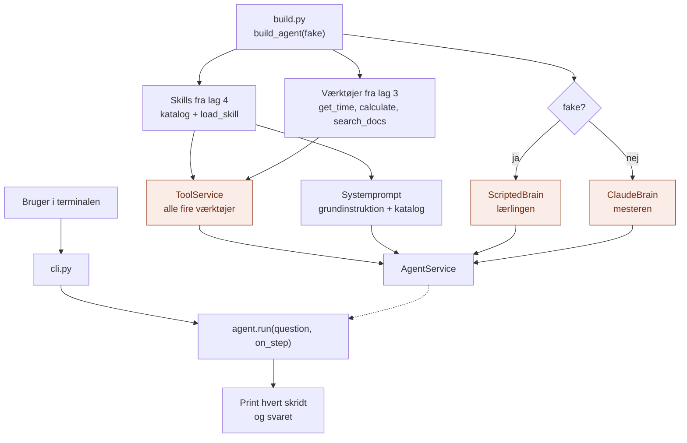

# api/

`api/` er Agent-lagets **hoveddør**: der, hvor omverdenen kommer ind.

Den svarer på spørgsmålet: **Hvordan bruger man det her lag udefra?**

## Analogien

Hvis `domain/` er logbogen, `application/` er arbejdsgangen, og `infrastructure/` er hovederne, så er `api/` **værkstedsdøren** og **formanden**.

Formanden gør håndværkeren klar, før hun går i gang: hun får værktøjskassen (alle værktøjer fra lag 3), nodemappen (skillene fra lag 4) og en arbejdsseddel (systemprompten). Og formanden bestemmer, om det er mesteren eller lærlingen, der tager opgaven.

## Flow



De orange bokse er det, der gør `api/` særlig: her bliver hjernen valgt, og alle hænderne samlet.

## Indhold

| Fil | Hvad den indeholder |
|---|---|
| `build.py` | `build_agent(fake)`: samler værktøjer, skills, systemprompt og hjerne |
| `cli.py` | Kommandolinjen: kør agenten og følg hvert skridt |

## Hvad api gør

1. **Samler hænderne:** alle værktøjer fra lag 3 og `load_skill` fra lag 4 i én `ToolService`
2. **Skriver arbejdssedlen:** grundinstruktionen fra `config/` og kataloget over skills
3. **Vælger hjernen:** lærlingen med `--fake`, ellers Claude
4. **Viser arbejdet:** hvert skridt, mens det sker, og svaret til sidst

## Hvad hører ikke til her

- Selve løkken: det er `application/`
- At tale med Claude: det er `infrastructure/`
- Begreber og kontrakter: det er `domain/`

## Afhængigheder

`api/` er den eneste mappe i Agent-laget, der kender alle de andre lag.

```
api/ ──► application/ ──► domain/ ◄── infrastructure/
  │
  ├──► MCP-laget (lag 3): værktøjerne
  └──► Skills-laget (lag 4): katalog og load_skill
           │
           └──► RAG-laget (lag 2) via search_docs
```

## Brug

```bash
# Lærlingen: ingen API-nøgle, fast demo-opgave
python -m Agent.api.cli --fake

# Mesteren: kræver ANTHROPIC_API_KEY
python -m Agent.api.cli "Hvornår har biblioteket åbent om lørdagen?"
python -m Agent.api.cli "Skriv en rykker til Sara Jensen. Hendes lån af 'Kaptajn Klo' er 12 dage over tiden."
```

Output viser hvert skridt som **Tænker**, **Gør** og **Ser**, og til sidst svaret og antal værktøjskald.

## Den hurtige test

Spørg om en kodelinje: **Handler den om at gøre agenten klar, eller om at vise hvad den gør?**

- **Ja:** den hører til i `api/`.
- **Nej:** den hører til et af de andre steder.

## Hvorfor

- **Ét sted at samle.** Et nyt værktøj i lag 3 eller en ny skill i lag 4 er automatisk med her.
- **Ét sted at skifte hjerne.** Lærling eller mester vælges kun i `build.py`.
- **Synligt arbejde.** Man ser hvert skridt, ikke kun svaret.
