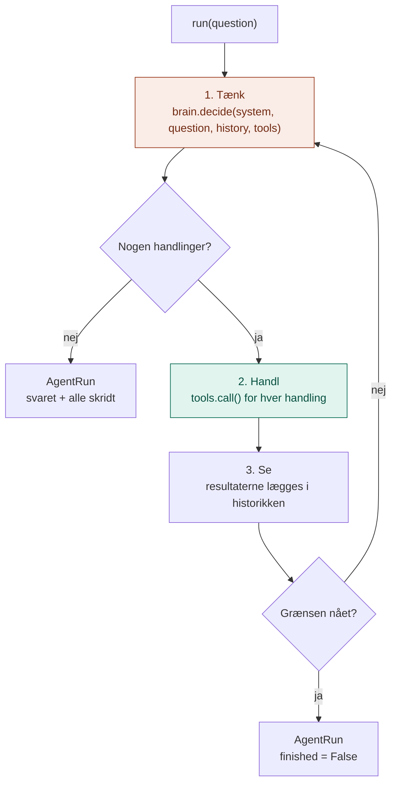

# application/

`application/` indeholder Agent-lagets **use case**: løkken, der lader hjernen tænke og hænderne handle.

Den svarer på spørgsmålet: **Hvordan løser agenten en opgave, trin for trin?**

## Analogien

Hvis `domain/` er logbogens sider og kravet til hovedet, så er `application/` **arbejdsgangen**.

Håndværkeren gør altid det samme: hun tænker, gør noget, ser resultatet og tænker igen. Hun skriver hvert skridt i logbogen. Og hun har en fast regel om fyraften: bliver hun ikke færdig inden for et bestemt antal skridt, stopper hun og siger det, i stedet for at blive ved i det uendelige.

## Flow



Den orange boks er **hjernen** (porten `AgentBrain`). Den grønne er **hænderne** (`ToolService` fra lag 3). Det er hele idéen bag en agent: hjerne + hænder i en løkke.

## Indhold

| Fil | Hvad den indeholder |
|---|---|
| `agent_service.py` | `AgentService`: løkken |

### AgentService

| Metode | Bruges når |
|---|---|
| `run(question, on_step=None)` | En opgave skal løses. Returnerer `AgentRun` med svar og alle skridt. `on_step` kaldes efter hvert skridt, så man kan følge med. |

Rundt om løkken sørger servicen for:

- **Historik:** hver beslutning og hvert resultat gemmes og sendes med i næste runde, for modellen husker intet selv
- **Alle handlinger udføres:** beder hjernen om flere ting på én gang, bliver de alle udført, før den tænker igen
- **Fejl stopper ikke løkken:** fejler et værktøj, ser hjernen fejlen og kan prøve noget andet
- **Grænse for antal skridt:** beskytter mod en agent, der kører i ring

## Hvad hører ikke til her

- At tale med Claude: det er `infrastructure/`
- At vælge hjerne og værktøjer: det er `api/`
- Selve værktøjerne og skillene: det er lag 3 og 4

## Afhængigheder

`application/` importerer fra sit eget `domain/` og bruger `ToolService` fra lag 3.

```
api/ ──► application/ ──► domain/ ◄── infrastructure/
              │
              └──► MCP-laget (lag 3): ToolService
```

## Dependency injection

Servicen **får** hjernen og hænderne udefra:

```python
agent = AgentService(brain, tools, system, max_steps=8)
```

## Den hurtige test

Spørg om en kodelinje: **Beskriver den rækkefølgen tænk, handl, se, uden at nævne en bestemt model?**

- **Ja:** den hører til i `application/`.
- **Nej, den beskriver et begreb eller en kontrakt:** `domain/`.
- **Nej, den taler med Claude:** `infrastructure/`.

## Hvorfor

- **Kort og overskuelig.** Løkken er det eneste nye i lag 5. Alt andet er bygget i lagene under.
- **Samme løkke til alle hjerner.** Lærlingen og Claude kører præcis samme kode.
- **Sikker.** Grænsen for antal skridt og fejl-flaget betyder, at agenten altid stopper og altid svarer.
