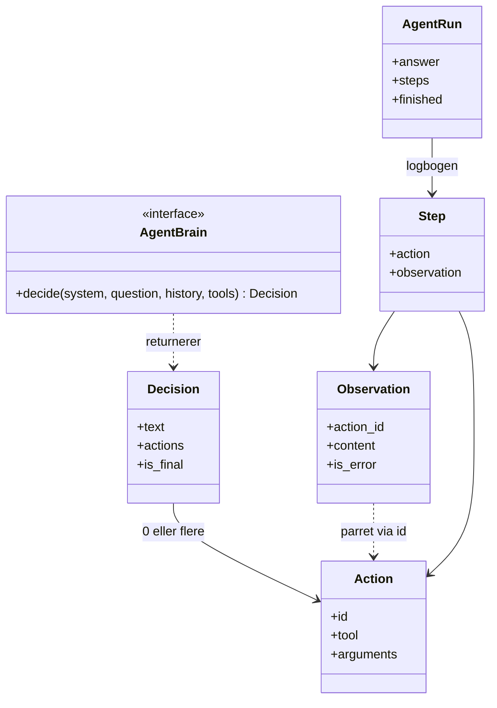
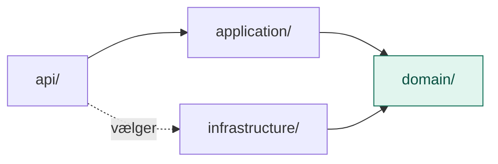

# domain/

`domain/` er Agent-lagets kerne af begreber og regler, beskrevet i lagets eget sprog og helt uden teknik.

Den svarer på spørgsmålet: **Hvad handler det her lag om?** Ikke *hvordan* det bliver gjort.

## Analogien: en håndværker på en opgave

Infografikken kalder agenten for **hjerne + hænder**. Tænk på en håndværker, der får en opgave. Hun tænker over, hvad der skal gøres, gør det, ser resultatet og tænker igen, indtil opgaven er løst. Undervejs fører hun logbog.

`domain/` er **logbogens sider** og **kravet til hovedet**: hvad en beslutning er, hvad en handling er, hvad hun så, og at der skal være nogen, der kan tænke. Det siger ikke, hvem der tænker.

| Begreb | Hos håndværkeren |
|---|---|
| `Decision` | Det, hun beslutter i ét skridt: hvad hun tænker, og hvad hun vil gøre |
| `Action` | Én ting, hun vil gøre med et bestemt værktøj |
| `Observation` | Det, hun ser bagefter |
| `Step` | En linje i logbogen: handling og resultat |
| `AgentRun` | Hele logbogen og det færdige resultat |
| `AgentBrain` (port) | Kravet til hovedet: det skal kunne beslutte næste skridt |

## Flow

Hvad domain består af:

Hvem der afhænger af domain:

## Indhold

| Fil | Hvad den indeholder |
|---|---|
| `models.py` | `Action`, `Decision`, `Observation`, `Step`, `AgentRun` og typen `History` |
| `ports.py` | `AgentBrain`: kontrakten for hjernen |

### Modeller (`models.py`)

| Model | Hvad det er | Hvorfor |
|---|---|---|
| `Action` | Værktøj, argumenter og et id | Id'et parrer handlingen med sit resultat, når der er flere på én gang |
| `Decision` | Tekst og handlinger | **Ingen handlinger betyder færdig.** Det er det eneste stop-signal, løkken har brug for. |
| `Observation` | Resultatet og et fejl-flag | En fejl skal kunne ses og bruges, ikke stoppe løkken |
| `Step` | Handling og resultat | Det, man viser et menneske bagefter |
| `AgentRun` | Svar, skridt og om den blev færdig | Et agentsvar er kun troværdigt, hvis man kan se vejen dertil |
| `History` | Skiftevis beslutninger og observationer | Det er samtalen, hjernen skal have med i næste skridt |

### Port (`ports.py`)

| Port | Hvad den lover | Hvorfor |
|---|---|---|
| `AgentBrain` | `decide()`: ud fra opgave, historik og værktøjer, beslut næste skridt | Hjernen kan være Claude, en anden model eller en lærling med manuskript |

## Hvorfor ikke bare bruge LLMProvider fra lag 1?

`LLMProvider` kan kun tekst ind og tekst ud. En agent skal også kunne fortælle modellen, hvilke værktøjer der findes, få at vide, at modellen vil bruge ét, og sende resultatet tilbage.

Man kunne udvide `LLMProvider` i lag 1, men så ville alle andre lag skulle leve med en mere kompliceret port. I stedet har agenten sin egen lille port, der siger præcis det, den har brug for. Det er et bevidst valg, og det kan ændres senere.

## Afhængigheder til andre lag

`ports.py` bruger `ToolSpec` fra MCP-lagets `domain/`. Det er i orden: et lag må gerne kende begreberne i lagene under sig. Værktøjernes mærkater er de samme overalt.

## Hvad hører ikke til her

- Selve løkken: det er `application/`
- Kode, der taler med Claude: det er `infrastructure/`
- Valget af hjerne og værktøjer: det er `api/`

## Den hurtige test

Spørg om en fil: **Skulle den ændres, hvis vi skiftede Claude ud med en anden model?**

- **Nej:** den hører til i `domain/`.
- **Ja:** den hører til i `infrastructure/`.

## Hvorfor

- **Sporbart.** Hvert skridt gemmes, så man kan se, hvad agenten gjorde, og hvor det gik galt.
- **Ét stop-signal.** En beslutning uden handlinger er svaret. Løkken behøver ikke mere.
- **Udskifteligt.** Hjernen kan skiftes, og en lærling med manuskript kan stå i stedet, når man vil prøve uden nøgle.
