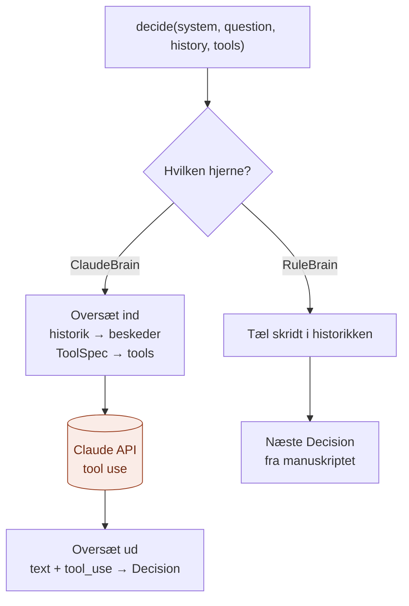

# infrastructure/

`infrastructure/` er der, hvor Agent-laget møder **den rigtige teknologi**: selve hjernerne.

Den svarer på spørgsmålet: **Hvem tænker, og hvordan taler vi med dem?**

## Analogien

Hvis `domain/` er logbogen og kravet til hovedet, og `application/` er arbejdsgangen, så er `infrastructure/` **hovederne**, der kan sættes i arbejde:

- **Mesteren** (`claude_brain.py`) tænker selv. Hun læser opgaven, vælger værktøjer og skriver svaret.
- **Lærlingen** (`rule_brain.py`) tænker ikke selv. Han følger faste regler for et kodetjek, skridt for skridt. Men værktøjerne, han bruger, er rigtige.

Arbejdsgangen er den samme for begge.

## Flow



## Indhold

| Fil | Opfylder porten | Hvad den gør |
|---|---|---|
| `brains/claude_brain.py` | `AgentBrain` | Taler med Claude med værktøjer. Den eneste fil i laget, der kender Anthropic. |
| `brains/rule_brain.py` | `AgentBrain` | Regelbaseret kodetjek uden API-nøgle: søger kravene, vælger filer efter navn, læser dem og matcher kriteriernes ord mod koden. Indeholder også demo-spørgsmålet. |

## Hvordan ClaudeBrain oversætter

Claude forventer en samtale, hvor værktøjskald og resultater er særlige blokke. `ClaudeBrain` laver agentens historik om til det:

| Agentens historik | Bliver til i Claudes format |
|---|---|
| Spørgsmålet | `user`-besked med teksten |
| En `Decision` | `assistant`-besked med en `text`-blok og en `tool_use`-blok pr. handling |
| En liste af `Observation` | `user`-besked med en `tool_result`-blok pr. resultat, parret via id |
| `ToolSpec` fra lag 3 | `tools`-listen med `name`, `description` og `input_schema` |

Svaret oversættes den anden vej: `text`-blokke bliver til `Decision.text`, og `tool_use`-blokke bliver til `Action`.

## Lærlingens manuskript

Demo-opgaven er en rykker til en låner. Manuskriptet bruger alle lagene under agenten:

| Skridt | Lærlingen beslutter | Værktøj | Lag |
|---|---|---|---|
| 1 | Hent skillen til rykkere | `load_skill` | 4 |
| 2 | Slå reglerne for sen aflevering op | `search_docs` | 2 via 3 |
| 3 | Regn gebyret ud: 12 × 5 | `calculate` | 3 |
| 4 | Skriv rykkeren | (ingen, svaret er færdigt) | 1 i den rigtige version |

Beslutningerne er skrevet på forhånd, men værktøjskaldene er rigtige. Derfor kan man se hele løkken køre uden API-nøgle.

## Hvad hører ikke til her

- Løkken: det er `application/`
- Valget af hjerne: det er `api/`
- Begreber og kontrakter: det er `domain/`

## Afhængigheder

```
api/ ──► application/ ──► domain/ ◄── infrastructure/
```

## Ny hjerne?

Lav en fil i `brains/` med en `decide()`, fx `openai_brain.py`. Vælg den i `api/build.py`. Intet andet skal ændres.

## Den hurtige test

Spørg om en fil: **Ved den, hvordan en bestemt model eller et manuskript tænker?**

- **Ja:** den hører til i `infrastructure/`.
- **Nej:** den hører til et af de andre steder.

## Hvorfor

- **Modellen er isoleret.** Kun én fil kender Anthropic og formatet for værktøjskald.
- **Kan prøves uden nøgle.** Lærlingen viser hele løkken med rigtige værktøjer.
- **Let at skifte.** En ny model er én ny fil.
