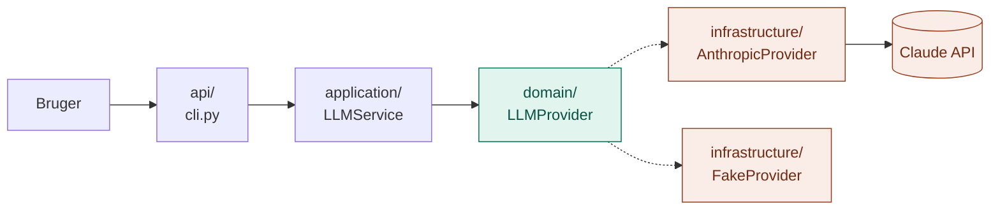
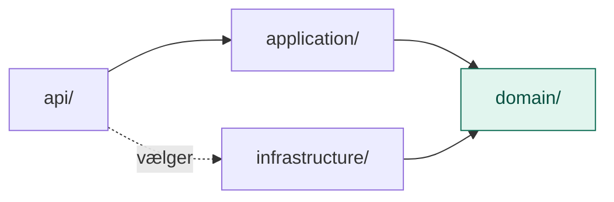

# LLM: Hjernen (lag 1)

LLM-laget er det **eneste sted i systemet, der taler direkte med sprogmodellen**. Det tager en samtale ind og giver et svar tilbage.

Alle andre lag (RAG, MCP, Skills, Agent) bygger ovenpå og kalder hjernen gennem `LLMService`. Ingen af dem taler med Anthropic selv.

## Hvad laget kan og ikke kan

Modellen er trænet på forhånd. Vi træner den ikke; vi bruger den.

| Kan | Kan ikke |
|---|---|
| Forstå og skrive tekst, ræsonnere, opsummere, skrive kode | Vide noget om vores egne data, eller hvad der er sket efter træningen (lukkes af **RAG**) |
| Svare i et bestemt format | Huske mellem kald; hele samtalen skal sendes med hver gang |
| | Handle eller kalde systemer (lukkes af **MCP** og **Agent**) |

## Analogien: en restaurant

| Mappe | I restauranten | Hvad den gør |
|---|---|---|
| `domain/` | Sedlen, tallerkenen og lugen | Begreber (`Message`, `Response`) og kontrakten (`LLMProvider`) |
| `application/` | Tjeneren | `LLMService`: tager imod, validerer, kalder lugen, logger |
| `infrastructure/` | Kokkene | `AnthropicProvider` (den rigtige) og `FakeProvider` (legetøj) |
| `api/` | Hoveddøren og chefen | `cli.py`: tager imod udefra og vælger kokken |
| `config/` | Opslagstavlen | Indstillinger som model og systemprompt *(ikke lavet endnu)* |

Hver mappe har sin egen README med detaljer.

## Struktur

```
LLM/
├── domain/
│   ├── models.py                  Message, Response
│   └── ports.py                   LLMProvider (kontrakten)
├── application/
│   └── llm_service.py             LLMService: ask(), chat(), stream()
├── infrastructure/
│   └── providers/
│       ├── anthropic_provider.py  Taler med Claude
│       └── fake_provider.py       Svarer uden internet og API-nøgle
├── api/
│   └── cli.py                     Kommandolinje
└── config/
    └── settings.py                (ikke lavet endnu)
```

## Flow: ét spørgsmål fra start til slut



Svaret går samme vej tilbage som en `Response`.

## Afhængighedsreglen

Alle afhængigheder peger ind mod `domain/`. `domain/` afhænger af intet.



Det er det, der gør det muligt at skifte model eller udbyder uden at røre resten.

## Kom i gang

Fra projektets rod:

```bash
pip install anthropic

# Uden API-nøgle
python -m LLM.api.cli "Hvad er en LLM?" --fake

# Med rigtig model
export ANTHROPIC_API_KEY=...
python -m LLM.api.cli "Hvad er en LLM?"
python -m LLM.api.cli "Hvad er en LLM?" --stream
```

## Brug fra andre lag

```python
from LLM.application.llm_service import LLMService
from LLM.infrastructure.providers.anthropic_provider import AnthropicProvider

llm = LLMService(AnthropicProvider(), system="Svar kort på dansk.")
response = llm.ask("Hvad er RAG?")
print(response.text)
```

Har laget brug for en hel samtale, bruges `llm.chat(messages)` med en liste af `Message`.

## Udvid laget

| Jeg vil... | Så gør jeg... |
|---|---|
| Bruge en anden udbyder | Lav en ny fil i `infrastructure/providers/` med `complete()` og `stream()`, og vælg den i `api/cli.py` |
| Skifte model | Giv `AnthropicProvider(model=...)` et andet navn (flyttes til `config/`) |
| Tilføje en ny indgang, fx HTTP | Lav `api/http.py`, der bruger samme `LLMService` |
| Tilføje en regel for alle kald | Læg den i `LLMService` i `application/` |

## Baseline til RAG

Stil et spørgsmål, modellen ikke kan vide, fx om et internt dokument, og gem svaret. Det er referencen, som lag 2 (RAG) skal slå.

```bash
python -m LLM.api.cli "Hvor mange feriedage har man hos os, og hvem skal man kontakte?"
```

## Mangler

- `config/settings.py`: model og systemprompt står lige nu som standardværdier i `anthropic_provider.py` og `cli.py`