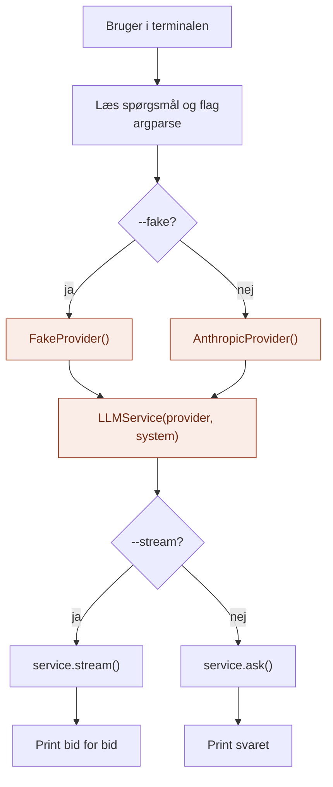

# api/

`api/` er lagets **hoveddør**: der, hvor omverdenen kommer ind.

Den svarer på spørgsmålet: **Hvordan bruger man det her lag udefra?**

## Analogien

Hvis `domain/` er sedlen, tallerkenen og lugen, og `application/` er tjeneren, så er `api/` **hoveddøren** og **restaurantchefen**.

Gæsterne kommer ind ad døren. Og før restauranten åbner, er det chefen, der vælger, hvilken kok der skal stå i køkkenet, og ansætter tjeneren.

## Flow



De orange bokse er det, der gør `api/` særlig: her bliver kokken valgt, og servicen bygget.

## Indhold

| Fil | Hvad den indeholder |
|---|---|
| `cli.py` | Kommandolinjen: stil et spørgsmål fra terminalen |

Senere kan der komme fx `http.py`, hvis laget skal kunne kaldes over nettet. Den vil bruge samme service.

## Hvad api gør

1. **Tager imod input udefra** (terminal, HTTP, et andet lag)
2. **Samler laget:** vælger provider og opretter `LLMService`
3. **Kalder servicen** og viser svaret i en form, der passer til den, der spurgte

## Hvad hører ikke til her

- Regler for, hvordan et kald forløber: det er `application/`
- Begreber og kontrakter: det er `domain/`
- Kode, der taler med Anthropic: det er `infrastructure/`

`api/` skal være tynd. Den oversætter bare mellem omverdenen og servicen.

## Afhængigheder

`api/` er den eneste mappe, der kender både `application/` og `infrastructure/`. Det er netop derfor, det er her, delene bliver sat sammen.

```
api/ ──► application/ ──► domain/ ◄── infrastructure/
  └──────────────────────────────────────────┘
          (vælger hvilken provider)
```

## Brug

```bash
python -m LLM.api.cli "Hvad er en LLM?"
python -m LLM.api.cli "Hvad er en LLM?" --stream
python -m LLM.api.cli "Hvad er en LLM?" --fake
```

`--fake` bruger den falske model, så man kan prøve uden API-nøgle.

## Den hurtige test

Spørg om en kodelinje: **Handler den om, hvordan nogen udefra taler med laget, eller om at sætte delene sammen?**

- **Ja:** den hører til i `api/`.
- **Nej:** den hører til et af de andre steder.

## Hvorfor

- **Ét sted at skifte.** Vil man bruge en anden model, ændres kun `build_service()`.
- **Flere døre, samme køkken.** En CLI og en HTTP-indgang kan bruge præcis samme service.
- **Resten forbliver ren.** Hverken `application/` eller `domain/` skal vide noget om terminaler, HTTP eller hvilken udbyder der er valgt.