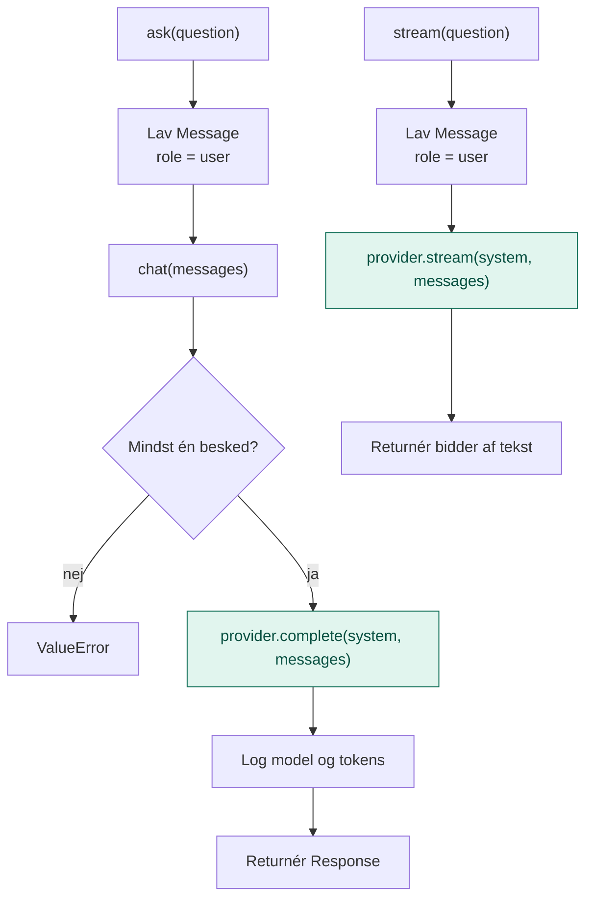

# application/

`application/` indeholder lagets **use cases**: de konkrete ting, laget kan gøre for resten af systemet.

Den svarer på spørgsmålet: **Hvad kan man bruge det her lag til, og hvordan forløber det?**

## Analogien

Hvis `domain/` er sedlen, tallerkenen og lugen ind til køkkenet, så er `application/` **tjeneren**.

Tjeneren tager imod din bestilling, skriver den pænt på en seddel, lægger den i lugen, venter på tallerkenen og noterer, hvad du fik. Hun laver ikke selv maden, og hun ved ikke, hvilken kok der står i køkkenet.

## Flow



De grønne bokse er de eneste steder, servicen rører kokken, og det sker altid gennem porten `LLMProvider`. Servicen ved ikke, hvem der svarer.

## Indhold

| Fil | Hvad den indeholder |
|---|---|
| `llm_service.py` | `LLMService`: lagets offentlige indgang til modellen |

### LLMService

| Metode | Bruges når |
|---|---|
| `ask(question)` | Ét spørgsmål, ét svar. Det simple tilfælde. |
| `chat(messages)` | Hele samtalen skal med, fordi modellen ikke husker noget selv. Bruges af agent-laget. |
| `stream(question)` | Svaret skal vises løbende, mens det bliver skrevet. |

Rundt om hvert kald sørger servicen for:

- **Validering:** der skal være mindst én besked
- **Systemprompt:** sættes én gang, når servicen oprettes
- **Logning:** model og tokens, ens for alle udbydere

## Hvad application gør

- Tager imod en forespørgsel i en simpel form (fx bare en tekst)
- Oversætter den til domænets modeller (`Message`)
- Kalder porten (`LLMProvider`)
- Tilføjer det, der skal ske omkring kaldet: validering, systemprompt, logning
- Returnerer domænets model (`Response`)

## Hvad hører ikke til her

- At tale med Anthropic eller andre udbydere: det er `infrastructure/`
- At læse miljøvariabler eller API-nøgler: det er `config/`
- At tage imod input fra terminal eller HTTP: det er `api/`

## Afhængigheder

`application/` må kun importere fra `domain/`. Aldrig fra `infrastructure/`.

```
api/ ──► application/ ──► domain/ ◄── infrastructure/
```

## Dependency injection

Servicen **får** sin provider udefra og vælger den ikke selv:

```python
service = LLMService(provider=AnthropicProvider(...), system="Svar på dansk.")
```

Den, der opretter servicen (typisk `api/`), bestemmer, om kokken er `anthropic_provider` eller `fake_provider`. Servicen virker ens med begge. Det er derfor, man kan skifte model eller køre uden API-nøgle uden at ændre en linje i servicen.

## Den hurtige test

Spørg om en kodelinje: **Beskriver den, hvordan en opgave forløber, uden at nævne en bestemt teknologi?**

- **Ja:** den hører til i `application/`.
- **Nej, den beskriver et begreb eller en kontrakt:** `domain/`.
- **Nej, den taler med en bestemt teknologi:** `infrastructure/`.

## Hvorfor

- **Ét sted for regler.** Validering, logning og systemprompt skrives én gang, i stedet for at hver kalder skal huske det.
- **Ens adfærd.** Alle kald logges og valideres ens, uanset udbyder, så lagene kan sammenlignes.
- **Let at bruge.** De næste lag kalder `ask()` eller `chat()` og behøver ikke vide noget om modeller, nøgler eller SDK'er.