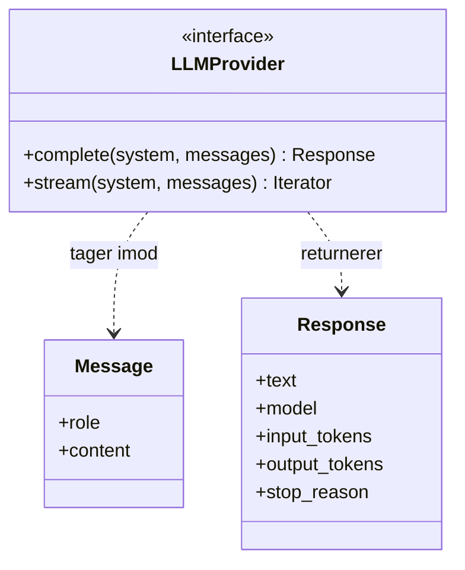
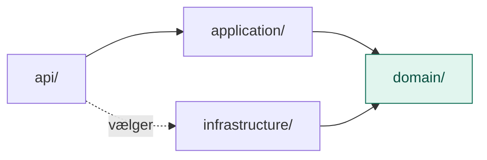

# domain/

`domain/` er lagets kerne af begreber og regler, beskrevet i lagets eget sprog og helt uden teknik.

Den svarer på spørgsmålet: **Hvad handler det her lag om?** Ikke *hvordan* det bliver gjort.

## Flow

Hvad domain består af:



Hvem der afhænger af domain:



Alle pile peger ind mod `domain/`. Ingen pil peger ud.

## Indhold

| Fil | Hvad den indeholder |
|---|---|
| `models.py` | De ting, laget arbejder med (rene datastrukturer) |
| `ports.py` | De ting, laget har brug for udefra, beskrevet som kontrakter (interfaces) |

### Modeller (`models.py`)

Modellerne er lagets fælles sprog. Alle andre dele af laget taler med dem.

For LLM-laget:

- `Message`: én besked i en samtale (rolle og indhold)
- `Response`: modellens svar (tekst, tokens, stop-årsag)

### Porte (`ports.py`)

En port siger **hvad** der skal kunne gøres, men ikke **hvordan**.

```python
class LLMProvider(Protocol):
    def complete(self, messages: list[Message]) -> Response: ...
```

Porten nævner ikke Anthropic, API-nøgler eller HTTP. Den siger bare: "Jeg skal bruge noget, der kan tage beskeder ind og give et svar tilbage."

Portene implementeres i `infrastructure/`. Fx er `anthropic_provider.py` én måde at opfylde `LLMProvider` på; en anden udbyder ville være en anden fil ved siden af.

## Hvad hører ikke til her

- Imports af `anthropic`, databaser, HTTP eller filsystem
- Konfiguration og API-nøgler
- Konkrete implementeringer

Det hører til i `infrastructure/` og `config/`.

## Afhængigheder

`domain/` afhænger af **intet** andet i projektet. Alle andre mapper må afhænge af `domain/`, aldrig omvendt.

```
api/ ──► application/ ──► domain/ ◄── infrastructure/
```

## Den hurtige test

Spørg om en fil: **Skulle den ændres, hvis vi skiftede Anthropic ud med en anden udbyder?**

- **Nej:** den hører til i `domain/`.
- **Ja:** den hører til i `infrastructure/`.

## Hvorfor

- **Stabilt.** Begreberne ændrer sig sjældent, teknologien ofte. Når de er adskilt, rammer et teknologiskift kun én mappe.
- **Udskifteligt.** Resten af laget kender kun porten, så model, vektordatabase eller værktøjsserver kan skiftes uden at røre resten.
- **Fælles sprog.** Man taler om `Message`, `Chunk` og `Skill`, ikke om SDK-objekter.

Tænk på det sådan: `domain/` er **stikkontaktens standard**, `infrastructure/` er **apparaterne**, der passer i den. Standarden ændrer sig næsten aldrig, apparaterne skiftes efter behov.

## Domain i alle fem lag

| Lag | Modeller | Porte |
|---|---|---|
| LLM | Message, Response | LLMProvider |
| RAG | Document, Chunk, SearchResult | DocumentLoader, Embedder, VectorStore |
| MCP | Tool, ToolCall, ToolResult | ToolRegistry, ToolExecutor |
| Skills | Skill (navn, beskrivelse, indhold) | SkillRepository |
| Agent | Run, Step | SessionStore |