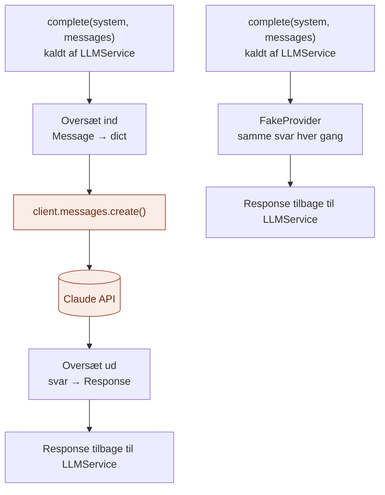

# infrastructure/

`infrastructure/` er der, hvor laget møder **den rigtige teknologi**.

Den svarer på spørgsmålet: **Hvordan bliver det faktisk gjort?**

## Analogien

Hvis `domain/` er sedlen, tallerkenen og lugen, `application/` er tjeneren, og `api/` er hoveddøren, så er `infrastructure/` **kokkene**.

Hver kok passer i samme luge, men laver maden på sin egen måde. Tjeneren ved aldrig, hvilken kok der står i køkkenet.

## Flow



Begge kokke tager imod det samme og giver det samme tilbage. Kun de orange bokse kender til Anthropic.

## Indhold

| Fil | Hvad den indeholder |
|---|---|
| `providers/anthropic_provider.py` | Den rigtige kok: taler med Claude via Anthropic's SDK |
| `providers/fake_provider.py` | Legetøjskokken: svarer altid det samme, uden internet og API-nøgle |

Begge opfylder kontrakten `LLMProvider` fra `domain/ports.py`: de har `complete()` og `stream()`.

## Hvad en adapter gør

Hver adapter gør altid de samme tre ting:

1. **Oversætter ind:** domænets `Message` → det format, udbyderen forstår
2. **Kalder udbyderen**
3. **Oversætter ud:** udbyderens svar → domænets `Response`

Resten af laget ser kun `Message` og `Response`. Udbyderens egne objekter slipper aldrig ud af adapteren.

## Hvad hører ikke til her

- Regler for, hvordan et kald forløber (validering, logning): det er `application/`
- Valget af, hvilken adapter der bruges: det er `api/`
- Begreber og kontrakter: det er `domain/`

## Afhængigheder

`infrastructure/` importerer fra `domain/` for at kende kontrakten og modellerne. Intet andet i laget importerer fra `infrastructure/`, undtagen `api/`, som vælger adapteren.

```
api/ ──► application/ ──► domain/ ◄── infrastructure/
```

## Ny udbyder?

Lav en ny fil ved siden af de to andre, fx `providers/openai_provider.py`, med `complete()` og `stream()`. Vælg den i `api/cli.py`. Intet andet skal ændres.

## Den hurtige test

Spørg om en fil: **Importerer den et bibliotek fra en bestemt udbyder eller teknologi?**

- **Ja:** den hører til i `infrastructure/`.
- **Nej:** den hører til et af de andre steder.

## Hvorfor

- **Teknologien er isoleret.** Kun én fil i hele laget kender til Anthropic.
- **Let at skifte.** En ny udbyder er én ny fil.
- **Let at prøve af.** `FakeProvider` lader hele systemet køre uden internet, uden nøgle og uden udgifter.