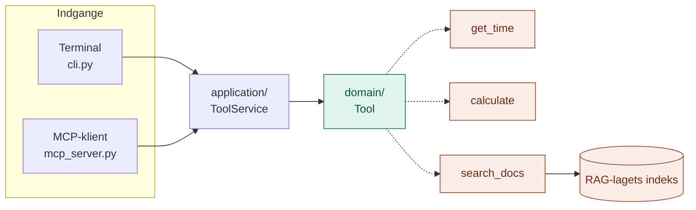
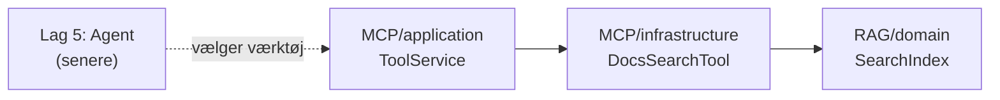

# MCP: Nervesystemet (lag 3)

MCP (Model Context Protocol) giver hjernen **værktøjer**: ting, den kan få udført i verden, som den ikke kan selv.

En LLM kan ikke se, hvad klokken er, den kan regne forkert, og den kan ikke slå op i et system. Et værktøj kan. MCP er standarden for, hvordan værktøjer beskrives og kaldes, så alle AI-programmer kan bruge dem på samme måde.

## Hvorfor laget findes

| LLM'en alene | Med værktøjer |
|---|---|
| Ved ikke, hvad klokken er | `get_time` fortæller det |
| Kan regne forkert | `calculate` regner altid rigtigt |
| Kan kun læse det, den får givet | `search_docs` lader den selv slå op i dokumenterne |

I lag 2 søgte koden *altid* i dokumenterne, før modellen blev spurgt. Med `search_docs` som værktøj kan LLM'en i lag 5 selv vælge, om og hvad der skal søges efter.

## Analogien: et hus med stikkontakter

Infografikken kalder MCP for **nervesystemet**: én standard, der forbinder hjernen med alt det, den skal kunne styre. I praksis er det nemmest at tænke på det som **et hus med stikkontakter**. Har et apparat det rigtige stik, kan det sættes i, og alle i huset kan bruge det.

| Mappe | I huset | Hvad den gør |
|---|---|---|
| `domain/` | Stikkontakt-standarden | Begreber (`ToolSpec`, `ToolCall`, `ToolResult`) og stikkets form (`Tool`) |
| `application/` | Eltavlen | `ToolService`: holder styr på apparaterne, kalder det rigtige, slår sikringen fra ved fejl |
| `infrastructure/` | Apparaterne | Uret, lommeregneren og dokumentsøgningen |
| `api/` | Stikkontakterne og elektrikeren | Vælger apparaterne og åbner for terminalen og for MCP-klienter |
| `config/` | Opslagstavlen | Servernavn og antal søgeresultater |

Hver mappe har sin egen README med detaljer.

## Struktur

```
MCP/
├── domain/
│   ├── models.py                   ToolSpec, ToolCall, ToolResult
│   └── ports.py                    Tool
├── application/
│   └── tool_service.py             ToolService: list_tools(), call()
├── infrastructure/
│   └── tools/
│       ├── time_tool.py            get_time
│       ├── calculator_tool.py      calculate
│       └── docs_search_tool.py     search_docs (bruger lag 2)
├── api/
│   ├── build.py                    Vælger værktøjerne
│   ├── cli.py                      Kommandolinje
│   └── mcp_server.py               Rigtig MCP-server
└── config/
    └── settings.py                 SERVER_NAME, SEARCH_K
```

## Flow: ét værktøjskald fra start til slut



Svaret går samme vej tilbage som et `ToolResult`. Går noget galt, kommer der et resultat med `is_error = True` i stedet for et nedbrud.

## Hvordan laget bruger lag 1 og 2

- **Lag 1 (LLM) bruges ikke.** MCP-laget kalder aldrig modellen. Det stiller bare værktøjer til rådighed. Det er LLM'en i lag 5, der vælger, hvornår de skal bruges.
- **Lag 2 (RAG) bruges** af `search_docs`, som søger i det samme indeks som lag 2.



## Afhængighedsreglen

Den samme som i lag 1 og 2: alle afhængigheder peger ind mod `domain/`, og `domain/` afhænger af intet. Kun `api/mcp_server.py` kender til `mcp`-pakken.

## Kom i gang

Fra projektets rod. Ingen API-nøgle nødvendig, for laget bruger ikke LLM'en.

```bash
# Kommandolinjen: ingen ekstra pakker
python -m MCP.api.cli list
python -m MCP.api.cli call get_time
python -m MCP.api.cli call calculate a=12 b=4 operation=divide
python -m MCP.api.cli call calculate a=1 b=0 operation=divide
python -m MCP.api.cli call search_docs query="lånerkort"

# MCP-serveren: kræver pip install "mcp>=2"
python -m MCP.api.mcp_server
```

Det fjerde kald viser sikringen: division med 0 giver en fejl som resultat, ikke et nedbrud.

## Brug fra andre lag

```python
from MCP.api.build import build_service
from MCP.domain.models import ToolCall

tools = build_service()

for spec in tools.list_tools():
    print(spec.name, spec.input_schema)

result = tools.call(ToolCall("calculate", {"a": 7, "b": 6, "operation": "multiply"}))
print(result.content, result.is_error)
```

`ToolSpec` har allerede den form, Claude forventer (`name`, `description`, `input_schema`), så agent-laget kan sende `list_tools()` direkte med til modellen.

## Udvid laget

| Jeg vil... | Så gør jeg... |
|---|---|
| Tilføje et værktøj | Lav en fil i `infrastructure/tools/` med `spec` og `run()`, og sæt det i i `api/build.py` |
| Gøre et værktøj nemmere at vælge for LLM'en | Skriv en tydeligere `description` i dets `spec` |
| Bruge værktøjerne i Claude Desktop eller en IDE | Tilføj `python -m MCP.api.mcp_server` som MCP-server i klientens indstillinger |
| Bruge værktøjer fra en andens MCP-server | Lav en adapter i `infrastructure/`, der opfylder `Tool` og kalder den anden server |

## Godt at vide

- **Beskrivelsen er en del af værktøjet.** LLM'en vælger ud fra `description` alene. En uklar beskrivelse giver et værktøj, der aldrig bliver brugt, eller bliver brugt forkert.
- **Værktøjer må fejle.** En fejl bliver til tekst, LLM'en kan læse og reagere på. Det bliver vigtigt i lag 5, hvor værktøjer kaldes i en løkke.
- **`get_time` viser ugedagen på engelsk**, fordi den følger systemets sprogindstilling.
