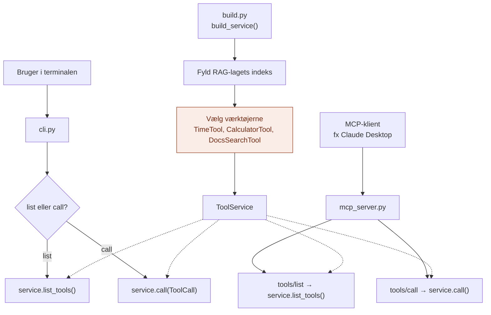

# api/

`api/` er MCP-lagets **døre**: der, hvor omverdenen kommer ind.

Den svarer på spørgsmålet: **Hvordan bruger man det her lag udefra?**

## Analogien

Hvis `domain/` er stikkontakt-standarden, `application/` er eltavlen, og `infrastructure/` er apparaterne, så er `api/` **stikkontakterne i væggen** og **elektrikeren**.

Elektrikeren bestemmer, hvilke apparater der sættes i, før huset tages i brug. Huset har to slags stikkontakter:
- **En knap på væggen** (`cli.py`): du trykker selv og ser, hvad der sker.
- **Et standardstik** (`mcp_server.py`): enhver, der har det rigtige stik (Claude Desktop, en IDE, agent-laget), kan sætte sig i og bruge alle apparaterne.

## Flow



Den orange boks er det, der gør `api/` særlig: her bliver værktøjerne valgt. Begge døre bruger samme `ToolService`, så de altid har præcis de samme værktøjer.

## Indhold

| Fil | Hvad den indeholder |
|---|---|
| `build.py` | `build_service()`: fylder RAG-indekset og vælger værktøjerne. Bruges af begge døre. |
| `cli.py` | Kommandolinjen: vis og kald værktøjer selv |
| `mcp_server.py` | En rigtig MCP-server over stdin/stdout |

## Hvad api gør

1. **Samler laget** (`build.py`): fylder RAG-indekset og vælger, hvilke værktøjer der sættes i
2. **Tager imod udefra:** fra terminalen eller fra en MCP-klient
3. **Oversætter** mellem omverdenens format og lagets `ToolCall` og `ToolResult`

`mcp_server.py` er den eneste fil i hele laget, der kender til `mcp`-pakken. Den oversætter `ToolSpec` til MCP's `Tool`, og `ToolResult` til MCP's `CallToolResult`.

## Hvad hører ikke til her

- Opslag og fejlhåndtering: det er `application/`
- Selve værktøjerne: det er `infrastructure/`
- Begreber og kontrakter: det er `domain/`

## Afhængigheder

`api/` er den eneste mappe, der kender både `application/`, `infrastructure/` og `mcp`-pakken.

```
api/ ──► application/ ──► domain/ ◄── infrastructure/
  └──────────────────────────────────────────┘
          (vælger værktøjer)
```

## Brug

**Kommandolinjen** (ingen ekstra pakker):

```bash
python -m MCP.api.cli list
python -m MCP.api.cli call get_time
python -m MCP.api.cli call calculate a=12 b=4 operation=divide
python -m MCP.api.cli call search_docs query="lånerkort"
```

Argumenter skrives som `navn=værdi`. Tal bliver automatisk til tal.

**MCP-serveren** (kræver `pip install "mcp>=2"`):

```bash
python -m MCP.api.mcp_server
```

Serveren taler over stdin/stdout, så i terminalen ser det ud, som om den bare venter. Den er beregnet til at blive startet af en MCP-klient. Vil du se den i en browser, kan MCP Inspector bruges, hvis Node.js er installeret:

```bash
npx @modelcontextprotocol/inspector python -m MCP.api.mcp_server
```

## Den hurtige test

Spørg om en kodelinje: **Handler den om, hvordan nogen udefra taler med laget, eller om at vælge værktøjer?**

- **Ja:** den hører til i `api/`.
- **Nej:** den hører til et af de andre steder.

## Hvorfor

- **Ét sted at vælge.** Et nyt værktøj sættes i `build.py` og dukker op i begge døre.
- **Protokollen er isoleret.** Kun `mcp_server.py` kender MCP. Skifter protokollen, er det én fil.
- **Let at prøve af.** Med CLI'en kan hvert værktøj testes for sig, uden LLM og uden MCP-klient.
