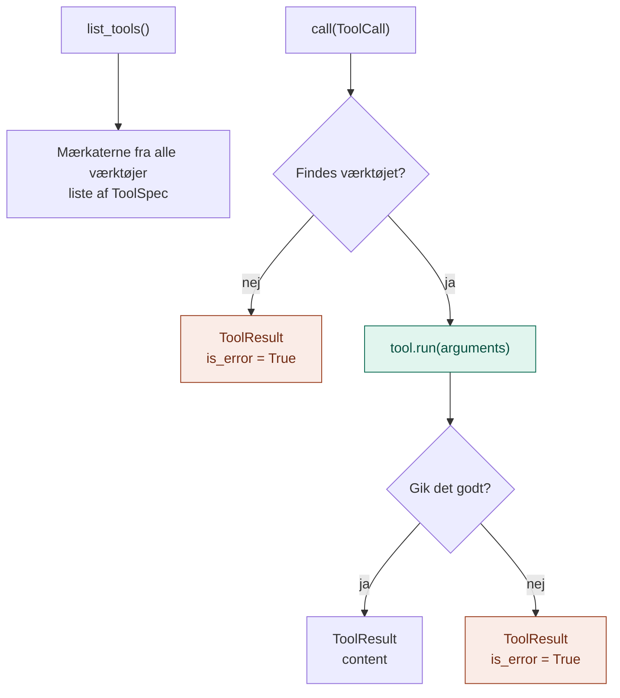

# application/

`application/` indeholder MCP-lagets **use cases**: de konkrete ting, laget kan gøre for resten af systemet.

Den svarer på spørgsmålet: **Hvad kan man bruge det her lag til, og hvordan forløber det?**

## Analogien

Hvis `domain/` er stikkontakt-standarden, så er `application/` **eltavlen**.

Eltavlen ved, hvilke apparater der er sat i, og sender strømmen det rigtige sted hen, når nogen trykker på en knap. Går et apparat i stykker, slår sikringen fra i det ene rum, så resten af huset stadig har strøm. Eltavlen ved ikke, hvad der er inde i apparaterne.

## Flow



Den grønne boks er det eneste sted, servicen rører et værktøj, og det sker gennem porten `Tool`. De orange er sikringerne: en fejl bliver til et resultat i stedet for et nedbrud.

## Indhold

| Fil | Hvad den indeholder |
|---|---|
| `tool_service.py` | `ToolService`: holder styr på værktøjerne og kalder det rigtige |

### ToolService

| Metode | Bruges når |
|---|---|
| `list_tools()` | Man vil se, hvilke værktøjer der findes. Det er det, en LLM får at se. |
| `call(ToolCall)` | Et værktøj skal udføres. Returnerer altid et `ToolResult`, også ved fejl. |

Rundt om hvert kald sørger servicen for:

- **Opslag på navn:** det rigtige værktøj findes ud fra `ToolCall.name`
- **Ukendt værktøj:** giver en læsbar fejl i stedet for et nedbrud
- **Fejl i værktøjet:** fanges og sendes tilbage som `is_error = True`, så en LLM kan prøve noget andet

## Hvad hører ikke til her

- Selve værktøjerne (ur, lommeregner, søgning): det er `infrastructure/`
- MCP-protokollen og terminalen: det er `api/`
- At vælge, hvilke værktøjer der er sat i: det er `api/`

## Afhængigheder

`application/` importerer kun fra `domain/`. Aldrig fra `infrastructure/` og aldrig fra `mcp`-pakken.

```
api/ ──► application/ ──► domain/ ◄── infrastructure/
```

## Dependency injection

Servicen **får** værktøjerne udefra:

```python
service = ToolService([TimeTool(), CalculatorTool(), DocsSearchTool(index)])
```

Den, der opretter servicen, bestemmer, hvilke værktøjer der er sat i. Servicen behandler dem alle ens.

## Den hurtige test

Spørg om en kodelinje: **Beskriver den, hvordan værktøjer findes og kaldes, uden at nævne et bestemt værktøj eller en bestemt protokol?**

- **Ja:** den hører til i `application/`.
- **Nej, den beskriver et begreb eller en kontrakt:** `domain/`.
- **Nej, den er et konkret værktøj:** `infrastructure/`.
- **Nej, den handler om MCP eller terminalen:** `api/`.

## Hvorfor

- **Ét sted for reglerne.** Opslag og fejlhåndtering skrives én gang, ikke i hvert værktøj.
- **Robust.** Et værktøj, der fejler, vælter aldrig resten. Det er afgørende, når en LLM i lag 5 kalder værktøjer i en løkke.
- **Samme service til alle døre.** Terminalen, MCP-serveren og agent-laget bruger præcis den samme `ToolService`.
