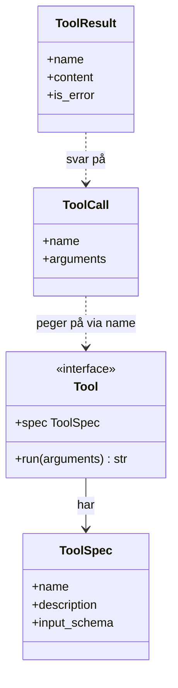
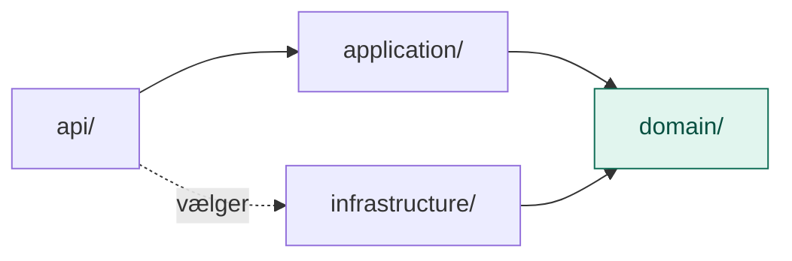

# domain/

`domain/` er MCP-lagets kerne af begreber og regler, beskrevet i lagets eget sprog og helt uden teknik.

Den svarer på spørgsmålet: **Hvad handler det her lag om?** Ikke *hvordan* det bliver gjort.

## Analogien: et hus med stikkontakter

`domain/` er **stikkontakt-standarden**. Den siger, hvilken form stikket skal have, at alle apparater skal have et mærkat, og hvad der sker, når man trykker på knappen. Den siger ikke, hvilke apparater huset har.

| Begreb | I huset |
|---|---|
| `Tool` (port) | Stikkets form. Har apparatet den, kan det sættes i. |
| `ToolSpec` | Mærkatet: hvad apparatet hedder, hvad det gør, og hvilke knapper det har |
| `ToolCall` | At trykke på en knap med bestemte indstillinger |
| `ToolResult` | Det, der kommer ud. Med en sikring, der slår fra ved fejl. |

## Flow

Hvad domain består af:

Hvem der afhænger af domain:

Alle pile peger ind mod `domain/`. Ingen pil peger ud.

## Indhold

| Fil | Hvad den indeholder |
|---|---|
| `models.py` | `ToolSpec`, `ToolCall`, `ToolResult` |
| `ports.py` | `Tool`: kontrakten for et værktøj |

### Modeller (`models.py`)

| Model | Hvad det er | Hvorfor |
|---|---|---|
| `ToolSpec` | Navn, beskrivelse og JSON-skema for argumenterne | Det er det, LLM'en læser for at vælge værktøj. Beskrivelsen er lige så vigtig som koden. |
| `ToolCall` | Hvilket værktøj og med hvilke argumenter | Det er præcis det, LLM'en svarer med, når den vil bruge et værktøj |
| `ToolResult` | Resultatet som tekst og et fejl-flag | LLM'en læser tekst, og en fejl skal kunne læses i stedet for at vælte systemet |

### Port (`ports.py`)

| Port | Hvad den lover | Hvorfor |
|---|---|---|
| `Tool` | `spec` og `run(arguments)` | Alle værktøjer kan sættes i samme stik: ur, lommeregner, dokumentsøgning, senere kalender eller API |

## Hvad hører ikke til her

- Imports af `mcp`-pakken. MCP er én måde at åbne værktøjerne op på, ikke det, de er.
- Konkrete værktøjer som ur og lommeregner
- Kode, der holder styr på værktøjerne og fanger fejl: det er `application/`

## Den hurtige test

Spørg om en fil: **Skulle den ændres, hvis vi tilføjede et nyt værktøj, eller skiftede MCP ud med en anden protokol?**

- **Nej:** den hører til i `domain/`.
- **Ja:** den hører til i `infrastructure/` eller `api/`.

## Hvorfor

- **Ét stik til alt.** Et nyt værktøj kræver ingen ændringer i resten af laget.
- **Uafhængigt af protokollen.** Værktøjerne virker fra terminalen, over MCP og fra agent-laget, fordi de ikke kender til nogen af dem.
- **Klar til LLM'en.** `ToolSpec` og `ToolCall` har allerede den form, Claude forventer.
