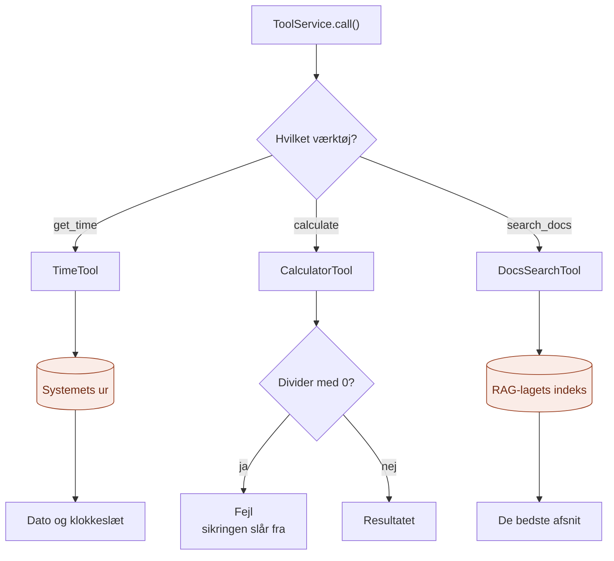

# infrastructure/

`infrastructure/` er der, hvor MCP-laget møder **den rigtige verden**: uret, regnemaskinen og dokumenterne.

Den svarer på spørgsmålet: **Hvad kan der faktisk gøres, og hvordan?**

## Analogien

Hvis `domain/` er stikkontakt-standarden, og `application/` er eltavlen, så er `infrastructure/` **apparaterne**.

Hvert apparat har det samme stik og et mærkat, der fortæller, hvad det gør. Eltavlen ved, at de er sat i, men ikke hvad der er inde i dem.

## Flow



De orange bokse er det, værktøjerne rører i verden udenfor. Resten af laget ser kun `ToolSpec` og tekst.

## Indhold

| Fil | Navn for LLM'en | Hvad den gør |
|---|---|---|
| `tools/time_tool.py` | `get_time` | Giver dato og klokkeslæt. En LLM ved aldrig selv, hvad klokken er. |
| `tools/calculator_tool.py` | `calculate` | Regner præcist med to tal. LLM'er kan regne forkert. |
| `tools/docs_search_tool.py` | `search_docs` | Søger i bibliotekets dokumenter fra lag 2 |
| `tools/requirements_search_tool.py` | `search_requirements` | Søger i user stories og testcases (xlsx) fra lag 2 |

Alle tre opfylder porten `Tool` fra `domain/ports.py`: de har et `spec` og en `run()`.

## Hvert værktøj består af to ting

1. **Et mærkat (`spec`):** navn, beskrivelse og hvilke argumenter det tager. Det er det, LLM'en læser for at vælge. En uklar beskrivelse giver et værktøj, der aldrig bliver brugt, eller bliver brugt forkert.
2. **En handling (`run`):** tager argumenterne som en `dict` og returnerer tekst. Går noget galt, kaster den bare en fejl. Sikringen i `application/` tager sig af resten.

## RAG som værktøj

`DocsSearchTool` er lag 2 lavet om til et værktøj. I lag 2 søgte koden *altid*, før modellen blev spurgt (klassisk RAG). Her vælger LLM'en *selv*, om den vil søge, og hvad den vil søge efter (agentisk RAG). Indekset er det samme; kun hvem der bestemmer, er forskellig.

## Hvad hører ikke til her

- At holde styr på værktøjerne og fange fejl: det er `application/`
- MCP-protokollen og terminalen: det er `api/`
- Begreber og kontrakter: det er `domain/`

## Afhængigheder

Værktøjerne importerer fra `domain/` for at kende `ToolSpec`. `DocsSearchTool` bruger også porten `SearchIndex` fra lag 2.

```
api/ ──► application/ ──► domain/ ◄── infrastructure/
                                            │
                                            └──► RAG-laget (lag 2)
```

## Nyt værktøj?

Lav en ny fil i `tools/` med et `spec` og en `run()`:

```python
class WeatherTool:
    spec = ToolSpec(name="get_weather", description="...", input_schema={...})

    def run(self, arguments: dict) -> str:
        ...
```

Sæt det i i `api/build.py`. Intet andet skal ændres, og det bliver automatisk tilgængeligt i både terminalen og MCP-serveren.

## Den hurtige test

Spørg om en fil: **Gør den én konkret ting i verden, som en LLM ikke kan selv?**

- **Ja:** den hører til i `infrastructure/tools/`.
- **Nej:** den hører til et af de andre steder.

## Hvorfor

- **Ét værktøj, én fil.** Let at finde, let at læse, let at fjerne.
- **Ingen protokol i værktøjerne.** De ved ikke, om de bliver kaldt fra terminalen, over MCP eller af agenten.
- **Mærkatet er en del af koden.** Beskrivelsen ligger lige ved siden af handlingen, så de ikke kommer ud af trit.
