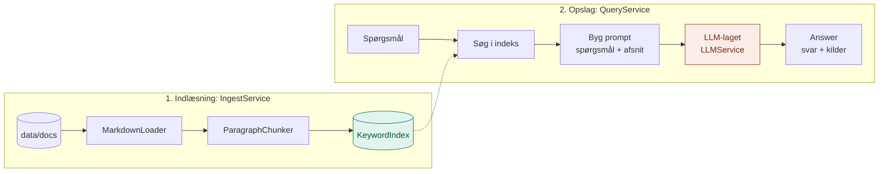
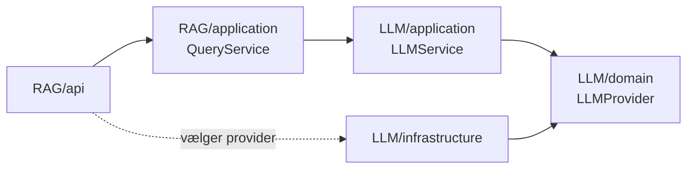

# RAG: Biblioteket (lag 2)

RAG (Retrieval-Augmented Generation) giver hjernen adgang til **vores egne dokumenter**.

Modellen bliver ikke trænet på vores viden. I stedet slår laget op i dokumenterne, *før* modellen bliver spurgt, og giver de relevante afsnit med i prompten. Modellen svarer så ud fra det, den lige har fået at læse.

## Hvorfor laget findes

LLM-laget kan ikke svare på noget, der kun står i vores egne dokumenter. Det var det, baseline-spørgsmålet i lag 1 viste:

> Hvor mange feriedage har man hos os, og hvem skal man kontakte?

Uden RAG gætter modellen eller må sige, at den ikke ved det. Med RAG får den afsnittet fra `ferie.md` med og kan svare korrekt og nævne kilden.

## Analogien: et bibliotek

Hvis LLM-laget er en klog person i et mørkt rum, så er RAG **biblioteket**. Du stiller et spørgsmål, bibliotekaren finder de mest relevante sider, og den kloge person læser dem, før hun svarer.

| Mappe | I biblioteket | Hvad den gør |
|---|---|---|
| `domain/` | Kartotekskortene og reglerne | Begreber (`Document`, `Chunk`, `SearchResult`, `Answer`) og kontrakter (`DocumentLoader`, `Chunker`, `SearchIndex`) |
| `application/` | Bibliotekaren | `IngestService` sætter bøger på plads, `QueryService` finder sider og spørger LLM-laget |
| `infrastructure/` | Reolerne, saksen og kartoteksskabet | Læser `.md`-filer, deler dem i afsnit, søger på ord |
| `api/` | Skranken og lederen | `cli.py`: tager imod spørgsmål og vælger delene |
| `config/` | Opslagstavlen | Dokumentmappe og antal afsnit |
| `data/docs/` | Bøgerne | De dokumenter, der kan søges i |

Hver mappe har sin egen README med detaljer.

## Struktur

```
RAG/
├── domain/
│   ├── models.py                   Document, Chunk, SearchResult, Answer
│   └── ports.py                    DocumentLoader, Chunker, SearchIndex
├── application/
│   ├── ingest_service.py           Indlæs → del op → læg i indeks
│   └── query_service.py            Søg → byg prompt → spørg LLM-laget
├── infrastructure/
│   ├── loaders/
│   │   └── markdown_loader.py      Læser .md-filer
│   ├── chunking/
│   │   └── text_chunker.py         Deler ved tomme linjer
│   └── index/
│       └── keyword_index.py        Søger på fælles ord
├── api/
│   └── cli.py                      Kommandolinje
├── config/
│   └── settings.py                 DOCS_FOLDER, TOP_K
└── data/docs/                      ferie.md, onboarding.md, it.md
```

## Flow: to faser



1. **Indlæsning** sker én gang: dokumenterne læses, deles i afsnit og lægges i indekset.
2. **Opslag** sker for hvert spørgsmål: indekset søges, de bedste afsnit lægges i prompten, og LLM-laget svarer.

Finder søgningen intet, bliver modellen slet ikke spurgt.

## Hvordan laget bruger lag 1

RAG-laget taler aldrig med Anthropic selv. `QueryService` får en `LLMService` fra lag 1 og kalder `ask()`. Alt det, lag 1 gør (validering, logning, valg af model), gælder derfor også her.



## Afhængighedsreglen

Den samme som i lag 1: alle afhængigheder peger ind mod `domain/`, og `domain/` afhænger af intet.

## Kom i gang

Fra projektets rod:

```bash
# Uden API-nøgle: søgningen virker fuldt ud, kun svaret er falsk
python -m RAG.api.cli "Hvor mange feriedage har man hos os, og hvem skal man kontakte?" --fake

# Med rigtig model
python -m RAG.api.cli "Hvor mange feriedage har man hos os, og hvem skal man kontakte?"
```

Output viser altid de fundne afsnit før svaret, så man kan vurdere søgningen for sig.

## Brug fra andre lag

```python
from LLM.application.llm_service import LLMService
from LLM.infrastructure.providers.anthropic_provider import AnthropicProvider
from RAG.application.ingest_service import IngestService
from RAG.application.query_service import QueryService
from RAG.config import settings
from RAG.infrastructure.chunking.text_chunker import ParagraphChunker
from RAG.infrastructure.index.keyword_index import KeywordIndex
from RAG.infrastructure.loaders.markdown_loader import MarkdownLoader

index = KeywordIndex()
IngestService(MarkdownLoader(settings.DOCS_FOLDER), ParagraphChunker(), index).run()

llm = LLMService(AnthropicProvider(), system="Svar kort på dansk.")
rag = QueryService(index, llm)

answer = rag.ask("Hvordan kontakter jeg IT?")
print(answer.text)
for source in answer.sources:
    print(source.chunk.source)
```

Agent-laget kan senere bruge `index.search()` direkte som et værktøj (agentisk RAG), i stedet for at gå gennem `QueryService` (klassisk RAG).

## Udvid laget

| Jeg vil... | Så gør jeg... |
|---|---|
| Tilføje dokumenter | Læg `.md`-filer i `data/docs/` |
| Læse PDF'er | Lav `infrastructure/loaders/pdf_loader.py` og vælg den i `api/cli.py` |
| Dele tekst anderledes | Lav en ny chunker i `infrastructure/chunking/` |
| Søge på betydning | Lav `infrastructure/index/embedding_index.py` med `add()` og `search()` |
| Sende flere afsnit med | Ret `TOP_K` i `config/settings.py` |

## Kendt begrænsning

Ordsøgningen ser kun på hele, ens ord. Spørg om *feriedage*, og den finder afsnittet med "25 feriedage", men ikke "Spørgsmål om **ferie** rettes til HR". Samme med "kontakte" og "kontaktes".

Det er bevidst. Den kører uden internet, nøgle og ekstra pakker, og den gør begrænsningen synlig. Det er baseline for en bedre søgning (`embedding_index.py`), præcis som lag 1's baseline var argumentet for RAG.
