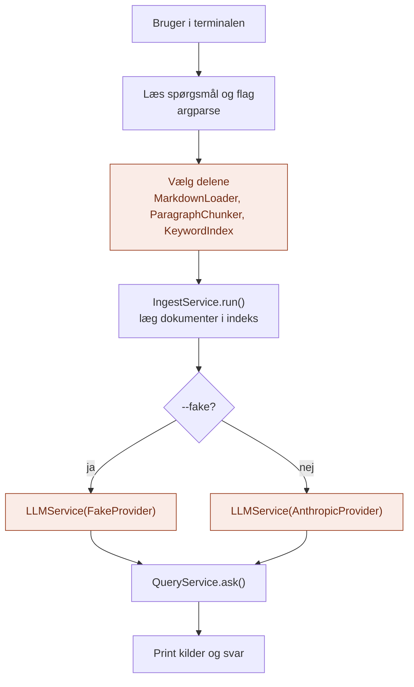

# api/

`api/` er RAG-lagets **hoveddør**: der, hvor omverdenen kommer ind.

Den svarer på spørgsmålet: **Hvordan bruger man det her lag udefra?**

## Analogien

Hvis `domain/` er kartotekskortene, `application/` er bibliotekaren, og `infrastructure/` er reolerne og kartoteksskabet, så er `api/` **skranken** og **bibliotekets leder**.

Gæsterne stiller deres spørgsmål ved skranken. Og før biblioteket åbner, er det lederen, der bestemmer, hvilke reoler og hvilket kartotek der bruges, og sørger for, at bøgerne er sat på plads.

## Flow



De orange bokse er det, der gør `api/` særlig: her bliver alle delene valgt og sat sammen.

## Indhold

| Fil | Hvad den indeholder |
|---|---|
| `cli.py` | Kommandolinjen: indlæs dokumenterne og stil et spørgsmål |

## Hvad api gør

1. **Tager imod input udefra** (terminal, senere HTTP eller agent-laget)
2. **Samler laget:** vælger loader, chunker, indeks og LLM-provider
3. **Fylder indekset** med `IngestService`
4. **Kalder** `QueryService` og viser kilder og svar

## Hvad hører ikke til her

- Rækkefølgen i indlæsning og opslag: det er `application/`
- Begreber og kontrakter: det er `domain/`
- At læse filer eller søge: det er `infrastructure/`

`api/` skal være tynd. Den sætter delene sammen og viser resultatet.

## Afhængigheder

`api/` er den eneste mappe, der kender både `application/` og `infrastructure/`, og den eneste, der vælger LLM-provider fra lag 1.

```
api/ ──► application/ ──► domain/ ◄── infrastructure/
  └──────────────────────────────────────────┘
          (vælger adaptere)
```

## Brug

```bash
python -m RAG.api.cli "Hvor mange feriedage har man hos os?" --fake
python -m RAG.api.cli "Hvor mange feriedage har man hos os?"
```

Med `--fake` virker søgningen fuldt ud. Kun selve svaret er falsk, så man kan se præcis, hvilke afsnit modellen ville have fået.

## Den hurtige test

Spørg om en kodelinje: **Handler den om, hvordan nogen udefra taler med laget, eller om at sætte delene sammen?**

- **Ja:** den hører til i `api/`.
- **Nej:** den hører til et af de andre steder.

## Hvorfor

- **Ét sted at skifte.** Ny loader, ny opdeling eller ny søgning vælges her og kun her.
- **Synlige kilder.** CLI'en viser altid de fundne afsnit, så søgningen kan vurderes for sig.
- **Resten forbliver ren.** Hverken `application/` eller `domain/` ved, hvilke adaptere der er valgt.
