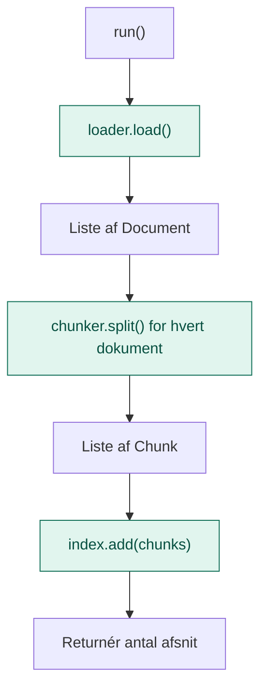
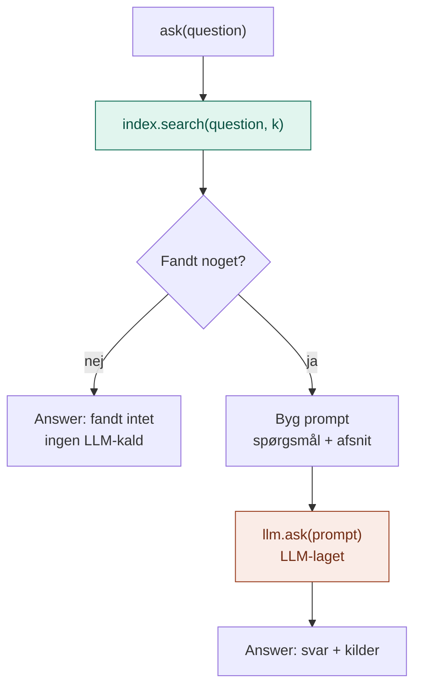

# application/

`application/` indeholder RAG-lagets **use cases**: de konkrete ting, laget kan gøre for resten af systemet.

Den svarer på spørgsmålet: **Hvad kan man bruge det her lag til, og hvordan forløber det?**

## Analogien

Hvis `domain/` er kartotekskortene og reglerne, så er `application/` **bibliotekaren**.

Bibliotekaren gør to ting: Hun sætter nye bøger på plads i kartoteket. Og når nogen stiller et spørgsmål, finder hun de rigtige sider og giver dem til den kloge person (LLM-laget), som læser dem og svarer. Hun ved ikke, hvilke reoler biblioteket har, eller hvordan kartoteket er bygget.

## Flow

**Indlæsning** (`IngestService.run()`):



**Opslag** (`QueryService.ask()`):



De grønne bokse går gennem portene i `domain/`. Den orange er det eneste sted, hvor RAG-laget bruger hjernen fra lag 1.

## Indhold

| Fil | Hvad den indeholder |
|---|---|
| `ingest_service.py` | `IngestService`: indlæs → del op → læg i indeks |
| `query_service.py` | `QueryService`: søg → byg prompt → spørg LLM-laget |

### IngestService

| Metode | Bruges når |
|---|---|
| `run()` | Dokumenterne skal lægges i indekset. Køres én gang, eller når dokumenterne ændrer sig. |

### QueryService

| Metode | Bruges når |
|---|---|
| `ask(question)` | Et spørgsmål skal besvares ud fra dokumenterne. Returnerer svaret og kilderne. |

Rundt om hvert opslag sørger servicen for:

- **Ingen gætteri:** finder søgningen intet, kaldes modellen slet ikke
- **Fast instruktion:** modellen bliver bedt om kun at svare ud fra konteksten og nævne kilden
- **Kilder med svaret:** så brugeren kan tjekke det, og fejl kan spores til søgning eller model

## Hvad hører ikke til her

- At læse filer eller søge i tekst: det er `infrastructure/`
- At vælge mappe, antal resultater eller adaptere: det er `api/` og `config/`
- At tale med Anthropic: det er LLM-laget

## Afhængigheder

`application/` importerer fra sit eget `domain/` og bruger `LLMService` fra lag 1. Aldrig fra `infrastructure/`.

```
api/ ──► application/ ──► domain/ ◄── infrastructure/
              │
              └──► LLM-laget (lag 1)
```

## Dependency injection

Begge services **får** deres dele udefra:

```python
ingest = IngestService(loader, chunker, index)
query = QueryService(index, llm, k=3)
```

Bemærk, at de to services deler **samme indeks**. Det, der lægges ind med `IngestService`, er det, `QueryService` søger i.

## Den hurtige test

Spørg om en kodelinje: **Beskriver den, hvordan en opgave forløber, uden at nævne en bestemt teknologi?**

- **Ja:** den hører til i `application/`.
- **Nej, den beskriver et begreb eller en kontrakt:** `domain/`.
- **Nej, den læser filer eller søger i tekst:** `infrastructure/`.

## Hvorfor

- **Klar rækkefølge.** Indlæsning og opslag er beskrevet trin for trin ét sted.
- **Billigere og ærligere.** Ingen relevante afsnit betyder intet kald og intet opdigtet svar.
- **Genbrug af lag 1.** RAG-laget taler aldrig med modellen selv, det bruger `LLMService`.
