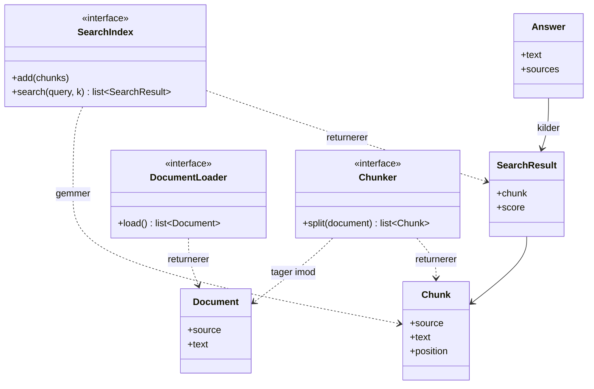
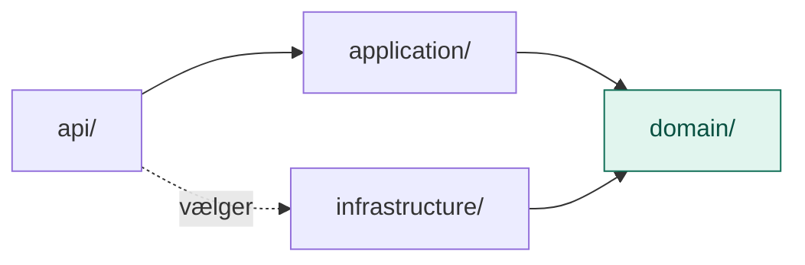

# domain/

`domain/` er RAG-lagets kerne af begreber og regler, beskrevet i lagets eget sprog og helt uden teknik.

Den svarer på spørgsmålet: **Hvad handler det her lag om?** Ikke *hvordan* det bliver gjort.

## Analogien: et bibliotek

`domain/` er **kartotekskortene og reglerne for at slå op**. De siger, hvad en bog er, hvad en side er, og at man skal kunne slå op i et kartotek. De siger ikke, hvilke reoler biblioteket har, eller hvordan kartoteket er bygget.

## Flow

Hvad domain består af:

Hvem der afhænger af domain:

Alle pile peger ind mod `domain/`. Ingen pil peger ud.

## Indhold

| Fil | Hvad den indeholder |
|---|---|
| `models.py` | De ting, laget arbejder med |
| `ports.py` | De ting, laget har brug for udefra, beskrevet som kontrakter |

### Modeller (`models.py`)

| Model | Hvad det er | Hvorfor |
|---|---|---|
| `Document` | Et helt dokument med kilde og tekst | Kilden følger med hele vejen til svaret |
| `Chunk` | Et afsnit af et dokument | Små afsnit giver præcise opslag og billigere kald |
| `SearchResult` | Et afsnit med en score | De bedste kommer først, irrelevante sorteres fra |
| `Answer` | Svaret og de afsnit, det bygger på | Brugeren kan tjekke svaret, og fejl kan spores |

### Porte (`ports.py`)

| Port | Hvad den lover | Hvorfor |
|---|---|---|
| `DocumentLoader` | `load()`: henter dokumenter | Kilden kan skifte fra filer til PDF, SharePoint eller database |
| `Chunker` | `split()`: deler et dokument op | Opdeling er noget, man eksperimenterer med |
| `SearchIndex` | `add()` og `search()` | Ordsøgning kan skiftes til søgning på betydning |

## Hvad hører ikke til her

- Kode, der læser filer, eller søgealgoritmer
- Imports af biblioteker til PDF, vektordatabaser eller embeddings
- Konfiguration som mappestier og antal resultater

Det hører til i `infrastructure/` og `config/`.

## Den hurtige test

Spørg om en fil: **Skulle den ændres, hvis vi skiftede fra .md-filer til SharePoint, eller fra ordsøgning til embeddings?**

- **Nej:** den hører til i `domain/`.
- **Ja:** den hører til i `infrastructure/`.

## Hvorfor

- **Stabilt.** Hvad et dokument og et afsnit er, ændrer sig sjældent. Hvor dokumenterne ligger, og hvordan man søger, ændrer sig ofte.
- **Udskifteligt.** Hver port kan få en ny adapter uden at resten af laget mærker det.
- **Fælles sprog.** Man taler om `Chunk` og `SearchResult`, ikke om filstier og indeks-detaljer.
