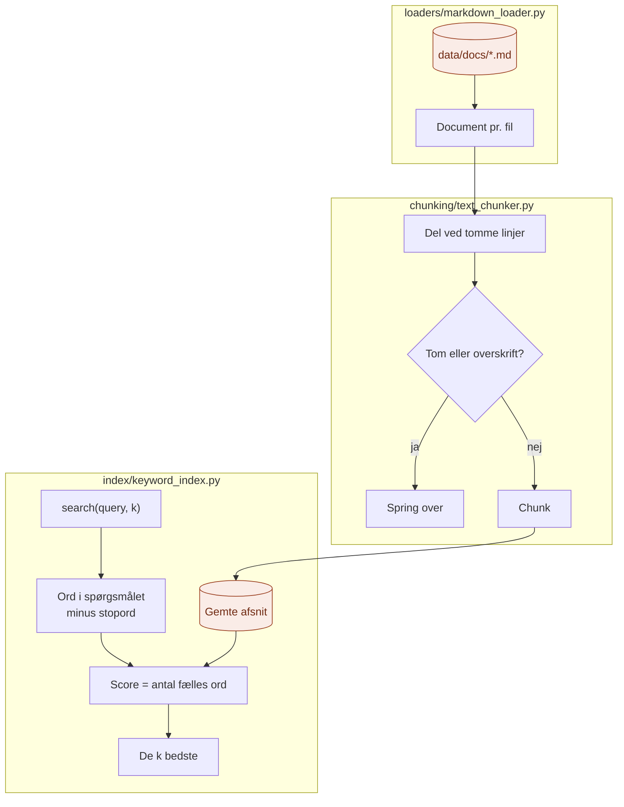

# infrastructure/

`infrastructure/` er der, hvor RAG-laget møder **den rigtige teknologi**: filer, tekstbehandling og søgning.

Den svarer på spørgsmålet: **Hvordan bliver det faktisk gjort?**

## Analogien

Hvis `domain/` er kartotekskortene og reglerne, og `application/` er bibliotekaren, så er `infrastructure/` **reolerne, saksen og kartoteksskabet**.

- **Reolerne** er der, hvor bøgerne står (`loaders/`)
- **Saksen** klipper bøgerne op i sider (`chunking/`)
- **Kartoteksskabet** er der, hvor man slår op (`index/`)

Bibliotekaren ved, at de findes, men ikke hvordan de er bygget.

## Flow



De orange bokse er det eneste, der rører filsystem og lager. Resten af laget ser kun `Document`, `Chunk` og `SearchResult`.

## Indhold

| Fil | Opfylder porten | Hvad den gør |
|---|---|---|
| `loaders/markdown_loader.py` | `DocumentLoader` | Læser alle `.md`-filer fra en mappe |
| `chunking/text_chunker.py` | `Chunker` | Deler tekst ved tomme linjer og springer overskrifter over |
| `index/keyword_index.py` | `SearchIndex` | Gemmer afsnit i hukommelsen og søger på fælles ord |

## Hvordan ordsøgningen virker

1. Spørgsmålet laves om til små bogstaver og deles i ord.
2. Stopord som "og", "har" og "hvor" fjernes, fordi de står overalt.
3. Hvert afsnit får ét point for hvert ord, det deler med spørgsmålet.
4. De afsnit med flest point returneres.

Det er simpelt med vilje. Den kan ikke se, at "kontakte" og "kontaktes" er beslægtede, eller at "fridage" og "ferie" betyder næsten det samme. Til gengæld kører den uden internet, uden API-nøgle og uden ekstra pakker.

## Hvad hører ikke til her

- Rækkefølgen af trin i indlæsning og opslag: det er `application/`
- Valget af, hvilken adapter der bruges: det er `api/`
- Begreber og kontrakter: det er `domain/`

## Afhængigheder

```
api/ ──► application/ ──► domain/ ◄── infrastructure/
```

## Ny adapter?

| Jeg vil... | Så laver jeg... |
|---|---|
| Læse PDF'er | `loaders/pdf_loader.py` med `load()` |
| Dele efter overskrifter eller antal ord | `chunking/heading_chunker.py` med `split()` |
| Søge på betydning i stedet for ord | `index/embedding_index.py` med `add()` og `search()` |

Vælg den nye adapter i `api/cli.py`. Intet andet skal ændres.

## Den hurtige test

Spørg om en fil: **Læser den filer, behandler den tekst, eller gemmer og søger den data på en bestemt måde?**

- **Ja:** den hører til i `infrastructure/`.
- **Nej:** den hører til et af de andre steder.

## Hvorfor

- **Teknologien er isoleret.** Filer og søgealgoritme ligger kun her.
- **Let at eksperimentere.** Bedre opdeling eller bedre søgning er én ny fil.
- **Kører overalt.** Den simple ordsøgning kræver ingenting, så laget kan prøves af uden nøgle.
