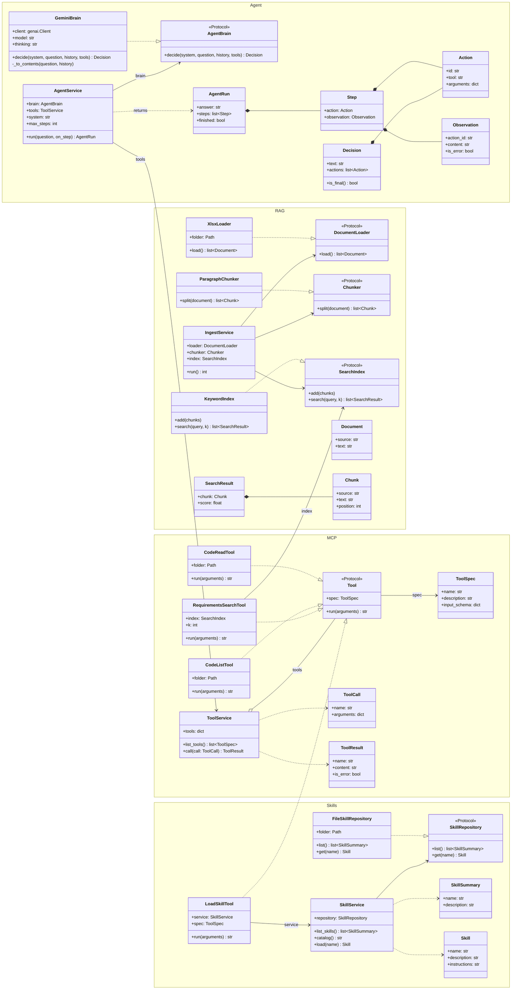
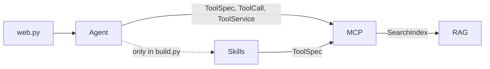

# Kodetjek demo

A developer asks: *"Does our code solve this user story?"* An AI agent looks up the user story and its acceptance criteria, reads the developer's code, and answers with a verdict per criterion and a `file:line` reference.

## Run the demo

Python 3.10+. Run everything from the `Kodetjek/` folder.

```bash
pip install -r requirements.txt
```

1. Set `CODE_FOLDER` in `settings.py` to the code to check.
2. Put a Gemini key from Google AI Studio in `local_secrets.py` (ignored by git):
   ```python
   GEMINI_API_KEY = "your-key"
   ```
3. Start the page:
   ```bash
   python -m Agent.api.web
   ```
4. Open http://localhost:8000 and ask a question.

## Questions to ask

Include the title, because the same US id exists in several sheets.

- Does our code solve US-005 Download faktura?
- Does our code solve US-002 Ingen regninger tilgængelige?
- Does our code solve US-002 Opdater telefonnummer?

The page shows each step live, then the verdict: **Solved**, **Partly solved** or **Not solved**.

## The flow

Each step is marked in the code with a comment like `# 13: TÆNK`. Search for `# 13:` to jump to it.

**When the server starts (once)**

| # | Step | Where |
|---|---|---|
| 1 | START | `Agent/api/web.py` · `main()` |
| 2 | Build the agent | `Agent/api/build.py` · `build_agent()` |
| 3 | Skills | `Skills/api/build.py` · `build_service()` |
| 4 | Tools | `MCP/api/build.py` · `build_service()` |
| 5 | Load the requirements | `RAG/application/ingest_service.py` · `run()` |
| 6 | Read the xlsx files | `RAG/infrastructure/loaders/xlsx_loader.py` · `load()` |
| 7 | Split into user stories and test cases | `RAG/infrastructure/chunking/text_chunker.py` · `split()` |
| 8 | Store in the search index | `RAG/infrastructure/index/keyword_index.py` · `add()` |
| 9 | Assemble tools, system prompt and Gemini | `Agent/api/build.py` · `build_agent()` |
| 10 | Wait for a question | `Agent/api/web.py` · `main()` |

**For each question**

| # | Step | Where |
|---|---|---|
| 11 | Question arrives | `Agent/api/web.py` · `do_GET()` |
| 12 | Agent loop starts | `Agent/application/agent_service.py` · `run()` |
| 13 | Gemini thinks | `Agent/infrastructure/brains/gemini_brain.py` · `decide()` |
| 14 | Done? If yes, go to 19 | `agent_service.py` |
| 15 | Call the tools Gemini asked for | `agent_service.py` |
| 16 | Tool runs | `MCP/application/tool_service.py` · `call()` |
| 16a | `load_skill`: answer format | `Skills/api/skill_tool.py` |
| 16b | `search_requirements`: keyword search | `MCP/infrastructure/tools/requirements_search_tool.py` |
| 16c | `list_code_files`: files in `CODE_FOLDER` | `MCP/infrastructure/tools/code_list_tool.py` |
| 16d | `read_code_file`: one file with line numbers | `MCP/infrastructure/tools/code_read_tool.py` |
| 17 | Results go into the history | `agent_service.py` |
| 18 | Step shown on the page, back to 13 | `web.py` · `render_step()` |
| 19 | Answer ready | `agent_service.py` |
| 20 | OUTPUT: answer shown on the page | `web.py` · `render_markdown()` |

Gemini decides which tools to call and in which order. The code only runs the loop.

## Classes

Each layer has the same shape: **domain** (data and ports), **application** (one service) and **infrastructure** (adapters that do the real work). Ports are marked `<<Protocol>>`. The adapters don't inherit from them; they just have the same methods (dotted arrow). Services only know the ports, never the adapters.



`LoadSkillTool` lives in Skills but behaves like an MCP tool, so the agent sees it next to the other three. `History` is not a class but a list of `Decision`s and lists of `Observation`s.

## Dependencies

An arrow means "imports". Only three dependencies cross layers: Agent uses MCP's types, MCP uses RAG's `SearchIndex` port, and Skills uses MCP's `ToolSpec`. RAG depends on no other layer.



File by file. Only the three `api/build.py` files read `settings.py`; everything else gets its values passed in. `Agent/api/build.py` is the one place where all four layers meet.

```mermaid
flowchart TD
  web["Agent/api/web.py"]
  settings[["settings.py"]]

  subgraph AGENT["Agent"]
    abuild["api/build.py"]
    asvc["application/agent_service.py"]
    agem["infrastructure/brains/gemini_brain.py"]
    aports["domain/ports.py"]
    amodels["domain/models.py"]
  end

  subgraph MCPL["MCP"]
    mbuild["api/build.py"]
    msvc["application/tool_service.py"]
    msearch["infrastructure/tools/requirements_search_tool.py"]
    mlist["infrastructure/tools/code_list_tool.py"]
    mread["infrastructure/tools/code_read_tool.py"]
    mports["domain/ports.py"]
    mmodels["domain/models.py"]
  end

  subgraph RAGL["RAG"]
    ringest["application/ingest_service.py"]
    rxlsx["infrastructure/loaders/xlsx_loader.py"]
    rchunk["infrastructure/chunking/text_chunker.py"]
    rindex["infrastructure/index/keyword_index.py"]
    rports["domain/ports.py"]
    rmodels["domain/models.py"]
  end

  subgraph SKL["Skills"]
    sbuild["api/build.py"]
    stool["api/skill_tool.py"]
    ssvc["application/skill_service.py"]
    srepo["infrastructure/file_skill_repository.py"]
    sports["domain/ports.py"]
    smodels["domain/models.py"]
  end

  web --> abuild
  web --> amodels

  abuild --> settings
  abuild --> asvc
  abuild --> agem
  abuild --> mbuild
  abuild --> msvc
  abuild --> sbuild
  abuild --> stool

  asvc --> amodels
  asvc --> aports
  asvc --> msvc
  asvc --> mmodels
  agem --> amodels
  agem --> mmodels
  aports --> amodels
  aports --> mmodels

  mbuild --> settings
  mbuild --> msvc
  mbuild --> msearch
  mbuild --> mlist
  mbuild --> mread
  mbuild --> ringest
  mbuild --> rxlsx
  mbuild --> rchunk
  mbuild --> rindex
  msvc --> mmodels
  msvc --> mports
  mports --> mmodels
  msearch --> mmodels
  msearch --> rports
  mlist --> mmodels
  mread --> mmodels

  ringest --> rports
  rports --> rmodels
  rxlsx --> rmodels
  rchunk --> rmodels
  rindex --> rmodels

  sbuild --> settings
  sbuild --> ssvc
  sbuild --> srepo
  stool --> mmodels
  stool --> ssvc
  ssvc --> smodels
  ssvc --> sports
  sports --> smodels
  srepo --> smodels
```



## Configuration

Everything is in `settings.py`: `GEMINI_MODEL`, `GEMINI_THINKING`, `CODE_FOLDER`, `SYSTEM_PROMPT`, `MAX_STEPS`. The answer format is in `Skills/data/skills/code-review/SKILL.md`.

## Limitations

- **Keyword search.** It only matches whole words, and the requirements are in Danish, so the agent searches with ids and Danish words.
- **Every file name on every step.** `list_code_files` returns all files, which is slow on a large solution.
- **Free Gemini tier.** It is slow, and Google may use what is sent, including the code being checked.
