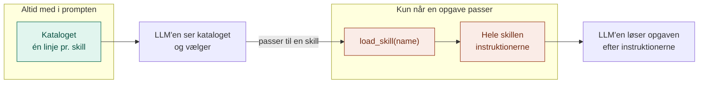
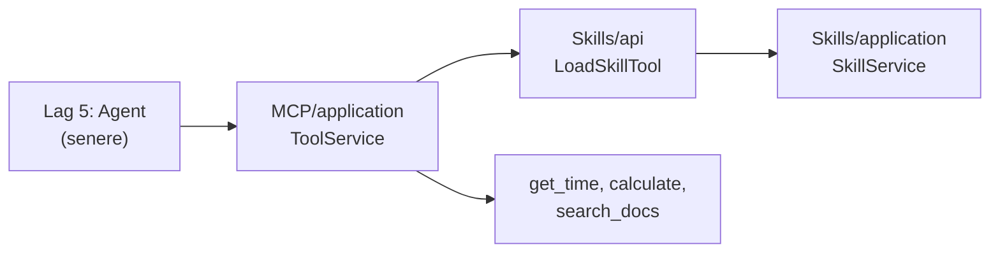

# Skills: Muskelhukommelsen (lag 4)

Skills er **genbrugelig know-how**: faste opskrifter på, hvordan bestemte opgaver løses hos os. Fx hvordan vi skriver mails, referater eller rykkere.

En skill er bare en tekstfil med instruktioner. LLM'en ser altid en kort liste over, hvilke skills der findes, men henter først de fulde instruktioner, når en opgave passer til en af dem.

## Hvorfor laget findes

| Uden skills | Med skills |
|---|---|
| LLM'en skriver en mail, som den selv synes | Mailen følger vores faste form |
| Al know-how skal stå i systemprompten, hver gang | Kun en linje pr. skill står der. Resten hentes ved behov. |
| Kun den, der kan programmere, kan ændre adfærden | Alle kan skrive en `SKILL.md` |

Lagene supplerer hinanden: RAG giver **viden** (hvad står der i reglerne), MCP giver **handling** (søg, regn), og Skills giver **fremgangsmåde** (sådan gør vi).

## Analogien: en musiker med en nodemappe

Infografikken kalder skills for **muskelhukommelse**. Tænk på en musiker: hun kender titlerne på alle sine numre, men tager først nodearket frem, når hun skal spille et bestemt nummer.

| Mappe | Hos musikeren | Hvad den gør |
|---|---|---|
| `domain/` | Formatet for et nodeark | Begreber (`SkillSummary`, `Skill`) og reolen som kontrakt (`SkillRepository`) |
| `application/` | Musikerens vane | `SkillService`: laver indholdsfortegnelsen og henter det rigtige nodeark |
| `infrastructure/` | Reolen | Læser skills fra mapper med en `SKILL.md` |
| `api/` | Døren til øvelokalet | Terminalen, og `load_skill` som værktøj i MCP-lagets stik |
| `config/` | Opslagstavlen | Hvor skillene ligger |
| `data/skills/` | Noderne | `mail`, `referat` og `rykker` |

Hver mappe har sin egen README med detaljer.

## Struktur

```
Skills/
├── domain/
│   ├── models.py                   SkillSummary, Skill
│   └── ports.py                    SkillRepository
├── application/
│   └── skill_service.py            SkillService: list_skills(), catalog(), load()
├── infrastructure/
│   └── file_skill_repository.py    Læser data/skills/*/SKILL.md
├── api/
│   ├── build.py                    Vælger reolen
│   ├── cli.py                      Kommandolinje
│   └── skill_tool.py               load_skill som værktøj til lag 3
├── config/
│   └── settings.py                 SKILLS_FOLDER
└── data/skills/
    ├── mail/SKILL.md
    ├── referat/SKILL.md
    └── rykker/SKILL.md
```

## Flow: indlæs kun ved behov



Med tre skills er forskellen lille. Med 50 er den stor: LLM'en skal kun læse 50 korte linjer, ikke 50 sider instruktioner.

## Hvordan laget bruger lag 1 til 3

- **Lag 1 (LLM) bruges ikke direkte.** Skills-laget kalder aldrig modellen. Det er LLM'en i lag 5, der læser kataloget og beder om en skill.
- **Lag 3 (MCP)** er den vej, agenten henter skills ad. `LoadSkillTool` passer i stikket `Tool`, så for agenten er en skill bare endnu et værktøj.
- **Lag 2 (RAG) og lag 3** bliver nævnt *inde i* skillen `rykker`, som beder LLM'en bruge `search_docs` og `calculate`. En skill kan altså fortælle, hvilke værktøjer der skal bruges hvordan.



## Afhængighedsreglen

Den samme som i de andre lag: alle afhængigheder peger ind mod `domain/`, og `domain/` afhænger af intet. Kun `api/skill_tool.py` kender til MCP-laget.

## Kom i gang

Fra projektets rod. Ingen API-nøgle og ingen ekstra pakker.

```bash
python -m Skills.api.cli list
python -m Skills.api.cli catalog
python -m Skills.api.cli show rykker
python -m Skills.api.cli show digt
```

`catalog` viser præcis det, LLM'en altid får at se. Det sidste kald viser fejlen, når en skill ikke findes.

## Brug fra andre lag

```python
from MCP.api.build import build_service as build_tools
from MCP.application.tool_service import ToolService
from Skills.api.build import build_service as build_skills
from Skills.api.skill_tool import LoadSkillTool

skills = build_skills()

# Til systemprompten
print(skills.catalog())

# Som værktøj sammen med lag 3's værktøjer
mcp_tools = build_tools()
tools = ToolService(list(mcp_tools.tools.values()) + [LoadSkillTool(skills)])
```

## Skriv en ny skill

1. Lav en mappe i `data/skills/`, fx `data/skills/boganbefaling/`.
2. Læg en `SKILL.md` i den:

```markdown
---
name: boganbefaling
description: Brug når en låner beder om forslag til, hvad de skal læse.
---

# Sådan anbefaler vi bøger

- Spørg først om én bog, låneren har været glad for.
- Foreslå højst tre bøger, med én linje om hvorfor.
```

3. Kør `python -m Skills.api.cli catalog`. Den nye skill er med, uden at der er ændret en linje kode.

## Godt at vide

- **Beskrivelsen afgør alt.** LLM'en vælger kun ud fra `description`. Skriv, *hvornår* skillen skal bruges, ikke hvad der står i den. Start gerne med "Brug når ...".
- **`name` skal matche mappens navn**, fordi `get()` finder skillen ud fra mappen.
- **Formatet minder om Claudes eget skill-format**, så skillene kan bruges andre steder senere.
