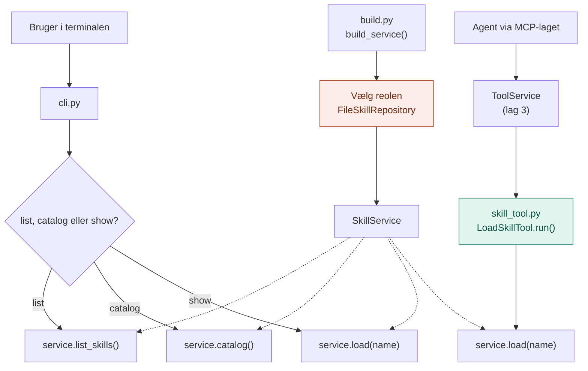

# api/

`api/` er Skills-lagets **døre**: der, hvor omverdenen kommer ind.

Den svarer på spørgsmålet: **Hvordan bruger man det her lag udefra?**

## Analogien

Hvis `domain/` er formatet for et nodeark, `application/` er musikerens vane, og `infrastructure/` er reolen, så er `api/` **døren til øvelokalet**.

Der er to måder at bede musikeren om noder på:
- **Du går selv ind** (`cli.py`) og beder hende vise indholdsfortegnelsen eller et bestemt nodeark.
- **Gennem husets stikkontakt** (`skill_tool.py`). Fra lag 3 kender vi huset med stikkontakter. `load_skill` er et apparat med det rigtige stik, så agenten kan bede om et nodeark på præcis samme måde, som den beder om klokken eller en søgning.

## Flow



Den orange boks er, hvor reolen bliver valgt. Den grønne er broen til lag 3: et værktøj, der passer i MCP-lagets stik.

## Indhold

| Fil | Hvad den indeholder |
|---|---|
| `build.py` | `build_service()`: vælger reolen og bygger `SkillService` |
| `cli.py` | Kommandolinjen: `list`, `catalog` og `show` |
| `skill_tool.py` | `LoadSkillTool`: gør `load()` til et værktøj, der opfylder `Tool` fra lag 3 |

## LoadSkillTool

Værktøjet har samme form som `get_time`, `calculate` og `search_docs` i lag 3:

| Del | Værdi |
|---|---|
| `spec.name` | `load_skill` |
| `spec.description` | Henter de fulde instruktioner for en skill fra kataloget |
| `spec.input_schema` | `name`, begrænset til de skills, der faktisk findes |
| `run()` | Returnerer skillens instruktioner som tekst |

Fordi listen af tilladte navne laves ud fra reolen, kan LLM'en kun vælge skills, der eksisterer. Og staver den alligevel forkert, fanger sikringen i `ToolService` fejlen og sender listen over rigtige navne tilbage.

## Hvad hører ikke til her

- At lave kataloget og hente skills: det er `application/`
- At læse filer: det er `infrastructure/`
- Begreber og kontrakter: det er `domain/`

## Afhængigheder

`api/` er den eneste mappe, der kender både `application/`, `infrastructure/` og MCP-laget.

```
api/ ──► application/ ──► domain/ ◄── infrastructure/
  │
  └──► MCP/domain (ToolSpec), så load_skill passer i stikket
```

## Brug

```bash
python -m Skills.api.cli list
python -m Skills.api.cli catalog
python -m Skills.api.cli show rykker
python -m Skills.api.cli show digt
```

`catalog` viser præcis det, LLM'en får at se. Det sidste kald viser fejlen, når en skill ikke findes.

## Den hurtige test

Spørg om en kodelinje: **Handler den om, hvordan nogen udefra taler med laget, eller om at vælge reolen?**

- **Ja:** den hører til i `api/`.
- **Nej:** den hører til et af de andre steder.

## Hvorfor

- **Ét sted at vælge.** Flytter skills til en database, ændres kun `build.py`.
- **Ingen særbehandling.** For agenten er en skill bare endnu et værktøj i samme stik.
- **Synligt katalog.** Man kan altid se, præcis hvad LLM'en får at vide om skillene.
