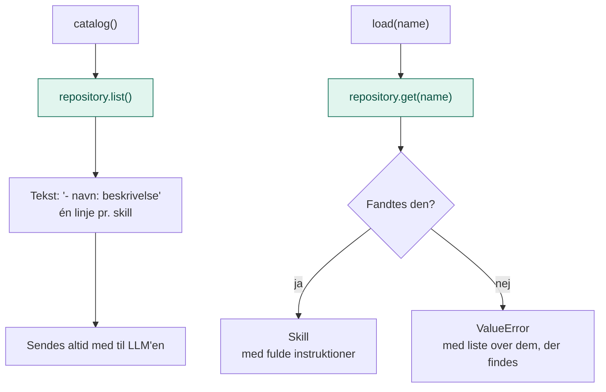

# application/

`application/` indeholder Skills-lagets **use cases**: de konkrete ting, laget kan gøre for resten af systemet.

Den svarer på spørgsmålet: **Hvad kan man bruge det her lag til, og hvordan forløber det?**

## Analogien

Hvis `domain/` er formatet for et nodeark og reglen om en reol, så er `application/` **musikerens vane**.

Hun skriver en indholdsfortegnelse over alle sine numre, så hun hurtigt kan se, hvad hun kan spille. Og når et nummer skal spilles, går hun til reolen og tager det rigtige nodeark frem. Står det der ikke, ved hun, hvilke andre hun har. Hun ved ikke, hvordan reolen er bygget.

## Flow



De grønne bokse går gennem porten `SkillRepository`. Det er de eneste steder, servicen rører reolen.

## Indhold

| Fil | Hvad den indeholder |
|---|---|
| `skill_service.py` | `SkillService`: laver kataloget og henter skills |

### SkillService

| Metode | Bruges når |
|---|---|
| `list_skills()` | Man vil have alle skills som objekter |
| `catalog()` | Man vil have indholdsfortegnelsen som tekst til LLM'ens systemprompt |
| `load(name)` | En skill skal bruges. Returnerer hele skillen med instruktioner. |

Rundt om hvert opslag sørger servicen for:

- **Et kort katalog:** én linje pr. skill, så det koster næsten intet at sende med hver gang
- **En hjælpsom fejl:** findes en skill ikke, siger fejlen, hvilke der findes. En LLM kan så prøve igen med det rigtige navn.

## Hvad hører ikke til her

- At læse `SKILL.md`-filer: det er `infrastructure/`
- At gøre `load()` til et værktøj, LLM'en kan kalde: det er `api/`
- Selve skillene: de ligger i `data/skills/`

## Afhængigheder

`application/` importerer kun fra `domain/`.

```
api/ ──► application/ ──► domain/ ◄── infrastructure/
```

## Dependency injection

Servicen **får** reolen udefra:

```python
service = SkillService(FileSkillRepository("Skills/data/skills"))
```

## Den hurtige test

Spørg om en kodelinje: **Beskriver den, hvordan skills findes og hentes, uden at nævne hvor de ligger?**

- **Ja:** den hører til i `application/`.
- **Nej, den beskriver et begreb eller en kontrakt:** `domain/`.
- **Nej, den læser filer:** `infrastructure/`.

## Hvorfor

- **Ét format til kataloget.** Alle steder, der viser skills til en LLM, får dem i samme form.
- **Fejl, man kan rette.** En LLM, der staver et navn forkert, får de rigtige navne tilbage.
- **Lille og genbrugelig.** Både terminalen og agent-laget bruger præcis samme service.
