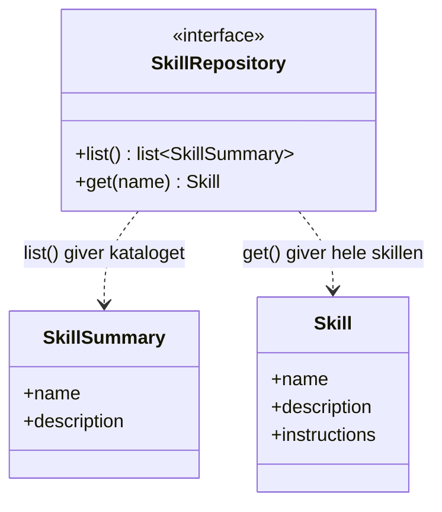
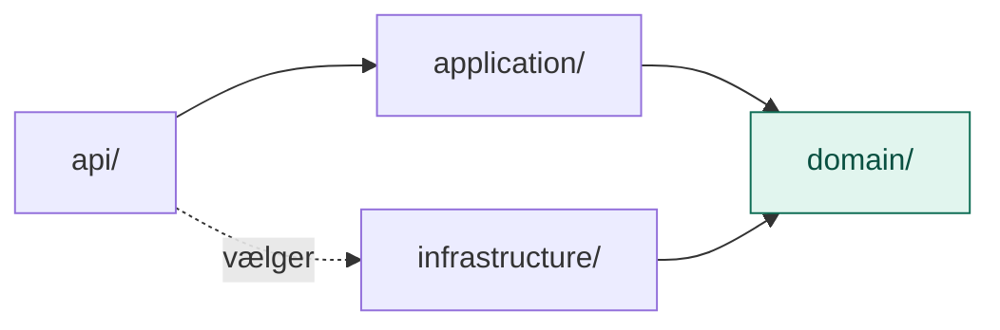

# domain/

`domain/` er Skills-lagets kerne af begreber og regler, beskrevet i lagets eget sprog og helt uden teknik.

Den svarer på spørgsmålet: **Hvad handler det her lag om?** Ikke *hvordan* det bliver gjort.

## Analogien: en musiker med en nodemappe

Infografikken kalder skills for **muskelhukommelse**: know-how til opgaver, man gør igen og igen. Tænk på en musiker. Hun kender titlerne på alle sine numre, men tager først nodearket frem, når hun skal spille et bestemt nummer.

`domain/` er **formatet for et nodeark** og **reglen om, at der skal være en reol med noder**. Det siger ikke, hvor reolen står, eller hvad der står på noderne.

| Begreb | Hos musikeren |
|---|---|
| `SkillSummary` | Titlen i indholdsfortegnelsen. Den kender hun altid. |
| `Skill` | Hele nodearket. Det tages kun frem, når nummeret skal spilles. |
| `SkillRepository` (port) | Reolen, hvor noderne står |

## Flow

Hvad domain består af:

Hvem der afhænger af domain:

Alle pile peger ind mod `domain/`. Ingen pil peger ud.

## Indhold

| Fil | Hvad den indeholder |
|---|---|
| `models.py` | `SkillSummary` og `Skill` |
| `ports.py` | `SkillRepository`: kontrakten for, hvor skills hentes fra |

### Modeller (`models.py`)

| Model | Hvad det er | Hvorfor |
|---|---|---|
| `SkillSummary` | Navn og beskrivelse | LLM'en ser den altid. Beskrivelsen skal sige, *hvornår* skillen bruges. |
| `Skill` | Navn, beskrivelse og instruktioner | Hentes kun ved behov. Instruktionerne er bare tekst, så alle kan skrive en skill. |

### Port (`ports.py`)

| Port | Hvad den lover | Hvorfor |
|---|---|---|
| `SkillRepository` | `list()` og `get(name)` | Skills kan ligge i mapper i dag og i en database i morgen |

## Hvorfor to modeller?

Det er hele idéen med skills: **indlæs kun ved behov**.

Med 50 skills ville det være dyrt og forvirrende at sende al deres tekst med hvert kald. I stedet ser LLM'en kun indholdsfortegnelsen. Når den kan se, at en opgave passer til en skill, beder den om hele nodearket.

## Hvad hører ikke til her

- Kode, der læser `SKILL.md`-filer: det er `infrastructure/`
- At lave kataloget om til tekst til LLM'en: det er `application/`
- Selve skillene: de ligger i `data/skills/`

## Den hurtige test

Spørg om en fil: **Skulle den ændres, hvis skills flyttede fra mapper til en database?**

- **Nej:** den hører til i `domain/`.
- **Ja:** den hører til i `infrastructure/`.

## Hvorfor

- **Billigt.** Kun kataloget sendes altid med. Indholdet kun ved behov.
- **Udskifteligt.** Skills kan flytte fra mapper til en database uden at resten af laget mærker det.
- **For alle.** En skill er bare tekst, så den kan skrives af den, der kender opgaven bedst.
