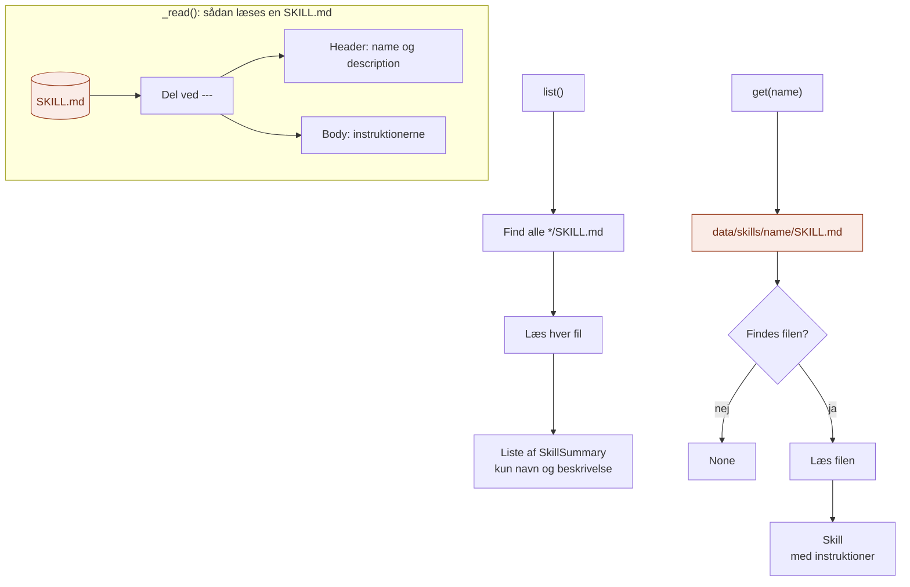

# infrastructure/

`infrastructure/` er der, hvor Skills-laget møder **den rigtige teknologi**: mapper og filer.

Den svarer på spørgsmålet: **Hvordan bliver det faktisk gjort?**

## Analogien

Hvis `domain/` er formatet for et nodeark, og `application/` er musikerens vane, så er `infrastructure/` **selve reolen**.

Reolen ved, hvor hvert nodeark står, og hvordan man tager det ud. Musikeren ved bare, at hun kan bede om et nummer og få nodearket.

## Flow



De orange bokse er det eneste, der rører filsystemet. Resten af laget ser kun `SkillSummary` og `Skill`.

## Indhold

| Fil | Opfylder porten | Hvad den gør |
|---|---|---|
| `file_skill_repository.py` | `SkillRepository` | Læser skills fra mapper med en `SKILL.md` i hver |

## Formatet for en SKILL.md

Hver skill er en mappe i `data/skills/` med en fil, der hedder `SKILL.md`:

```
data/skills/
├── mail/SKILL.md
├── referat/SKILL.md
└── rykker/SKILL.md
```

Filen har en header mellem to `---` og instruktionerne under:

```markdown
---
name: mail
description: Brug når brugeren vil have skrevet en mail til en kollega eller en låner.
---

# Sådan skriver vi mails

- Emnelinje på højst 6 ord.
- ...
```

| Felt | Hvad det er | Godt at vide |
|---|---|---|
| `name` | Skillens navn | Skal være det samme som mappens navn |
| `description` | Hvornår skillen skal bruges | Det er det eneste, LLM'en ser, før den vælger. Start gerne med "Brug når ..." |
| Brødtekst | Instruktionerne | Almindelig markdown. Hentes først, når skillen bruges. |

Formatet minder om det, Claude selv bruger til skills, så skillene kan flyttes med, hvis I senere vil bruge dem andre steder.

## Hvad hører ikke til her

- At lave kataloget om til tekst: det er `application/`
- At gøre en skill til et værktøj: det er `api/`
- Begreber og kontrakter: det er `domain/`

## Afhængigheder

```
api/ ──► application/ ──► domain/ ◄── infrastructure/
```

## Ny adapter?

| Jeg vil... | Så laver jeg... |
|---|---|
| Hente skills fra en database | `database_skill_repository.py` med `list()` og `get()` |
| Dele skills mellem flere teams | En adapter, der læser fra et fælles sted, fx et git-repo eller SharePoint |

Vælg den nye adapter i `api/build.py`. Intet andet skal ændres.

## Den hurtige test

Spørg om en fil: **Ved den, hvor skills ligger, og hvordan de er gemt?**

- **Ja:** den hører til i `infrastructure/`.
- **Nej:** den hører til et af de andre steder.

## Hvorfor

- **Ingen ekstra pakker.** Headeren læses med ren Python, ikke et YAML-bibliotek.
- **Én mappe pr. skill.** Senere kan en skill få eksempler eller skabeloner med i sin egen mappe.
- **Let at skifte.** Flytter skills til en database, er det én ny fil.
