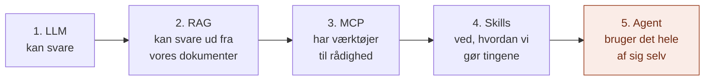
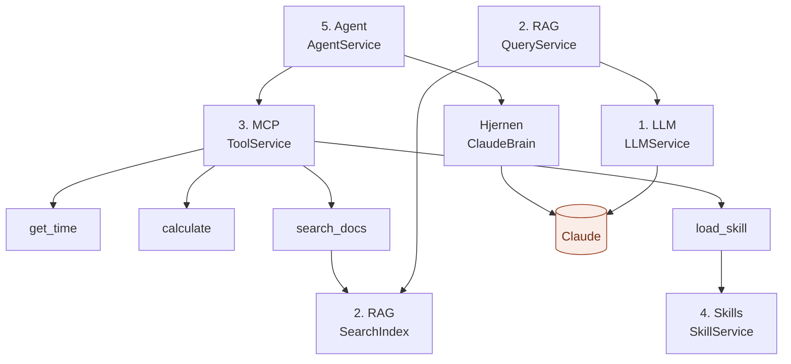
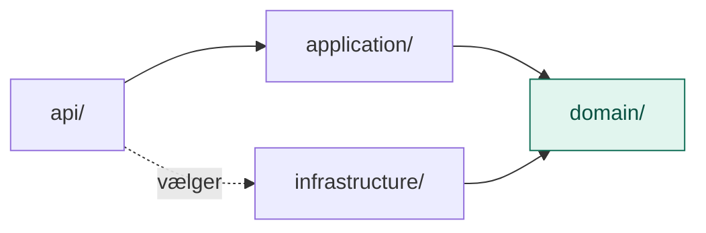

# Agent Anatomy POC

Et proof of concept, der bygger AI-stakken op **ét lag ad gangen**, så man kan se, hvad hver del gør, hvorfor den findes, og hvordan delene spiller sammen.

Udgangspunktet er infografikken *"Your AI Stack, Explained Like a Human Body"*:

| # | Lag | I kroppen | Hvad det gør |
|---|---|---|---|
| 1 | **LLM** | Hjernen | Forstår, skriver og ræsonnerer. Kender kun det, den lærte under træningen. |
| 2 | **RAG** | Hjerne + bibliotek | Slår op i vores egne dokumenter før svaret |
| 3 | **MCP** | Nervesystemet | Ét standardstik til værktøjer, data og systemer |
| 4 | **Skills** | Muskelhukommelse | Genbrugelig know-how, der kun hentes, når den skal bruges |
| 5 | **Agent** | Hjerne + hænder | Planlægger selv skridtene og bruger værktøjer til at handle |

Hvert lag bygger kun på lagene under sig, og hvert lag kan prøves af for sig.

## Hvad hvert lag tilføjer



Hvert lag lukker et hul, laget før havde:

| Lag | Hullet, det lukker | Baseline, der viser hullet |
|---|---|---|
| 1. LLM | – | Spørg om noget i vores dokumenter: modellen kan ikke vide det |
| 2. RAG | Modellen kender ikke vores viden | Ordsøgningen kan ikke se, at "ferie" og "feriedage" hænger sammen |
| 3. MCP | Modellen kan ikke regne sikkert, se klokken eller selv slå op | Værktøjerne står klar, men ingen bruger dem af sig selv |
| 4. Skills | Modellen ved ikke, hvordan *vi* skriver mails, referater og rykkere | Skillene står klar, men ingen henter dem af sig selv |
| 5. Agent | Ingen binder det hele sammen | – |

## Hvordan lagene bruger hinanden



- **RAG** bruger LLM-laget til at svare.
- **MCP** bruger RAG-lagets indeks i `search_docs`.
- **Skills** gør sig tilgængelig som et værktøj i MCP-lagets stik (`load_skill`).
- **Agent** samler værktøjerne og skillene og lader Claude bestemme, hvad der skal bruges hvornår.

Intet lag kender lagene over sig.

## Samme arkitektur i alle lag

Alle fem lag er bygget efter **ports & adapters** (også kaldet hexagonal arkitektur), med de samme fem mapper:

| Mappe | Svarer på | Indhold |
|---|---|---|
| `domain/` | *Hvad handler laget om?* | Modeller og porte (kontrakter). Ingen teknik. |
| `application/` | *Hvordan forløber det?* | Services, der bruger portene |
| `infrastructure/` | *Hvordan bliver det faktisk gjort?* | Adaptere, der opfylder portene med rigtig teknologi |
| `api/` | *Hvordan bruger man laget udefra?* | Kommandolinje og andre indgange. Her vælges adapterne. |
| `config/` | *Hvilke indstillinger?* | Model, mapper, grænser |

Afhængighederne peger altid ind mod `domain/`:



Det er det, der gør det muligt at skifte model, dokumentkilde, søgning eller værktøjer ved at tilføje én fil i `infrastructure/`, uden at røre resten.

## Analogierne

Hvert lag har sin egen analogi, som går igen i lagets README-filer:

| Lag | Analogi | `domain/` | `application/` | `infrastructure/` | `api/` |
|---|---|---|---|---|---|
| LLM | En restaurant | Sedlen, tallerkenen og lugen | Tjeneren | Kokkene | Hoveddøren og chefen |
| RAG | Et bibliotek | Kartotekskortene | Bibliotekaren | Reolerne, saksen og kartoteket | Skranken og lederen |
| MCP | Et hus med stikkontakter | Stikkontakt-standarden | Eltavlen med sikringer | Apparaterne | Stikkontakterne og elektrikeren |
| Skills | En musiker med en nodemappe | Formatet for et nodeark | Musikerens vane | Reolen med noder | Døren til øvelokalet |
| Agent | En håndværker på en opgave | Logbogen | Arbejdsgangen | Hovederne: mester og lærling | Værkstedsdøren og formanden |

## Struktur

```
agent-anatomy-poc/
├── README.md                Denne fil
├── requirements.txt
├── LLM/                     1. Hjernen
│   ├── domain/              Message, Response, LLMProvider
│   ├── application/         LLMService
│   ├── infrastructure/      AnthropicProvider, FakeProvider
│   ├── api/                 cli.py
│   └── config/
├── RAG/                     2. Biblioteket
│   ├── domain/              Document, Chunk, SearchResult, Answer + porte
│   ├── application/         IngestService, QueryService
│   ├── infrastructure/      MarkdownLoader, ParagraphChunker, KeywordIndex
│   ├── api/                 cli.py
│   ├── config/
│   └── data/docs/           bibliotek.md, ferie.md, onboarding.md, it.md
├── MCP/                     3. Nervesystemet
│   ├── domain/              ToolSpec, ToolCall, ToolResult, Tool
│   ├── application/         ToolService
│   ├── infrastructure/      get_time, calculate, search_docs
│   ├── api/                 build.py, cli.py, mcp_server.py
│   └── config/
├── Skills/                  4. Muskelhukommelsen
│   ├── domain/              SkillSummary, Skill, SkillRepository
│   ├── application/         SkillService
│   ├── infrastructure/      FileSkillRepository
│   ├── api/                 build.py, cli.py, skill_tool.py
│   ├── config/
│   └── data/skills/         mail, referat, rykker
└── Agent/                   5. Hjerne + hænder
    ├── domain/              Decision, Action, Observation, Step, AgentRun, AgentBrain
    ├── application/         AgentService
    ├── infrastructure/      ClaudeBrain, ScriptedBrain
    ├── api/                 build.py, cli.py
    └── config/
```

Hver lag-mappe har en `README.md`, og det samme har hver af dens undermapper.

## Kom i gang

Kræver Python 3.10 eller nyere. Alle kommandoer køres fra roden af projektet.

```bash
pip install -r requirements.txt
```

### Uden API-nøgle

Alt kan prøves uden nøgle. Hvor en model skulle svare, står en falsk model i stedet, men alt andet er ægte.

```bash
# 1. LLM: falsk svar, men hele kæden kører
python -m LLM.api.cli "Hvad er en LLM?" --fake

# 2. RAG: søgningen er ægte, kun svaret er falsk
python -m RAG.api.cli "Hvad koster det at aflevere en bog for sent?" --fake

# 3. MCP: værktøjerne er ægte og bruger ingen model
python -m MCP.api.cli list
python -m MCP.api.cli call calculate a=12 b=5 operation=multiply
python -m MCP.api.cli call search_docs query="lånerkort"

# 4. Skills: ingen model involveret
python -m Skills.api.cli catalog
python -m Skills.api.cli show rykker

# 5. Agent: lærlingen følger et manuskript, men værktøjskaldene er ægte
python -m Agent.api.cli --fake
```

### Med API-nøgle

Kræver en nøgle fra [platform.claude.com](https://platform.claude.com/settings/keys). API-forbrug betales separat fra et Claude-abonnement.

```powershell
# PowerShell
$env:ANTHROPIC_API_KEY = "sk-ant-..."
```

```bash
# macOS / Linux
export ANTHROPIC_API_KEY="sk-ant-..."
```

```bash
python -m LLM.api.cli "Hvor mange feriedage har man hos os?"
python -m RAG.api.cli "Hvor mange feriedage har man hos os?"
python -m Agent.api.cli "Hvornår har biblioteket åbent om lørdagen?"
```

Kør det samme spørgsmål gennem lag 1, 2 og 5 og sammenlign. Det er hele pointen med POC'en.

### MCP-serveren

Lag 3 kan også startes som en rigtig MCP-server, som fx Claude Desktop eller en IDE kan forbinde til:

```bash
python -m MCP.api.mcp_server
```

Kræver `mcp>=2`, som er med i `requirements.txt`.

## Hvad kræver hvad

| Lag | Uden nøgle | Med nøgle | Ekstra pakker |
|---|---|---|---|
| 1. LLM | `--fake` | Rigtigt svar | `anthropic` |
| 2. RAG | Ægte søgning, falsk svar | Rigtigt svar ud fra dokumenterne | `anthropic` |
| 3. MCP | Alt | Bruges ikke | `mcp` kun til `mcp_server.py` |
| 4. Skills | Alt | Bruges ikke | Ingen |
| 5. Agent | Lærlingen med manuskript | Claude tager beslutningerne | `anthropic` |

## Udvid POC'en

| Jeg vil... | Så gør jeg... | Lag |
|---|---|---|
| Bruge en anden model | Ny provider i `LLM/infrastructure/providers/` og ny hjerne i `Agent/infrastructure/brains/` | 1, 5 |
| Tilføje viden | Læg `.md`-filer i `RAG/data/docs/` | 2 |
| Søge smartere | Ny `embedding_index.py` i `RAG/infrastructure/index/` | 2 |
| Give agenten et nyt værktøj | Ny fil i `MCP/infrastructure/tools/`, sæt det i i `MCP/api/build.py` | 3 |
| Lære agenten en ny fremgangsmåde | Ny mappe med en `SKILL.md` i `Skills/data/skills/` | 4 |

Nye værktøjer, skills og dokumenter er automatisk med i agenten.

## Kendte begrænsninger og bevidste valg

- **Ordsøgningen i RAG er simpel med vilje.** Den finder kun hele, ens ord. Det er baseline for en smartere søgning.
- **Agenten har sin egen port til hjernen** (`AgentBrain`), fordi `LLMProvider` i lag 1 kun kan tekst. Det betyder, at `ClaudeBrain` taler med Anthropic ved siden af lag 1. Se `Agent/README.md` for hvorfor, og hvordan det kan samles senere.
- **RAG-indekset ligger i hukommelsen** og bygges forfra ved hver kørsel. Med få dokumenter mærkes det ikke.
- **Der er ingen tests.** De er fravalgt i POC'en for at holde fokus på lagene.
- **Kommentarer og README-filer er på dansk**, mens navne i koden er på engelsk, som det er normalt.