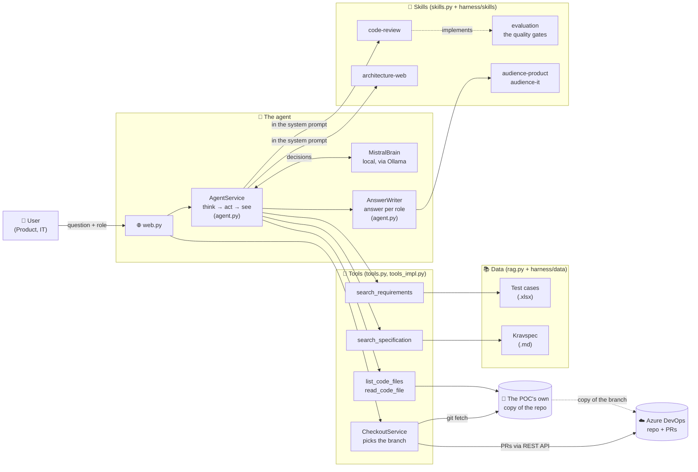
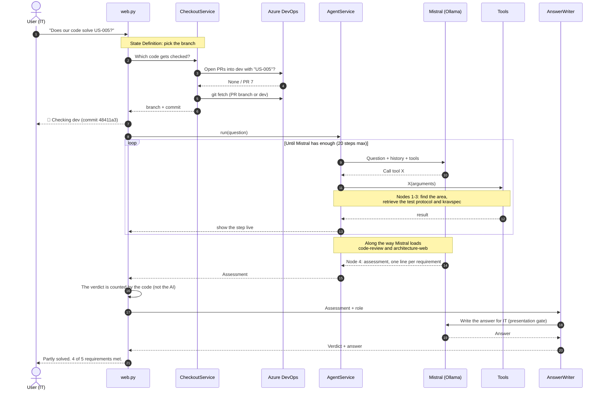
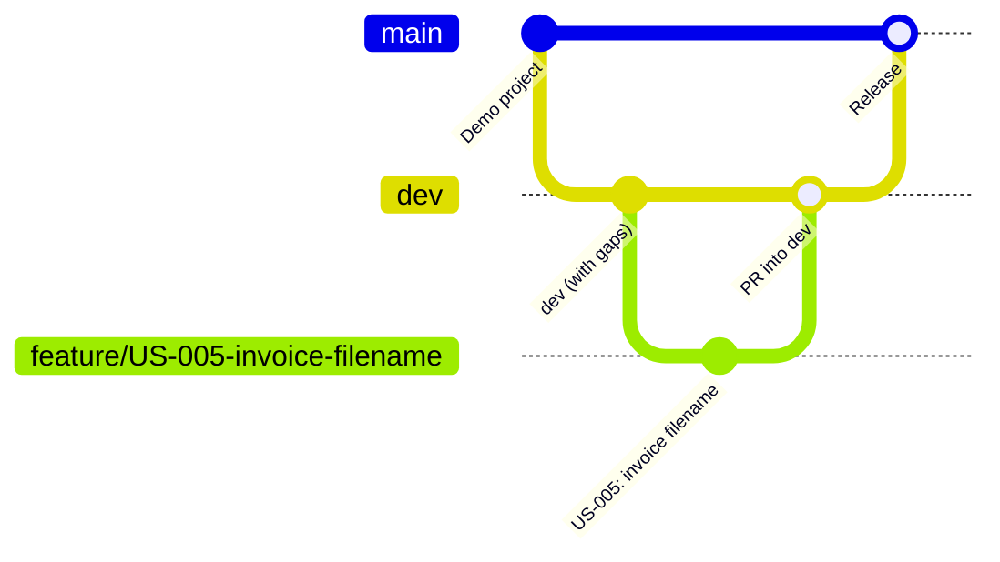
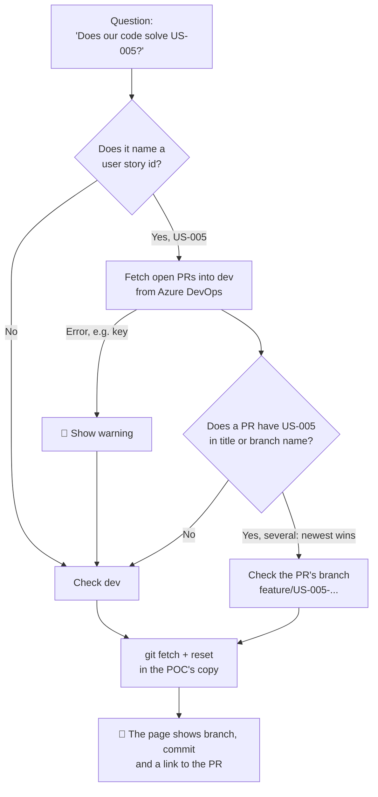
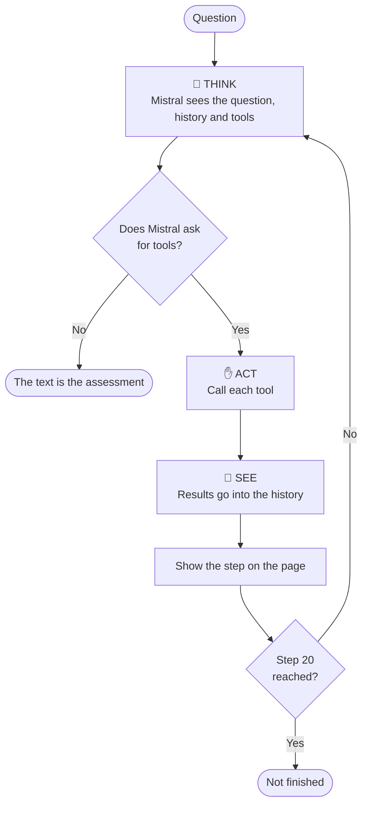
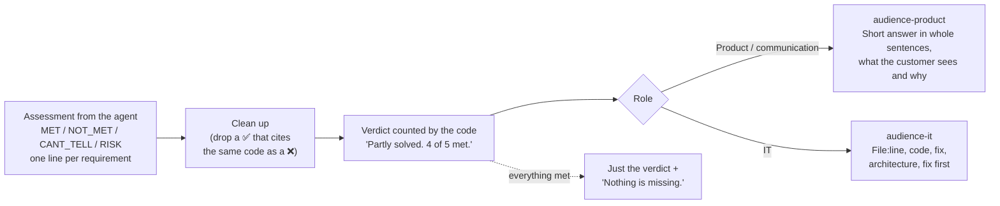
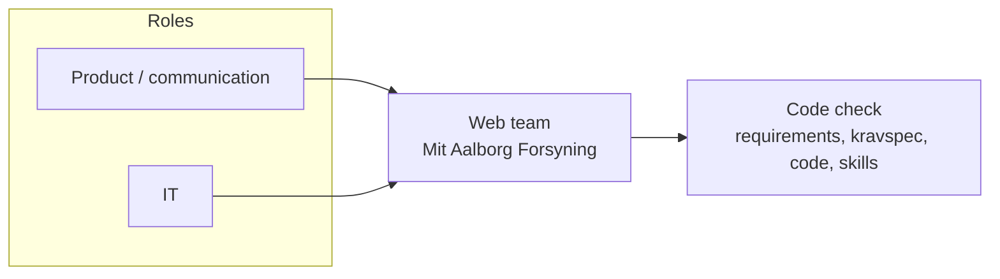
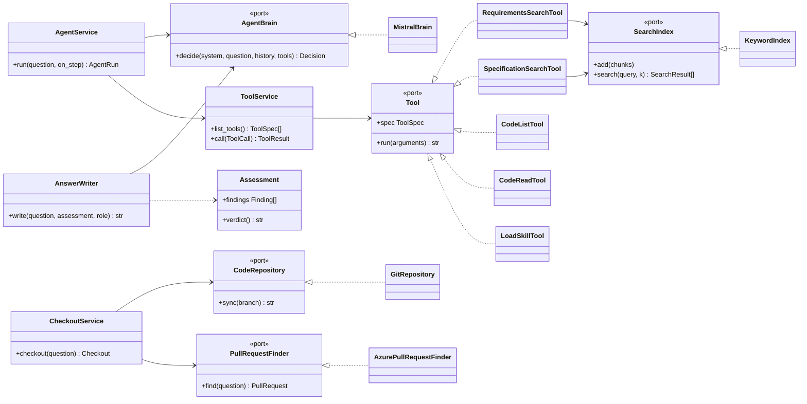
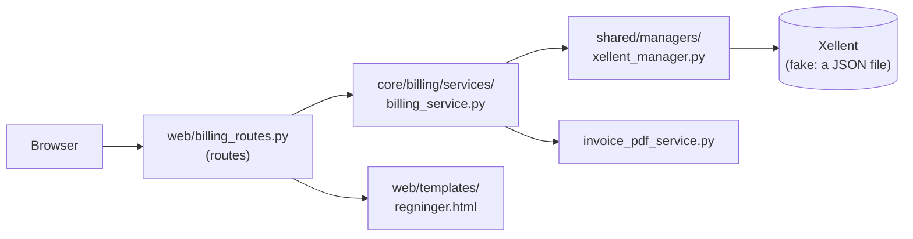

# AI Platform POC – evaluation guide

This replaces `DEMO.md` and `ORDLISTE.md`: one walkthrough plus one glossary, both structured around the same quality gates as the `evaluation` skill (`harness/skills/evaluation/SKILL.md`). Every other skill (`vocabulary`, `code-review`, `architecture-web`, `audience-product`, `audience-it`) is written to satisfy one of those gates; this guide shows where each gate fires during a real code check and gives you the words for it.

An AI agent answers **"Does our code solve this task?"**. It looks up the user story, the test cases and the business requirements, reads the developer's code directly from Azure DevOps (the right branch or PR), and gives a verdict — **Solved**, **Partly solved** or **Not solved** — with exactly what's missing. The answer is written for whoever asks: product/communication gets plain language, IT gets file and line.

---

## 1. Overview

The whole app is nine files at the repo root — no more layered folders. See the **Code layout** table in [README.md](../README.md) for what each one does; this guide is about the *behaviour*, not the file boundaries.

---

## 2. A code check, start to finish — mapped onto evaluation's gates

Question: *"Does our code solve US-005 Download faktura?"* as **IT**.

| evaluation gate | What happens here |
|---|---|
| **State Definition** | `vocabulary` resolves the user's wording to a branch; `CheckoutService` (§3) actually picks it: a PR matching the user story id, otherwise `dev`. |
| **Node 1** (Initial Prompt Analysis) | `code-review` step 1: find the area (Regninger/Profil/Overblik) from the question. |
| **Node 2** (Contribution Scan, fallback) | `list_recent_changes` resolves the area from the newest commits when the question doesn't name one. |
| **Node 3** (Retrieve Testing Protocols) | `search_requirements` and `search_specification` retrieve and parse the test protocol and kravspec. |
| **Node 4** (Evaluate Conflicts) | `code-review` section 2 writes one `MET`/`NOT_MET`/`CANT_TELL`/`RISK` line per requirement; `architecture-web` supplies the architecture half of this gate. |
| *(presentation, not a gate)* | `audience-product`/`audience-it` rewrite Node 4's finished result for the reader. Never re-scores it. |

**What the audience sees on the page:** each step appears live ("🔎 Looking up test cases", "📄 Reading BillingService.cs") in a box that folds away once the answer lands as a chat bubble with the verdict as a coloured badge and two folded boxes (*Sources* and *Assessment per requirement*).

One honest gap: `evaluation`'s own text describes State Definition as "pull `dev` for staging, `main` for production." This system never reads `main` directly — `CheckoutService` only ever resolves to an open PR branch or `dev` (IT's actual rule is feature-branch → PR into `dev` → `dev` into `main`, and the last step happens outside this tool). Treat `evaluation`'s dev/main wording as the general intent, and this section as what's actually implemented.

---

## 3. Which code gets checked (branch selection / State Definition)

IT's git rule: **feature branch → PR into `dev` → `dev` into `main`**.

The POC picks the branch before every code check. The code decides, not the AI, so the same question always gets the same branch:

| Situation | What the page writes |
|---|---|
| Open PR for US-005 | 🔀 Checking pull request 7 "US-005: ..." (feature/US-005-... → dev), commit abc1234 |
| No PR | 🔀 No open pull request matches the question, so checking dev (commit 48411a3) |
| Azure doesn't respond | 🔴 Could not look for pull requests, so dev is used: ... |

Only one code check runs at a time, because there's only one copy of the repo. Otherwise two questions could swap each other's branch mid-check.

---

## 4. The agent loop

Mistral decides what to look up and in what order, limited to the tools its role has. It can only read the code, never change it.

---

## 5. Node 4's result → the presentation gate

The agent doesn't write an answer, it writes an **assessment**: one line per requirement. The code counts the verdict, and the answer is written for the role afterwards — this is the hand-off from `evaluation`'s Node 4 to the two `audience-*` presentation skills.

**Why this shape?**
- **The same assessment for everyone.** The agent isn't told the role, so a product person and a developer get the same verdict. Only the wording differs.
- **The number always adds up.** "4 of 5" is counted by the code from the lines, not by the AI.
- **Same code, same answer.** The assessment is cached. Asking again about unchanged code (or switching role) reuses it (♻️). Changing a file, or checking a different branch, triggers a new check.

Statuses in the assessment:

| Status | Means | Counts toward the verdict |
|---|---|---|
| ✅ MET | The code does what the requirement says | Met |
| ❌ NOT_MET | The code does it differently or not at all | Not met |
| ❓ CANT_TELL | Can't be seen in the code (e.g. speed) | Not met |
| ⚠️ RISK | The code works, but deviates from the team's conventions | Doesn't count, shown as a risk |

---

## 6. Roles and teams

The role in the dropdown decides which tools the agent gets. The AI doesn't choose.

| Role | Sees | Gets |
|---|---|---|
| Product / communication | Web | Code check, short answer in plain language |
| IT | Web | Code check with file:line, fix, architecture deviations |

---

## 7. Skills and the gates they satisfy

| Skill | Satisfies |
|---|---|
| `evaluation` | Defines the gates themselves: State Definition, Nodes 1-4. |
| `vocabulary` | Feeds State Definition — resolves the user's wording to a branch. |
| `code-review` | Implements Nodes 1-4 for a code check (see the table in §2). |
| `architecture-web` | The architecture half of Node 4 — a deviation here is a `RISK` line. |
| `audience-product`, `audience-it` | Presentation only, strictly after Node 4: rewrite the finished assessment for the reader, never re-score it. |

A skill is a folder with a `SKILL.md`. `code-review` and the team's `architecture-<team>` are always put in the system prompt; any other skill is shown only as name + description and fetched with `load_skill` when it's needed. A new team would get its own `architecture-<team>` without touching code.

---

## 8. Ports and adapters (UML)

Each piece talks to the rest through a protocol (an interface). That's what makes it possible to swap Mistral, Azure DevOps or the search without touching anything else.

---

## 9. The demo project (what gets checked)

*Mit Aalborg Forsyning – Regninger* in the Azure repo. It's built the way the web team codes, with gaps left in on purpose.

---

## 10. Demo script

**Before the demo**
- [ ] `git pull` on the POC
- [ ] Ollama is running locally (`ollama serve`) with `mistral:7b-instruct-v0.3-q4_K_M` pulled
- [ ] `AZURE_DEVOPS_PAT` is in `local_secrets.py`
- [ ] `dev` exists in the Azure repo (with the gaps)
- [ ] Optional: feature branch `feature/US-005-invoice-filename` with an open PR into `dev`, title containing "US-005"
- [ ] Start: `python web.py` and open http://localhost:8000
- [ ] Run each question once before the demo, so the answers are cached (♻️) and come back instantly

**Flow**

| # | Role | Question | Expected | Point |
|---|---|---|---|---|
| 1 | Product / communication | Does our code solve US-006 Skift kontrakt/adresse? | ✅ Solved | A green answer in plain language |
| 2 | Product / communication | Does our code solve US-005 Download faktura? | Partly solved, filename missing | Finds a concrete bug |
| 3 | IT | *same question* | Same verdict, now with `web/billing_routes.py:35` and a fix | Same assessment, written for a developer (♻️ reused) |
| 4 | IT | Does our code solve US-004 Vis betalingsstatus? | Partly solved, "Forfalden" missing | Catches a requirement that only lives in kravspec and the test case |
| 5 | IT | Does our code solve US-003 Regninger er ikke længere tilgængelige? | Not solved | A red verdict |
| 6 | IT | Does our code solve US-007 Sikker og robust oplevelse? | Solved, with architecture risks | Also checks *how* the code is built |
| 7 | IT | Does our code solve US-005 Download faktura? *(after the PR is made)* | 🔀 Checking pull request ..., Solved | Sees the developer's work before it's merged |

**Along the way, show:**
- The live steps: the agent looks things up and reads code itself.
- The *Sources* box: exactly which documents, branch, commit and files the answer is built on.
- The *Assessment* box: one line per requirement, so the verdict can be checked.

---

## 11. Limitations (it's a POC)

- **Local model.** Mistral 7B through Ollama is free and private, but slower and less reliable than a hosted frontier model, so the verdict is always counted by the code, and contradictory lines are cleaned up rather than trusted outright.
- **Keyword search.** It finds words, not meaning. Ask with id and title.
- **PR match on id.** A PR is only found if the user story id is in its title or branch name.
- **One code check at a time**, because there's one copy of the repo.
- **Assessments live only in memory** and are forgotten on restart.
- **Test cases and kravspec are examples** written for the demo project.

**Possible next steps:** search on meaning (embeddings), and an architecture skill per team as more teams are added (e.g. FDAP).

---

## 12. Glossary

Words you see on the page and hear during the demo, explained briefly. The page, the answers and the assessment are in Danish; the words below are given as they appear on screen.

### Verdict and answer

| Word | Means |
|---|---|
| **Verdict** (*dommen*) | First line of the answer, e.g. **"Delvist løst. 4 af 5 krav er opfyldt."** Counted by the code from the assessment's lines, not by the AI, so the number always matches. (`Assessment.verdict` in `agent.py`) |
| **Løst** (Solved) | Every requirement is met (MET). |
| **Delvist løst** (Partly solved) | Some requirements are met, not all. |
| **Ikke løst** (Not solved) | No requirement is met. |
| **"X af Y krav er opfyldt"** | X = count of MET. Y = MET + NOT_MET + CANT_TELL. RISK doesn't count. |
| **Intet mangler.** (Nothing is missing.) | Shown under the verdict when everything is MET and there are no risks. Nothing more is written. |
| **"Forretningen har ikke skrevet krav ned for dette."** | Added to the verdict when kravspec has no requirement for the user story (the agent wrote `NO_SPEC`). The agent must not invent one. |
| **Ikke færdig** (Not finished) | Shown when the agent didn't reach an assessment: either it hit the **step limit** ("I did not finish within the step limit."), or it didn't write an assessment the code could read. The page then shows what it did write. Not a verdict. |
| **AI spørger** (The agent asks) | The agent doesn't know which user story is meant, and asks instead of guessing (it wrote `QUESTION:`). You answer in the field below, and the answer is sent with the conversation. Not a verdict. |
| **Samtalen** (The conversation) | Earlier questions and answers sit as bubbles above the new question. The page sends the last 3 with the next question, so the agent can understand e.g. "the one about billing". |
| **AI · svar til …** (AI · answer for …) | Sits above the answer itself, e.g. *AI · answer for IT*. Says which role the answer was written for. **Ny samtale** (New chat) at the top starts over. |
| **Fejl** (Error) | Something went wrong (e.g. Ollama didn't respond). Shown on the page so the demo doesn't just hang. |

### The assessment

| Word | Means |
|---|---|
| **Vurdering** (Assessment) | The agent's result: one line per requirement with status, the requirement, the code and where in the code (file:line). The same for every role; only the answer is written differently. Shown in the folded **Assessment per requirement** box under the answer. |
| **Fund** (Finding) | One line in the assessment. |
| ✅ **MET** | The code does what the requirement says. Counts as met. |
| ❌ **NOT_MET** | The code does it differently or not at all. Counts as not met. |
| ❓ **CANT_TELL** | Can't be seen in the code (e.g. speed, or something needing a real server). Counts as not met, because it isn't proven. |
| ⚠️ **RISK** | The code works, but deviates from the team's conventions (the architecture skill). Doesn't count in the verdict, shown as a risk. |
| **Rettelse** (Fix) | Suggested change. Lives in the assessment so the answer to IT can't invent a different one. Product never sees it. |
| **Modstridende linjer** (Contradictory lines) | If the small model writes the same requirement as both MET and NOT_MET citing the same code, the MET line is dropped and NOT_MET wins (`drop_contradictions`). |

### Requirements and sources

| Word | Means |
|---|---|
| **User story** (US-xxx) | The task, e.g. *US-005 Download faktura*. Its id is used to find requirements, test cases and a PR. |
| **Acceptkriterie** (Acceptance criterion, AC) | A condition in the user story that must be met before it's done. |
| **Testcase** (Test case) | What the test team checks. Lives in the test protocols (`harness/data/test-protocols/*.xlsx`), one file per area (Regninger, Profil, Overblik). Each area numbers its user stories from US-001, so the id is named together with the area, e.g. Regninger US-001, and found with `search_requirements`. |
| **Kravspec** | The business's requirements: what the business ordered. Each requirement has an id like `KRAV-REG-03` and a *Dækker:* line naming the user stories it covers. Lives in `harness/data/kravspec/` and found with `search_specification`. |
| **Krav** (Requirement) | Umbrella term for what the code is checked against: acceptance criteria, test cases and kravspec. |
| **Not documented** | Answer from `search_specification` when there's no requirement. The agent must say so instead of guessing. |
| **Kilder** (Sources) | Folded box under the answer: exactly which documents, branch, commit and files the answer is built on. |

### Branch selection (State Definition)

| Word | Means |
|---|---|
| **Branch-valg** (Branch selection) | Before every code check, the code (not the AI) picks which branch is read. (`CheckoutService`) This is `evaluation`'s State Definition gate — see §3. |
| **dev** | The default branch. Checked when no open PR matches the question. (`CODE_BRANCH` in `settings.py`) |
| **PR** (Pull request) | A developer's change waiting to go into `dev`. If the user story id (e.g. US-005) is in the PR's title or branch name, its branch is checked instead of `dev`. Several matches: the newest wins. |
| **Feature branch** | A developer's own branch, e.g. `feature/US-005-invoice-filename`. IT's rule: feature branch → PR into `dev` → `dev` into `main`. |
| **Commit** | The exact version of the code that was checked (e.g. `48411a3`). Shown on the page and in *Sources*. |
| 🔀 **Checking pull request …** | The page reports that a PR was found and is being checked. |
| 🔀 **No open pull request matches the question, so checking dev** | No PR matched, so `dev` is checked. |
| 🔴 **Could not look for pull requests / Could not fetch the code** | Azure DevOps didn't respond (e.g. a bad token). `dev` or the last copy of the code is used instead. |
| **POC's copy of the repo** | The POC clones the Azure repo and fetches the latest before every check, so a push can be asked about right away. Only one code check runs at a time, because there's only one copy. |

### The agent

| Word | Means |
|---|---|
| **Agent** | An AI model (Mistral, local via Ollama) in a loop: **think → act → see**, until it has enough for an answer. (`AgentService`) |
| **Skridt** (Step) | One round of the loop: a tool is called, and the result goes into the history. Shown live under *How I find the answer*, e.g. "📄 Reading BillingService.cs", folded away once the answer is ready. |
| **Step-grænse** (Step limit) | At most 20 steps (`MAX_STEPS`). Protects against an agent running in circles. Hit it, and the page shows **Not finished**. |
| **Hjernen** (The brain) | The AI model that makes the decisions. Here, local Mistral via Ollama (`MistralBrain`). Can be swapped for a new file. |
| **AnswerWriter** | Rewrites the assessment into an answer for the role ("✍️ Writing the answer"). Gets no tools, so it can't change the assessment — the presentation gate in §2 and §5. |
| ♻️ **Genbrugt tjek** (Reused check) | "The code and requirements have not changed, so the earlier check is used." Asking the same question about unchanged code reuses the saved assessment, so the answer is the same and comes back instantly. Changing a file, or checking a different branch, triggers a new check. Lives only in memory. |
| **Fingeraftryk** (Fingerprint) | What decides whether the code is unchanged: the content of the files and requirements the agent last read. |

### Roles, teams and quality gates

| Word | Means |
|---|---|
| **Rolle** (Role) | Who's asking, chosen in the dropdown: **Product / communication** or **IT**. Decides which tools the agent gets and how the answer is written. The AI doesn't choose. |
| **Hold** (Team) | An IT team; currently just **web** (builds Mit Aalborg Forsyning). (`TEAMS`) |
| **Kodetjek** (Code check) | What every role gets: check the code against requirements, kravspec and the team's coding conventions. |
| **Quality gate** | A checkpoint `evaluation` defines (State Definition, Node 1-4) that another skill or piece of code must satisfy before the result can be trusted. See §2 and §7 for which skill satisfies which gate. |
| **Node** | One step in `evaluation`'s flow — Node 1 (find the module), Node 2 (fallback: scan recent contributions), Node 3 (retrieve the test protocol), Node 4 (evaluate conflicts). Not a class in the code; a concept the skills reference. |
| **Presentation gate** | `audience-product`/`audience-it` rewriting Node 4's finished assessment for the reader. Runs after every quality gate, and is not itself one — it must never add, remove or re-score a finding. |
| **Skill** | A set of instructions in a `SKILL.md`. The agent sees only its name and description, and fetches the text when it needs it. |
| `code-review` | Skill: how the code is assessed (look up requirements, read the code, one line per requirement, never guess). Implements evaluation's Nodes 1-4. |
| `architecture-web` | Skill: how the web team codes (routes → services → managers, interfaces, dependency injection). Feeds `RISK` lines into Node 4. |
| `vocabulary` | Skill: maps the user's wording ("på test", "i produktion") to a branch. Feeds the State Definition gate. |
| `audience-product` / `audience-it` | Skills: how the answer is written for the role. Product: short answer in whole sentences like a colleague, no ids or code. IT: file:line, code, fix and what to fix first. |
| **Port / adapter** | A port is a fixed interface (e.g. `AgentBrain`); an adapter is what satisfies it (e.g. `MistralBrain`). Makes it possible to swap the model, Azure or the search without touching the rest. |
| **POC** | *Proof of concept*: a small, working sample, not a finished product. |
