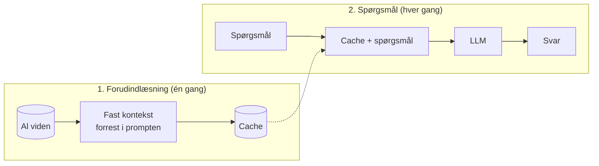

# CAG – Cache-Augmented Generation

**Kort sagt:** I stedet for at søge ved hvert spørgsmål lægger vi hele den relevante viden ind i modellens kontekst én gang. Modellen gemmer sin bearbejdning af teksten i en cache, og alle følgende spørgsmål genbruger den.

## Hvad er CAG?

[RAG](RAG) henter små stykker viden frem, hver gang der stilles et spørgsmål. Det kræver en søgning, og søgningen kan ramme forkert. CAG springer søgningen over. Moderne sprogmodeller kan læse meget lange kontekster (hundredtusindvis af tokens), så hvis vores viden er lille nok, kan vi bare give modellen *det hele*.

Det dyre ved en lang kontekst er, at modellen skal læse og bearbejde den hver gang. Derfor caches den:

| Trin | Hvad der sker |
|---|---|
| **Forudindlæsning** | Al viden (dokumenter, krav, testcases) lægges fast forrest i prompten |
| **Cache** | Modellens bearbejdning af den faste del (KV-cachen) gemmes, så den ikke skal regnes igen |
| **Spørgsmål** | Hvert nyt spørgsmål sættes bag på den cachede del og besvares med al viden til rådighed |

Hos de store udbydere hedder funktionen typisk *prompt caching* eller *context caching*. Ved lokale modeller kan man selv gemme KV-cachen.

## Hvad gør CAG? To faser

1. **Forudindlæsning** sker én gang, eller når vidensgrundlaget ændres. Hele grundlaget lægges i konteksten, og cachen bygges.
2. **Spørgsmål** genbruger cachen. Der er ingen søgning og intet indeks, og modellen ser altid alt.

## CAG sammenlignet med RAG

| | RAG | CAG |
|---|---|---|
| **Søgning** | Ja, ved hvert spørgsmål | Nej |
| **Hvad modellen ser** | De top-k stykker, søgningen fandt | Hele vidensgrundlaget |
| **Typisk fejl** | Søgningen finder ikke det rigtige stykke | Vigtige detaljer drukner i en meget lang kontekst |
| **Vidensmængde** | Ubegrænset | Begrænset af kontekstvinduet |
| **Ændringer i data** | Indekset opdateres løbende | Cachen skal bygges igen |
| **Arkitektur** | Indlæser, chunker, indeks og søgning | Kun en prompt og en cache |

## CAG og AI Platform POC'en

AI Platform POC'en bruger i dag RAG med ordsøgning over xlsx-filerne i `AIPlatform/RAG/data/`. De tre regneark med user stories og testcases er så små, at de sagtens kunne ligge i konteksten på én gang. Med CAG ville agenten:

- altid se alle acceptkriterier og testcases og ikke risikere, at ordsøgningen overser et krav med andre ord,
- slippe for søgeværktøjet, så agenten bruger færre skridt.

Det er ikke bygget, men det er en oplagt sammenligning for demoen.

## Hvornår passer CAG?

**Godt valg når:**
- Vidensgrundlaget er lille nok til at være i kontekstvinduet med god margin.
- Data ændrer sig sjældent, så cachen kan genbruges længe.
- Mange spørgsmål stilles mod det samme grundlag.
- Man vil undgå fejl fra søgningen og holde arkitekturen enkel.

**Svagheder:**
- Skalerer ikke. Bliver vidensgrundlaget større end konteksten, må man tilbage til [RAG](RAG).
- Meget lange kontekster koster mere pr. kald og kan gøre modellen mindre præcis på detaljer.
- Ved hyppige ændringer skal cachen bygges igen hver gang.
- Svaret henviser ikke automatisk til en kilde, fordi intet bestemt stykke blev valgt. Det må man bede modellen om.
- Kobler ikke fakta på tværs af struktur. Det gør [KAG](KAG).
