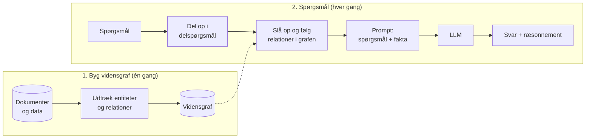
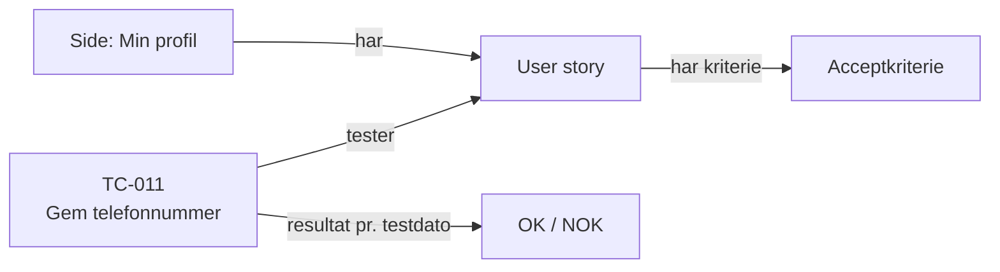

# KAG – Knowledge-Augmented Generation

**Kort sagt:** Vi bygger en vidensgraf af fakta og deres relationer. Når der stilles et spørgsmål, slår modellen op i grafen og følger relationerne, så den kan ræsonnere over sammenhænge frem for løse tekststykker.

## Hvad er KAG?

[RAG](RAG) finder tekststykker, der ligner spørgsmålet. Det virker godt til "hvad står der om X?", men dårligt til spørgsmål, der kræver at koble flere fakta: "Hvilke testcases dækker de acceptkriterier, der handler om regninger, og hvilke af dem fik NOK sidst?" Svaret ligger ikke i ét stykke tekst, men i *relationerne* mellem mange.

KAG løser det ved at gøre viden til en struktur:

| Begreb | Betyder | Eksempel fra AI Platform POC-data |
|---|---|---|
| **Entitet** (node) | En ting | En user story, testcasen `TC-011`, siden *Min profil* |
| **Relation** (kant) | Hvordan to ting hænger sammen | `TC-011` *tester* en user story |
| **Egenskab** | Fakta om en ting | `TC-011` ("Gem telefonnummer med gyldig værdi") har resultatet *OK* på hver testdato |

Termen KAG bruges især om rammeværket fra Ant Group (OpenSPG/KAG), men idéen er bredere og overlapper med det, der også kaldes *GraphRAG*: grafen er en del af det, modellen slår op i.

## Hvad gør KAG? To faser

1. **Byg vidensgrafen** sker én gang, eller når data ændres. Entiteter og relationer trækkes ud af kilderne, enten med regler (strukturerede data) eller med en LLM (fritekst), og gemmes i en grafdatabase.
2. **Spørgsmål** bliver ofte delt op i delspørgsmål. Hvert delspørgsmål slås op i grafen ved at følge relationerne, og de fundne fakta lægges i prompten. Modellen svarer og kan vise, hvilke trin den fulgte.

## KAG sammenlignet med RAG og CAG

| | RAG | CAG | KAG |
|---|---|---|---|
| **Viden lagres som** | Tekststykker i et indeks | Hele teksten i konteksten | Entiteter og relationer i en graf |
| **Opslag** | Søg efter lignende tekst | Intet, alt er med | Følg relationer |
| **Stærk til** | "Hvad står der om X?" | Små, stabile vidensgrundlag | Spørgsmål med flere led og sammenhænge |
| **Forarbejde** | Lille: chunk og indeksér | Mindst: læg det i prompten | Størst: modellér og byg grafen |
| **Forklarlighed** | Kilde-stykker | Lav | Høj: stien gennem grafen |

## KAG og AI Platform POC'en

Testcase-dataene i AI Platform POC'en er allerede struktureret: user stories har ID'er og acceptkriterier, og testcases peger på user stories og har resultater pr. testdato. Det er tæt på en graf i forvejen. Et forenklet eksempel:

Med KAG kunne agenten svare på spørgsmål som "hvilke acceptkriterier på siden Min profil har ingen testcase med resultatet OK?" ved at følge relationerne i stedet for at håbe, at ordsøgningen finder de rigtige stykker. Det er ikke bygget, men det viser, hvornår KAG giver mere end RAG.

## Hvornår passer KAG?

**Godt valg når:**
- Spørgsmålene kræver at koble fakta på tværs af mange dokumenter (flere led).
- Data har tydelige ting og relationer, eller kan få det.
- Svarene skal være præcise og kunne forklares trin for trin, for eksempel i jura, sundhed eller compliance.

**Svagheder:**
- Det største forarbejde af de tre: man skal modellere domænet og bygge og vedligeholde grafen.
- Udtræk med en LLM kan give forkerte eller manglende relationer, og fejl i grafen giver forkerte svar.
- Overkill til simple opslag, hvor [RAG](RAG) eller [CAG](CAG) er enklere.
