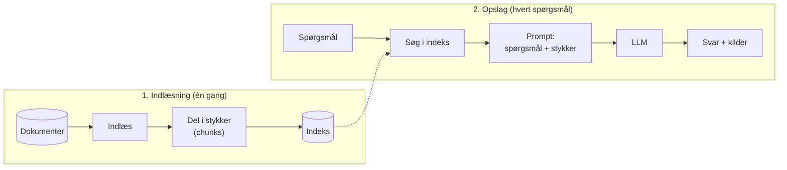

# RAG – Retrieval-Augmented Generation

**Kort sagt:** Før modellen svarer, søger vi i vores egne dokumenter og giver den de mest relevante stykker med i prompten. Modellen svarer ud fra det, den lige har fået at læse.

## Hvad er RAG?

En sprogmodel kender kun det, den lærte under træningen. Den kender ikke vores interne dokumenter, vores krav eller vores testcases. RAG løser det uden at træne modellen om: vi slår op i vores egen viden *i det øjeblik*, spørgsmålet stilles, og lægger det fundne ind i prompten.

Navnet beskriver de tre trin:

| Trin | Betyder | Hvad der sker |
|---|---|---|
| **Retrieval** | Hentning | Find de tekststykker, der passer bedst til spørgsmålet |
| **Augmented** | Beriget | Læg stykkerne ind i prompten sammen med spørgsmålet |
| **Generation** | Svar | Modellen skriver svaret ud fra stykkerne og kan henvise til kilden |

## Hvad gør RAG? To faser

1. **Indlæsning** sker én gang, eller når dokumenterne ændres. Dokumenterne læses, deles i mindre stykker og lægges i et søgeindeks.
2. **Opslag** sker for hvert spørgsmål. Indekset søges, de bedste stykker (top-k) lægges i prompten, og modellen svarer.

### Søgning: ord eller betydning

| Metode | Sådan virker den | Styrke | Svaghed |
|---|---|---|---|
| **Ordsøgning** (keyword, BM25) | Finder stykker med de samme ord som spørgsmålet | Simpel, hurtig, forklarlig | Ser ikke, at "ferie" og "feriedage" eller "regning" og "faktura" hænger sammen |
| **Vektorsøgning** (embeddings) | Gør tekst til tal, der fanger betydning, og finder de nærmeste | Finder synonymer og omskrivninger | Kræver en embedding-model og en vektordatabase |
| **Hybrid** | Kombinerer begge | Ofte bedst i praksis | Mere at bygge og tune |

## RAG i dette repo

| Sted | Data | Søgning |
|---|---|---|
| `RAG/` (lag 2 i undervisningseksemplet) | Markdown-dokumenter om et fiktivt bibliotek (`ferie.md`, `it.md` …) | Ordsøgning |
| `AIPlatform/RAG/` (AI Platform POC'en) | User stories og testcases fra xlsx-filerne i `AIPlatform/RAG/data/` | Ordsøgning |

I AI Platform POC'en bliver hvert ark i et regneark til ét dokument, og hver user story (`US-…`) og testcase (`TC-…`) bliver sit eget stykke. Når udvikleren spørger, om koden løser en opgave, henter agenten de relevante krav via RAG og vurderer koden op imod dem.

## Hvornår passer RAG?

**Godt valg når:**
- Vidensmængden er for stor til at ligge i prompten på én gang.
- Data ændrer sig ofte, og svarene skal bruge den nyeste udgave.
- Svarene skal kunne henvise til en konkret kilde.

**Svagheder:**
- Svaret er kun så godt som søgningen. Finder den ikke det rigtige stykke, kan modellen ikke svare rigtigt.
- Stykkerne mister sammenhæng med resten af dokumentet, når de deles op.
- Spørgsmål, der kræver at koble fakta på tværs af mange dokumenter, er svære. Det er her [KAG](KAG) kommer ind.
- Hvis al viden kan være i prompten på én gang, er [CAG](CAG) ofte enklere.
